# Zero Trust Layer 7 App-ID Enforcement vs. Legacy L4 Port Evasion

An end-to-end engineering validation of Palo Alto Networks Single-Pass Parallel Processing (SP3) architecture running PAN-OS 11.2.5. This repository documents the operational mechanics of Layer 7 application identification, mid-session policy re-evaluation, the architectural failure modes of traditional Layer 4 port-based rules, and zero-downtime application containment via custom Application Groups.

Every state transition, TCP flow sequence, and security rule decision was verified using live session tracking (`show session id`), CLI deterministic policy simulation (`test security-policy-match`), traffic telemetry logs, and deep packet flow inspections.

---

## Architecture & Verification Topology

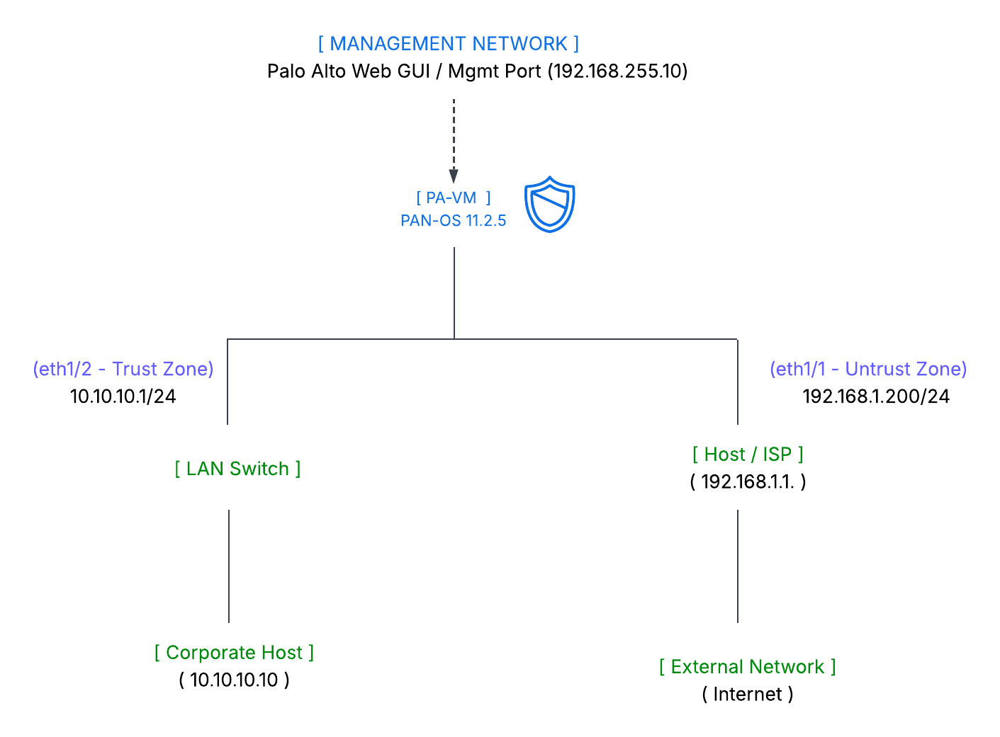

| Infrastructure Node | Physical Interface | IP Configuration | Security Zone | Architectural Role |
| :--- | :--- | :--- | :--- | :--- |
| **PA-VM** | `mgmt` | `192.168.255.10/24` | Out-of-Band | Central Management, XML API, Web UI |
| **PA-VM** | `ethernet1/1` | `192.168.1.200/24` | `Untrust` | WAN Uplink to External Gateway (`192.168.1.1`) |
| **PA-VM** | `ethernet1/2` | `10.10.10.1/24` | `Trust` | Corporate LAN Gateway |
| **Corporate Host** | `eth0` | `10.10.10.10/24` | `Trust` | Enterprise Workstation Generating Workloads |
| **ISP / Host Gateway** | Core Gateway | `192.168.1.1/24` | External | Default Next-Hop Gateway to Internet Core |

---

## The Engineering Problem: The L4 Port-Evasion Illusion

Legacy stateful firewalls evaluate network sessions against static 5-tuples (`Source IP`, `Destination IP`, `Source Port`, `Destination Port`, `Protocol`). Under this legacy model, an enterprise security rule permitting `TCP 443` or `TCP 80` trusts any payload traversing those ports. Attackers, unapproved shadow-IT SaaS platforms, and Command-and-Control (C2) agents routinely exploit this blind spot by tunneling non-web protocols over port 443.

Palo Alto Networks completely decouples **Service (Port)** from **Application (Signature & Behavioral Heuristics)**:
1. **Initial Flow Setup:** The TCP 3-way handshake is provisionally admitted under an matching rule to collect sufficient application data.
2. **Payload Parsing:** The Single-Pass engine inspects packet headers (specifically TLS Client Hello Server Name Indication [SNI]) and decodes application behavioral signatures.
3. **Mid-Stream Application Shift:** Once identified, the session is dynamically reclassified from generic `ssl` to a granular child App-ID (e.g., `google-base`, `youtube-base`).
4. **Mid-Flow Policy Re-Evaluation:** If the newly discovered Layer 7 App-ID is not explicitly permitted in that rule, the session is terminated immediately with a TCP RST or silent drop, regardless of the destination port.

---

## Baseline Configuration 

The firewall was configured via PAN-OS CLI with strict interface parameters, static routing, source NAT, and initial security policies.

```text
set cli config-output-format set
configure

# 1. Interface IP Addressing
set network interface ethernet ethernet1/1 layer3 ip 192.168.1.200/24
set network interface ethernet ethernet1/2 layer3 ip 10.10.10.1/24
```
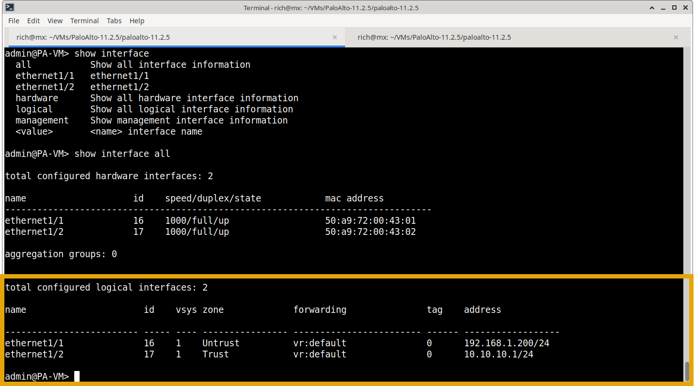

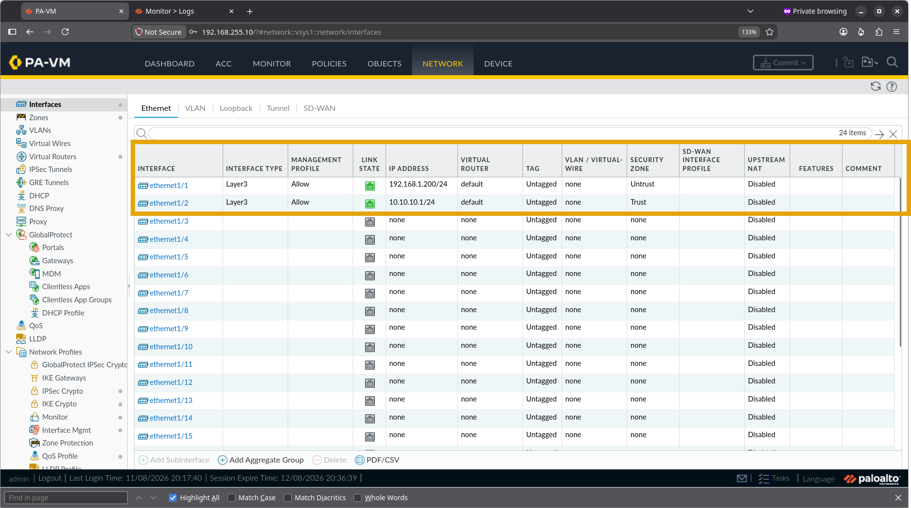

```text
# 2. Zone Bindings
set zone Untrust network layer3 ethernet1/1
set zone Trust network layer3 ethernet1/2
```

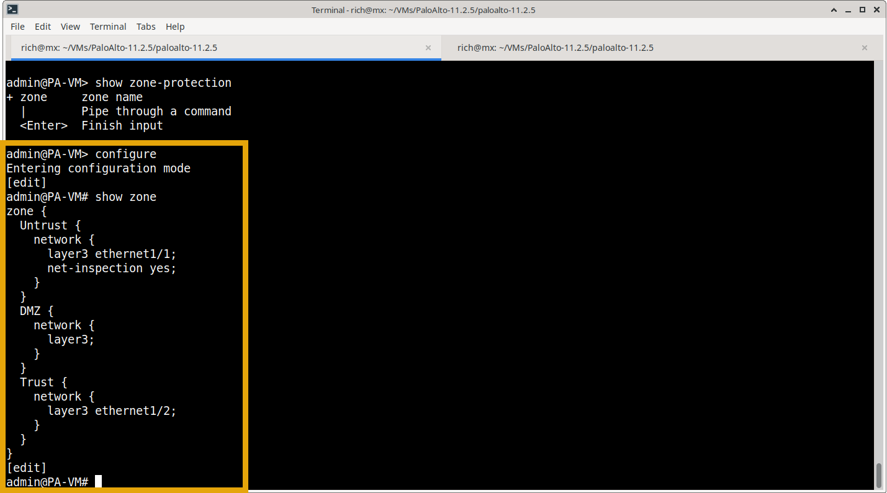

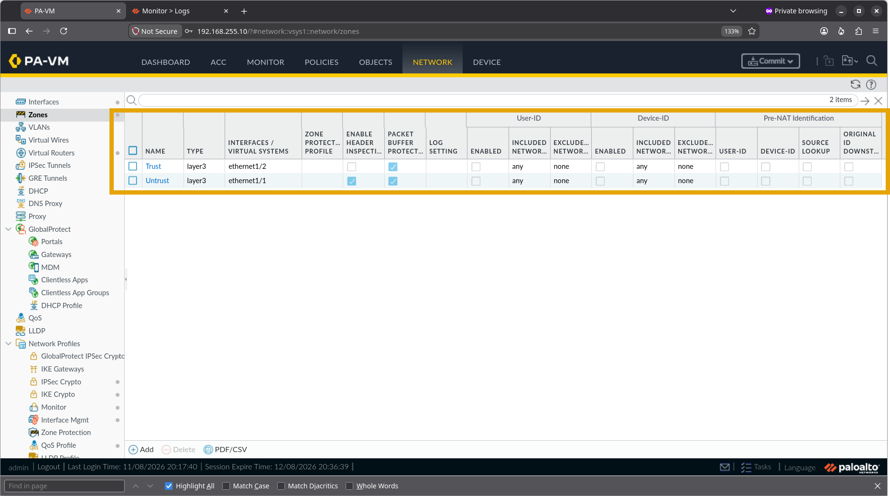

```text
# 3. Virtual Router & Static Route
set network virtual-router default interface [ ethernet1/1 ethernet1/2 ]
set network virtual-router default routing-table ip static-route DEFAULT-WAN destination 0.0.0.0/0 interface ethernet1/1 nexthop ip-address 192.168.1.1 metric 10
```
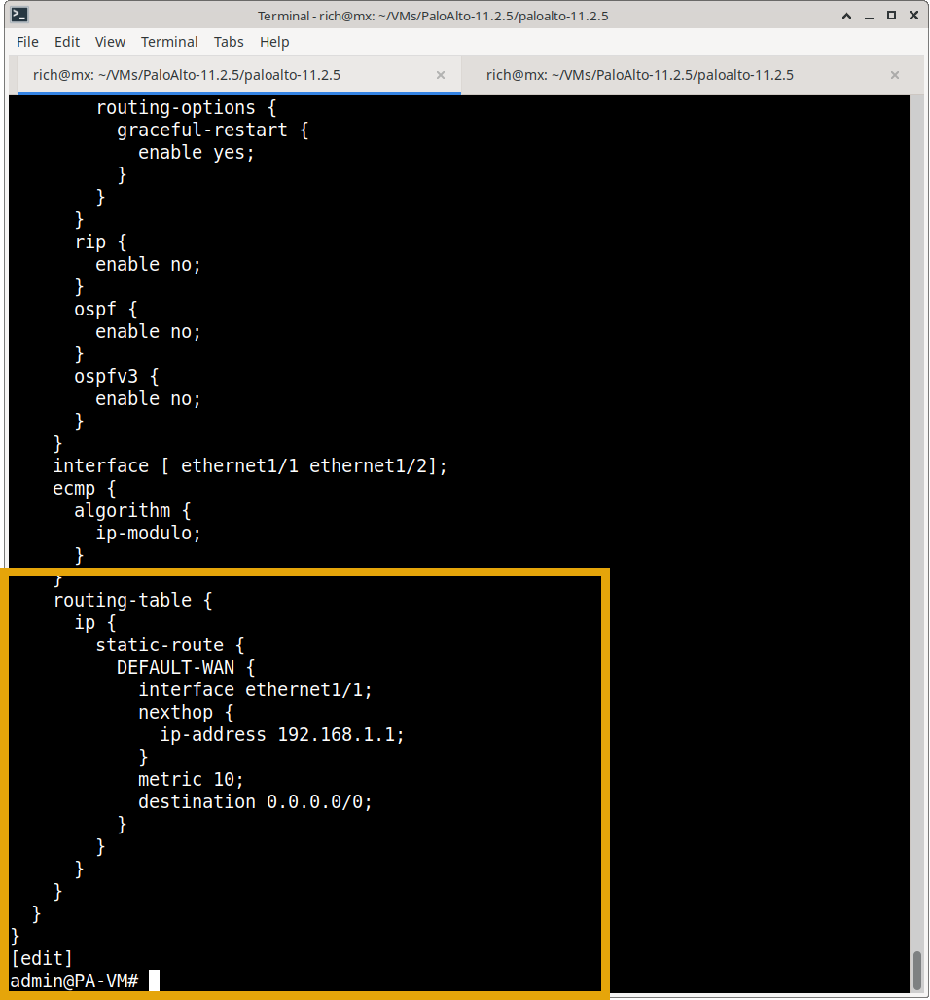

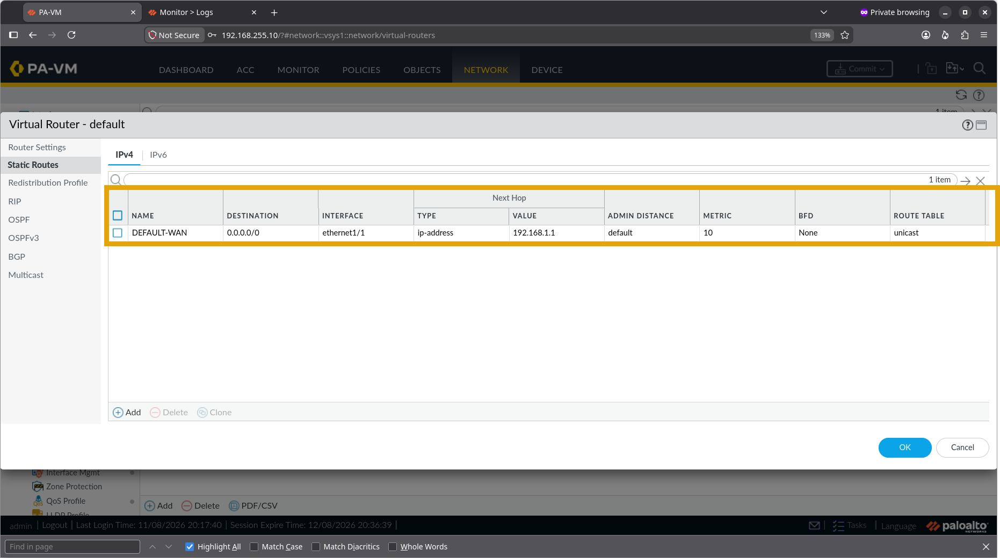

```text
# 4. Outbound Source NAT (PAT)
set rulebase nat rules LAN-to-Internet-NAT from Trust to Untrust source any destination any service any source-translation dynamic-ip-and-port interface-address interface ethernet1/1
```
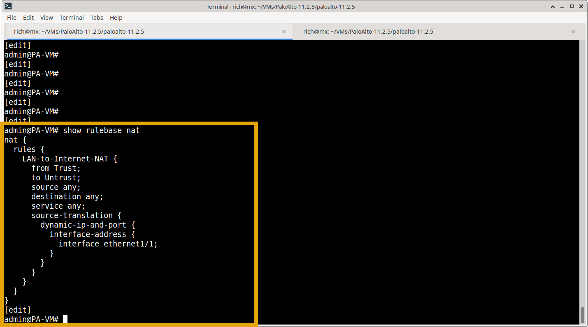

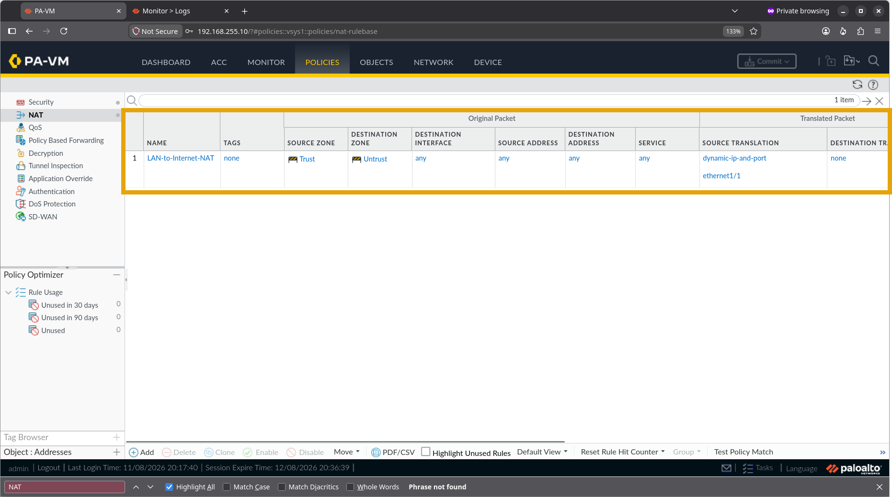

```text
# 5. Baseline Security Rulebase
set rulebase security rules Allow-ICMP-Test from Trust to Untrust source any destination any application ping service application-default action allow
set rulebase security rules Allow-DNS-NTP from Trust to Untrust source any destination any application [ dns ntp ] service application-default action allow
set rulebase security rules Allow-Web-Browsing from Trust to Untrust source any destination any application [ ssl web-browsing ] service application-default action allow
set rulebase security rules DENY_TRAFFIC from Trust to Untrust source any destination any application any service any action drop

commit
```
*This was the initial configuration, Allow-Web-Browsing was later updated with an Appication Group*

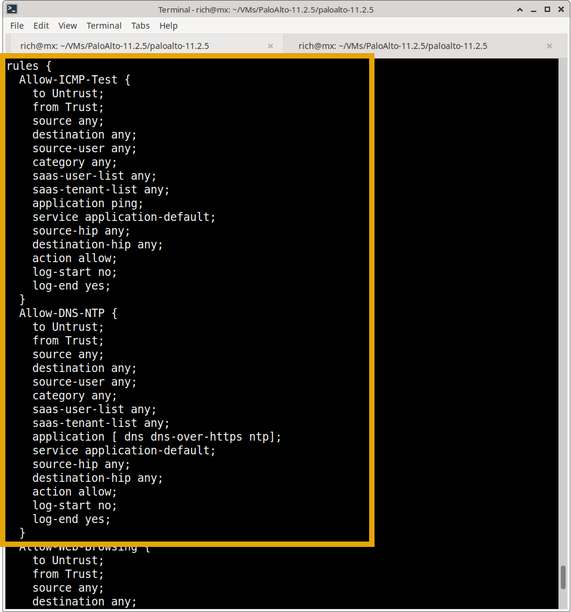

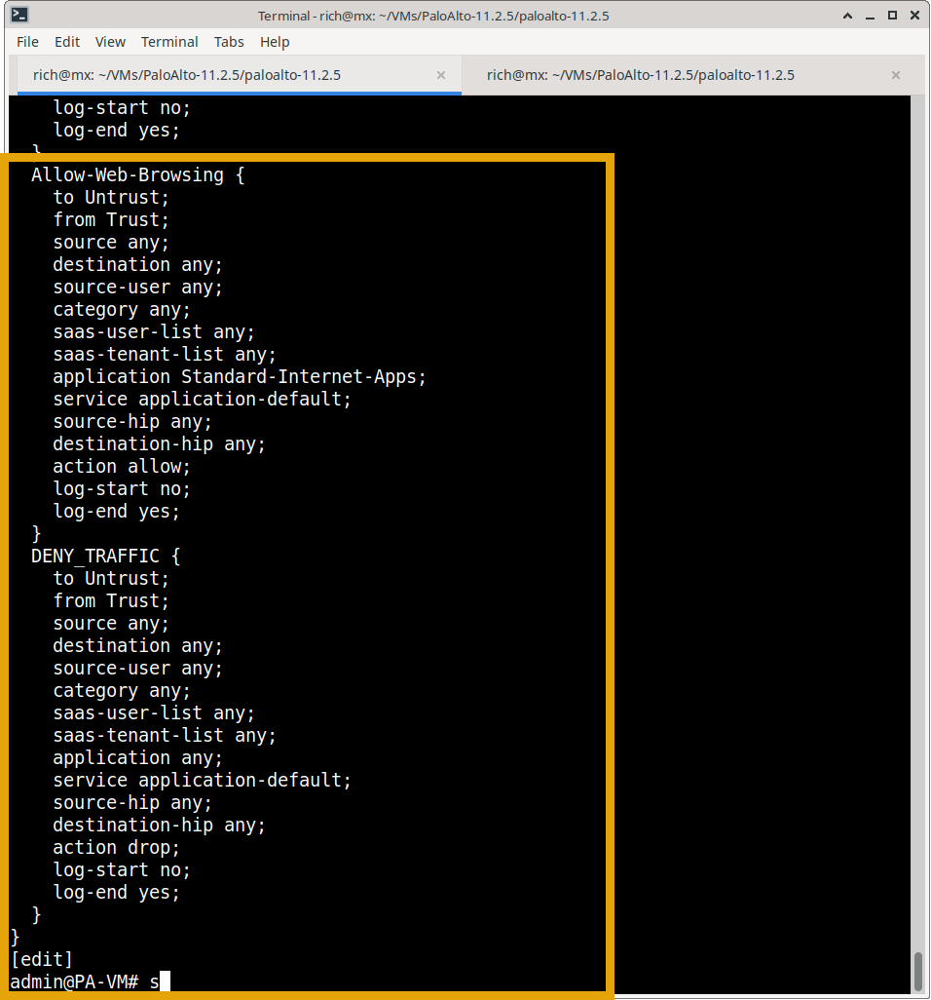

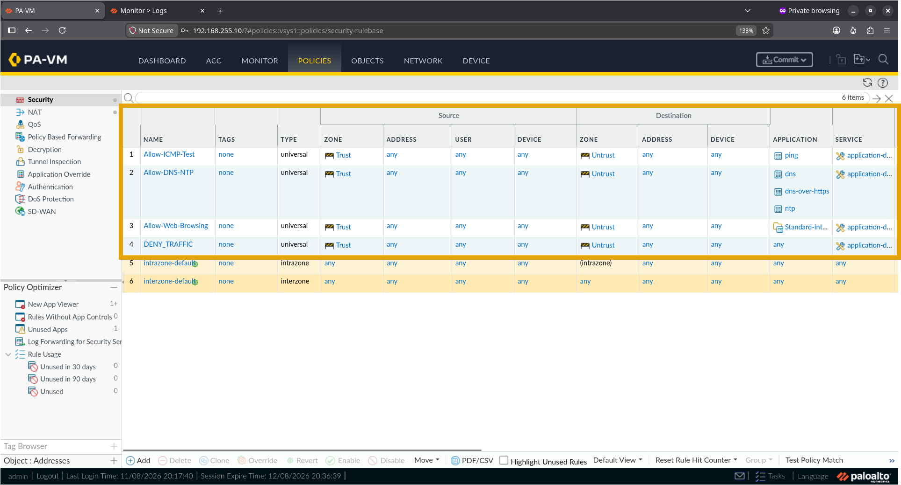

**Application: ping**

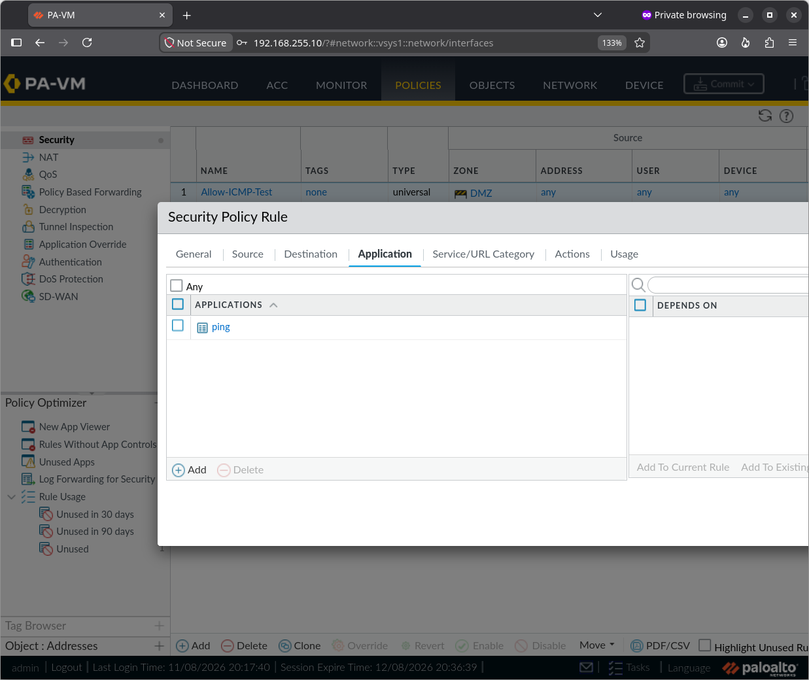

**Application: DNS, NTP**

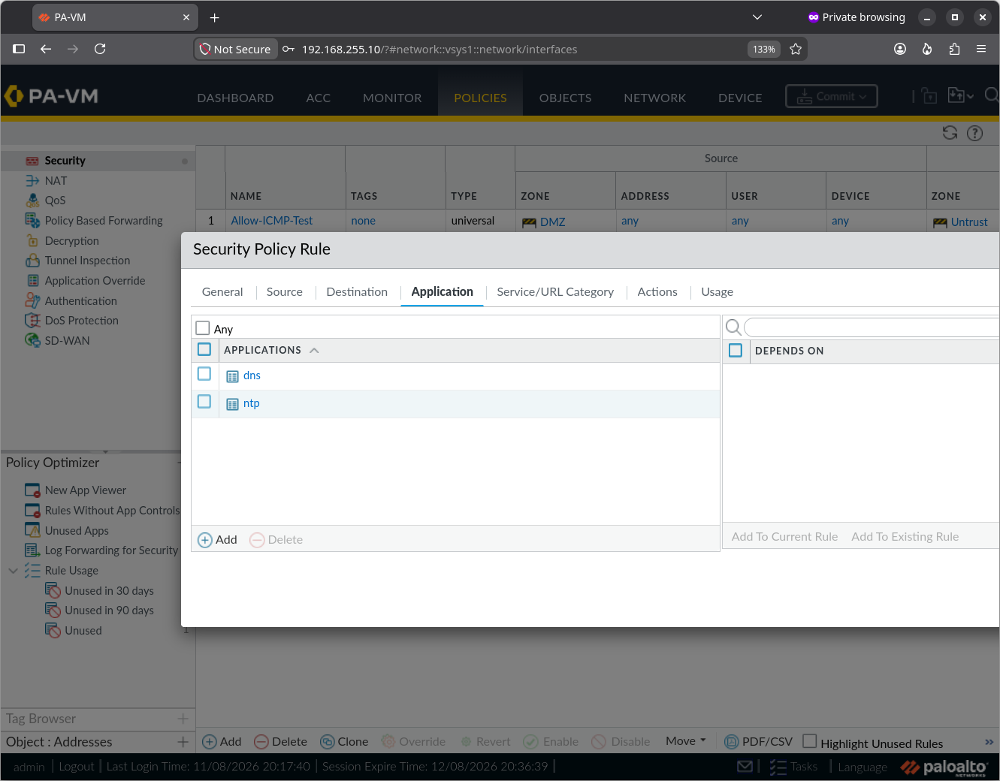

**Application: ssl, web-browsing**

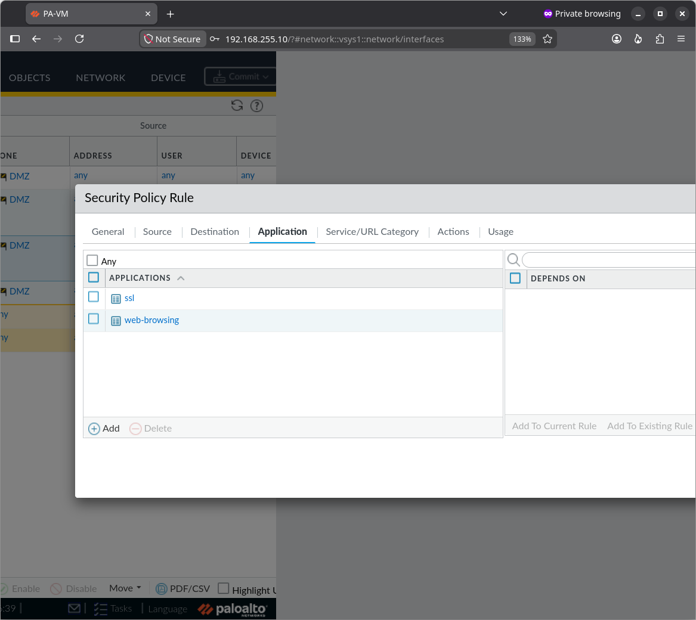

---

## Multi-Phase Test & Verification 

| # | Test Scenario | Operational Capability Tested | Expected Data-Plane Action | Observed Result | Primary Artifact |
| :-: | :--- | :--- | :--- | :--- | :--- |
| **1** | **DNS & NTP Resolution** | Infrastructure App-ID baseline verification. | Allow queries over UDP/53 and UDP/123. | Session state `INIT / FLOW`, Layer 7 processing enabled. | `google-base-show-session-id-2245.png` |
| **2** | **Google Access (Phase 1)** | Strict App-ID matching with generic `ssl`/`web-browsing`. | Handshake permitted; drop after SNI identification. | `google-base` dropped mid-flow under `DENY_TRAFFIC`. | `monitor-traffc-google-being-denied.png` |
| **3** | **YouTube Access (Phase 1)** | Granular App-ID identification across identical IP/Port. | Handshake permitted; drop after SNI identification. | `youtube-base` dropped mid-flow under `DENY_TRAFFIC`. | `monitor-traffic-youtube-base-denied.png` |
| **4** | **L7 Mid-Stream Drop Audit** | Wire-level telemetry verification of session termination. | Packets exchanged > 3 before `policy-deny` drop. | **4 packets / 947 bytes** exchanged before termination. | `youtube-base-denied-detail-log-view.png` |
| **5** | **Application Group Remediation** | Zero-downtime policy modification using App Containers. | Create group with `google-base`; keep YouTube excluded. | `Standard-Internet-Apps` bound to Rule 3. | `applying-standard-internet-apps.png` |
| **6** | **Google Access (Phase 2)** | Selective L7 allowance for business applications. | Permit Google browsing traffic cleanly. | Web page renders; state transitions to `ACTIVE`. | `google-working-after-policy-change.png` |
| **7** | **YouTube Access (Phase 2)** | Micro-segmentation isolation against video streaming. | Continued drop of `youtube-base` on port 443. | Connection timed out; state pinned to `DISCARD`. | `youtube not loadinfg.png` |
| **8** | **Deterministic CLI Match** | Control-plane simulation without endpoint traffic. | CLI validates rule indices and terminal actions. | Google matches index 3 (`allow`); YouTube matches index 4 (`drop`). | `security-policy-match-google.png`<br>`security-policy-match-youtube.png` |

---

## Detailed Engineering Analysis & Evidence

### 1. The Mid-Stream Application Shift
When the client at `10.10.10.10` attempted to reach `https://www.google.com`, the browser stalled:

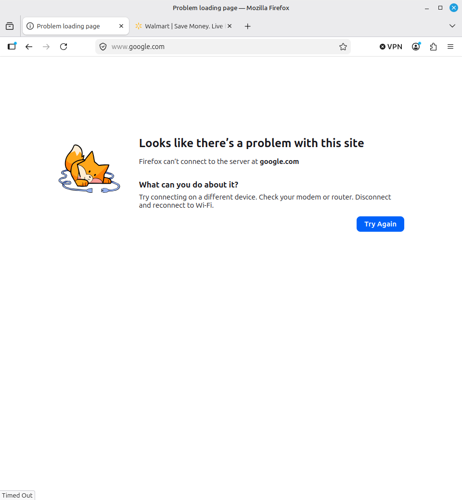

Checking the traffic logs revealed the exact moment the firewall reclassified the session:

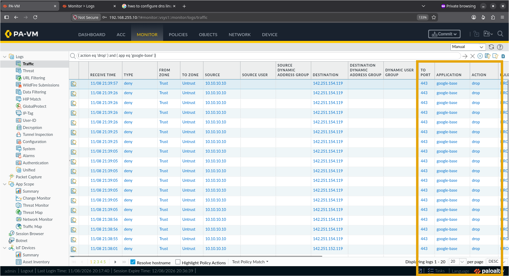

* The session entered `ethernet1/2` destined for port 443.
* Initially permitted under Rule 3 (`Allow-Web-Browsing`) while classified as `ssl`.
* Upon decoding the Client Hello SNI, the App-ID engine promoted the session to `google-base`.
* Because `google-base` was not explicitly listed in Rule 3, the session fell through to Rule 4 (`DENY_TRAFFIC`), where it was dropped.

### 2. Empirical Wire Telemetry: Handshake Succeeded Before Drop
Inspecting the **Detailed Log View** for a denied `youtube-base` flow produced empirical evidence proving that this was a Layer 7 payload drop rather than a Layer 4 port block:

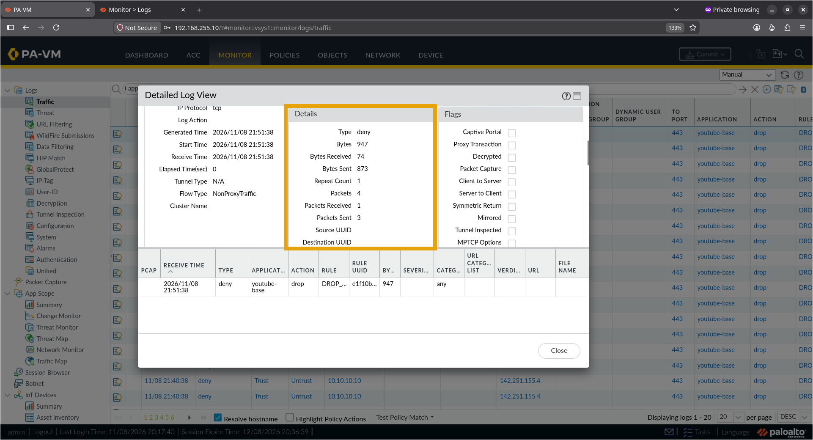

```text
Detailed Log Breakdown:
-----------------------------------------------------------
Session End Reason     : policy-deny
Action                 : drop
Rule Matched           : DENY_TRAFFIC
Total Packets          : 4 Packets (3 Client-to-Server, 1 Server-to-Client)
Total Bytes Exchanged  : 947 Bytes (873 Sent, 74 Received)
Destination Port       : 443 (TCP)
Application Identified : youtube-base
Flow Flags             : NonProxyTraffic
```

> **Engineering Takeaway:** If an administrator blocked this traffic using a traditional Layer 4 firewall rule (`deny tcp any any eq 443`), the packet count would equal **1** (the initial TCP SYN dropped at the interface). A packet count of **4** with **947 bytes exchanged** proves that the TCP 3-way handshake succeeded, the client submitted its TLS Client Hello, and the firewall terminated the connection only after Layer 7 application identification was established.

### 3. Dataplane Discard vs. Active State Tracking
CLI diagnostics confirmed the firewall actively held these unauthorized sessions in the `DISCARD` state inside the hardware flow table:

```text
admin@PA-VM> show session all filter application youtube-base

ID     Application   State   Type Flag  Src[Sport]/Zone/Proto (translated IP[Port])
                                        Dst[Dport]/Zone (translated IP[Port])
--------------------------------------------------------------------------------
2392   youtube-base  DISCARD FLOW NS    10.10.10.10[54816]/Trust/6 (192.168.1.200[4440])
                                        142.251.155.4[443]/Untrust (142.251.155.4[443])
2391   youtube-base  DISCARD FLOW NS    10.10.10.10[54808]/Trust/6 (192.168.1.200[40775])
                                        142.251.155.4[443]/Untrust (142.251.155.4[443])
```
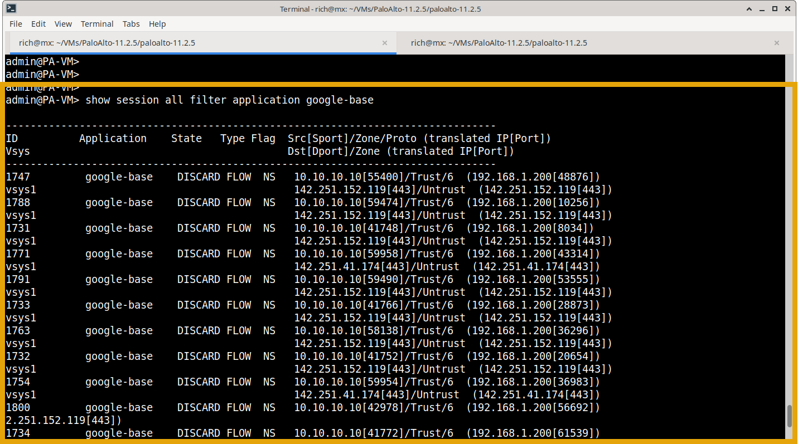

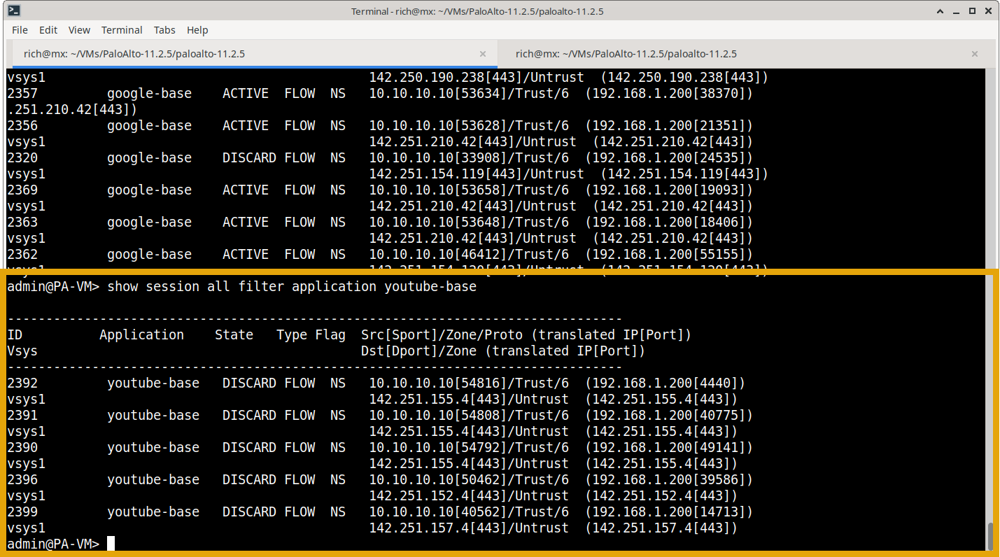

---

### 4.Application Group Remediation

To allow enterprise web browsing without creating sprawling, unmaintainable rules, an **Application Group** named `Standard-Internet-Apps` was provisioned:

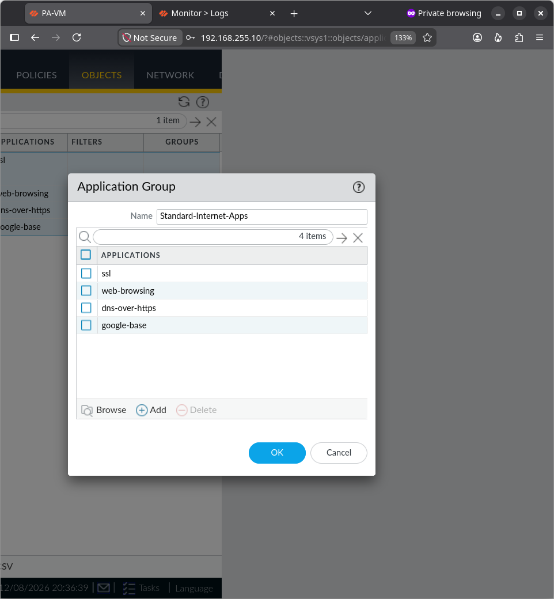

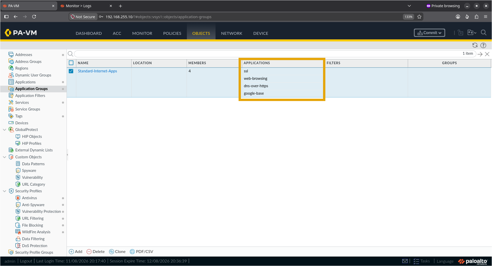

```text
set object application-group Standard-Internet-Apps members [ ssl web-browsing dns-over-https google-base ]
set rulebase security rules Allow-Web-Browsing application Standard-Internet-Apps
commit
```
The group was bound directly to Rule 3 (`Allow-Web-Browsing`):

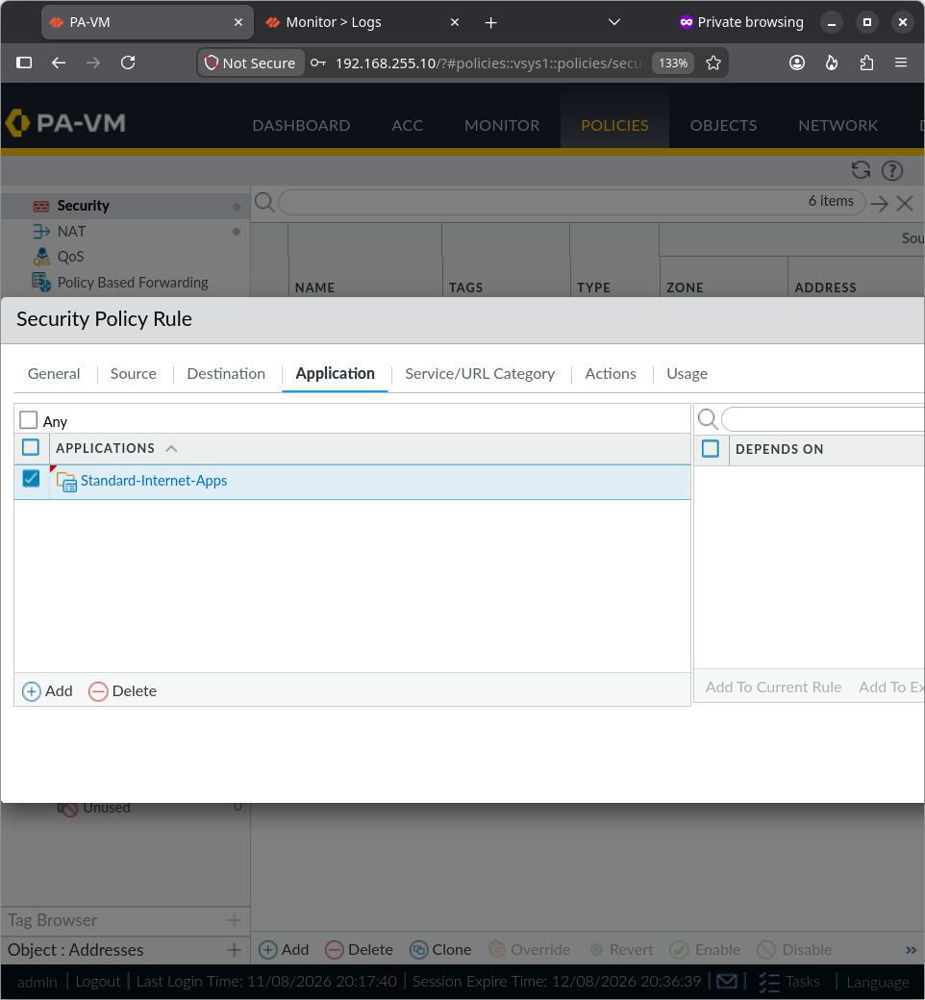

---

### 5. Final State Validation & Deterministic Policy Matching

#### Selective Service Verification
Following the commit, traffic generation was repeated from the client:
* **Google:** Loaded completely with zero browser warnings:
  
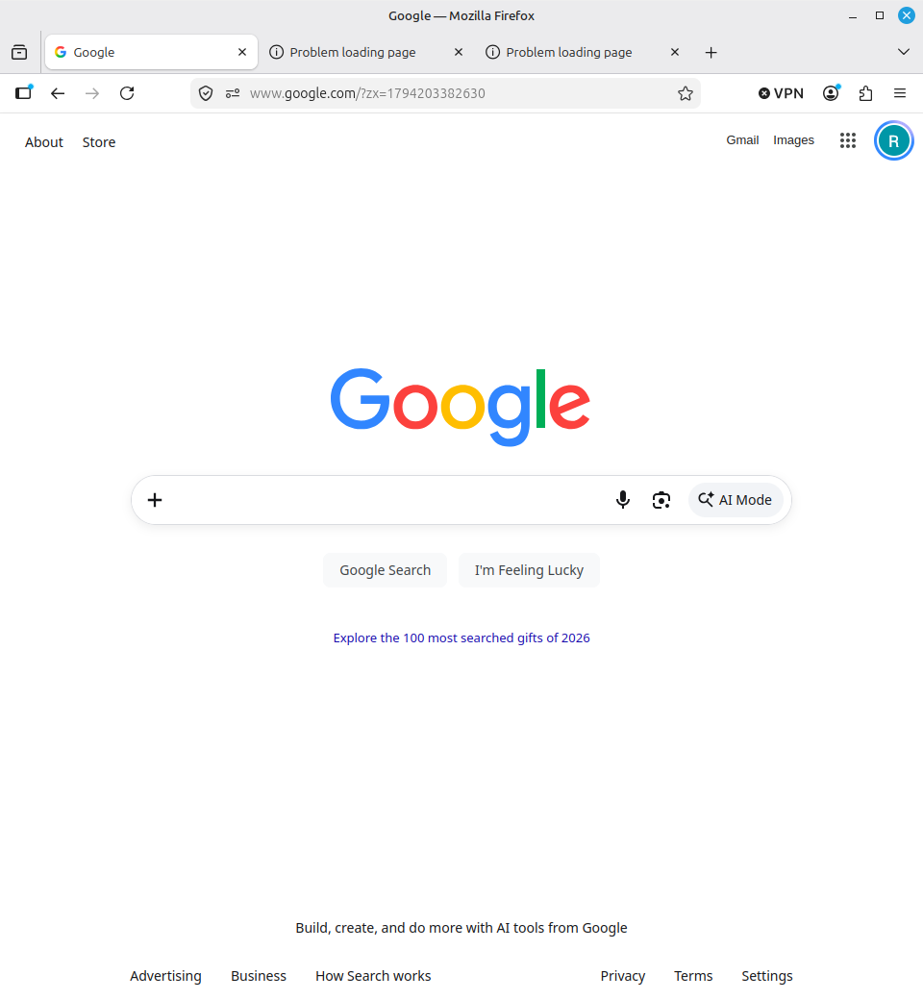

* **YouTube:** Completely timed out over the exact same port:
  
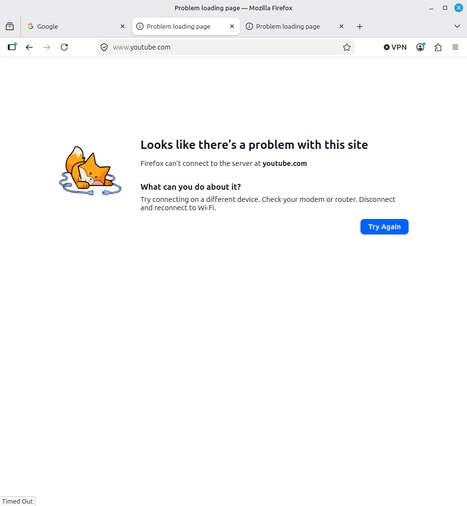

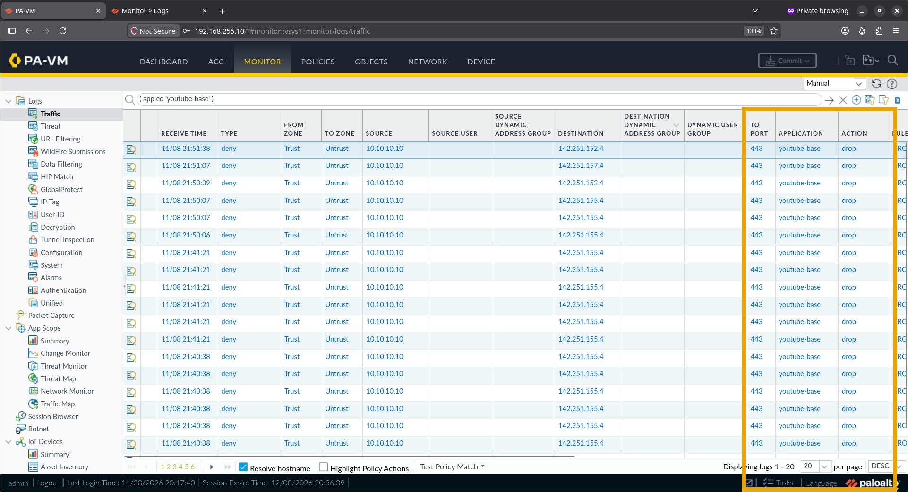

#### Dataplane Active State Proof
Running session diagnostics confirmed `google-base` sessions immediately transitioned to **`ACTIVE`**:

```text
admin@PA-VM> show session all filter application google-base

ID     Application   State   Type Flag  Src[Sport]/Zone/Proto (translated IP[Port])
                                        Dst[Dport]/Zone (translated IP[Port])
--------------------------------------------------------------------------------
2368   google-base   ACTIVE  FLOW NS    10.10.10.10[38688]/Trust/6 (192.168.1.200[61618])
                                        172.253.62.84[443]/Untrust (172.253.62.84[443])
2353   google-base   ACTIVE  FLOW NS    10.10.10.10[43282]/Trust/6 (192.168.1.200[12819])
                                        142.250.68.202[443]/Untrust (142.250.68.202[443])
```
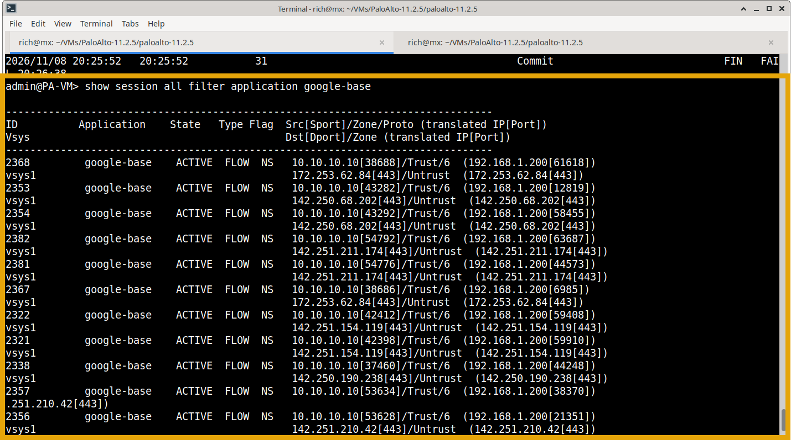

The real-time monitor log confirmed live session completion for Google (`action: allow`, `type: end`):

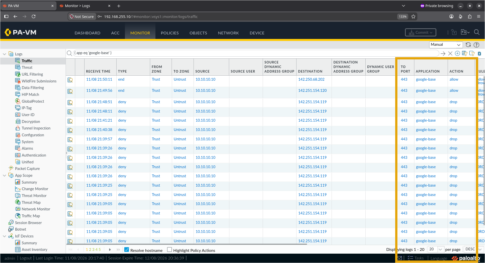

#### Control-Plane Deterministic Verification
Using `test security-policy-match`, the firewall's policy evaluation engine was verified from the CLI without generating live traffic:

* **Google Evaluation:**
  
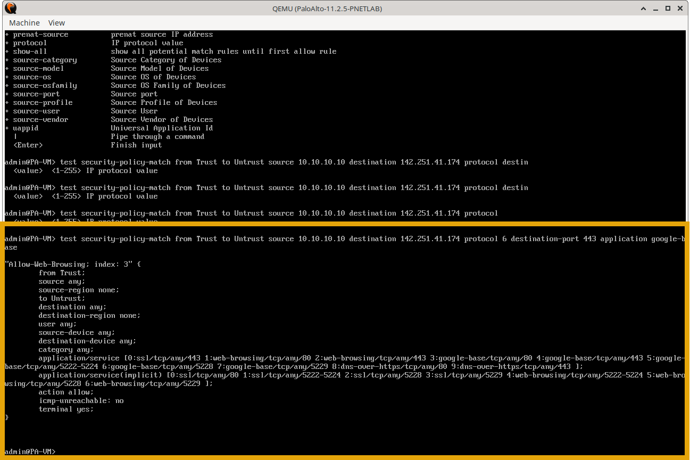
  
  ```text
  admin@PA-VM> test security-policy-match from Trust to Untrust source 10.10.10.10 destination 142.251.41.174 protocol 6 destination-port 443 application google-base

  "Allow-Web-Browsing; index: 3" {
      from Trust;
      to Untrust;
      action allow;
      terminal yes;
  }
  ```

* **YouTube Evaluation (Identical IP & Port):**
  
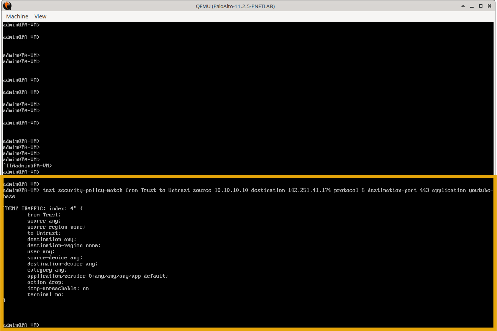
  
  ```text
  admin@PA-VM> test security-policy-match from Trust to Untrust source 10.10.10.10 destination 142.251.41.174 protocol 6 destination-port 443 application youtube-base

  "DENY_TRAFFIC; index: 4" {
      from Trust;
      to Untrust;
      action drop;
      terminal no;
  }
  ```

---

## Key Artifact Index

The primary engineering proofs, packet-level verifications, and data plane diagnostics are cataloged below:

| Artifact File | Category | Technical Proof & Validation |
| :--- | :--- | :--- |
| **`app-id-visio.png`** | Architecture | Visio topology showing SP3 single-pass flow and security zone boundaries. |
| **`policies-security-overview.png`** | Policy Config | Security rulebase enforcing strict `application-default` port constraints. |
| **`unable-to-view-google.png`** | Data Plane Test | Client browser timeout verifying the mid-stream drop of unlisted App-IDs. |
| **`monitor-traffc-google-being-denied.png`** | Traffic Log | Monitor log proving `google-base` identified via SNI and dropped by `DENY_TRAFFIC`. |
| **`youtube-base-denied-detail-log-view.png`** | Wire Telemetry | **Primary Proof:** Detailed log showing 4 packets / 947 bytes exchanged before L7 drop. |
| **`show-session-all-filter-youtube.png`** | CLI Diagnostic | Dataplane flow table showing `youtube-base` sessions locked in `DISCARD FLOW`. |
| **`application-group-overview.png`** | Enterprise Remediation | Definition of `Standard-Internet-Apps` container grouping permitted dependencies. |
| **`google-working-after-policy-change.png`** | Verification | Successful web browsing rendering `google.com` following application-group remediation. |
| **`youtube-failing.png`** | Verification | Browser timeout proving continued granular micro-segmentation of `youtube.com` on port 443. |
| **`show-session-all-google-allowed.png`** | CLI Diagnostic | Dataplane flow table verifying sessions transitioned from `DISCARD` to `ACTIVE FLOW`. |
| **`security-policy-match-google.png`** | Control Plane CLI | CLI simulation confirming `google-base` matches Rule 3 with action `allow`. |
| **`security-policy-match-youtube.png`** | Control Plane CLI | CLI simulation confirming `youtube-base` matches Rule 4 with action `drop`. |
