# Sub-Second Multi-Vendor BGP Convergence via BFD over Encrypted IPsec Overlays (PAN-OS ➔ Cisco IOS)

A production-grade implementation and empirical benchmark of **Bidirectional Forwarding Detection (BFD, RFC 5880)** integrated with **External BGP (eBGP)** across a multi-vendor **Route-Based IPsec VTI** interconnecting Palo Alto Networks PAN-OS 11.2.5 (`AS 65001` on `VR-Perimeter`) and a Cisco IOS / CSR1000v Router (`AS 65000`).

Standard BGP peering relies on slow control-plane keepalives (`30s` keepalive / `90s` hold-time in PAN-OS), creating prolonged routing blackouts when an encrypted overlay fails silently. By decoupling failure detection from BGP timers and offloading `250 ms` micro-timers (`3×` multiplier = **`750 ms` detection threshold**) to the BFD data plane, the firewall detects tunnel loss in **<1 second** and immediately tears down the BGP peering session (`2 seconds` total log cycle vs. **`67 seconds`** without BFD—a **97.0% reduction** in teardown latency).

Every state transition, BFD discriminator negotiation (`0x61900001 / 0x1`), control-plane syslog, and comparative failure benchmark was verified using PAN-OS BFD/BGP diagnostics (`show routing bfd details`, `show routing protocol bgp peer`), Cisco IOS BFD tables (`show bfd neighbors`, `show bfd summary`), and chronological system log audits.

---

## Architecture & BFD Convergence Pipeline

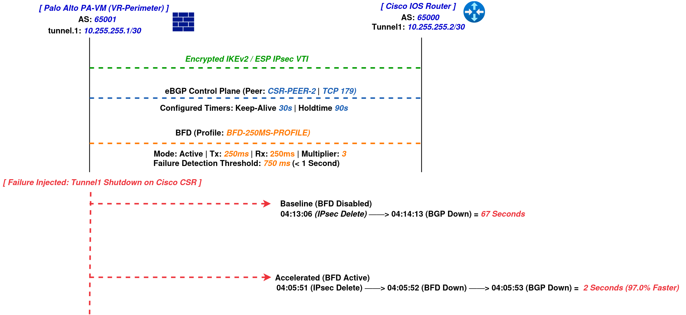

---

## Protocol & Benchmark Specification

| Parameter | Palo Alto (PA-VM) | Cisco IOS Router | Engineering Function |
| :--- | :--- | :--- | :--- |
| **Virtual Router / Peer** | `VR-Perimeter` (`CSR-PEER-2`) | Global Routing (`10.255.255.1`) | Hosts VTI overlay and BGP session |
| **Tunnel Interface** | `tunnel.1` (`10.255.255.1/30`) | `Tunnel1` (`10.255.255.2/30`) | Route-based IPsec VTI overlay |
| **BGP Autonomous System** | `AS 65001` (Router ID `10.255.255.1`) | `AS 65000` (Router ID `10.255.255.2`) | Dynamic eBGP route exchange |
| **BGP Hold / Keepalive** | `90s` / `30s` | Standard eBGP timers | Baseline fallback control-plane timers |
| **BFD Profile / Mode** | `BFD-250MS-PROFILE` (`Active`) | Interface `Tunnel1` BFD | Sub-second forwarding-plane keepalives |
| **Desired Min Tx / Min Rx** | `250 ms` / `250 ms` | `250 ms` / `250 ms` | Negotiated control packet interval |
| **Detect Multiplier** | `3` | `3` | Declares peer dead after 3 missed probes (**`750 ms`**) |
| **Local / Remote Discrim.** | `0x61900001` / `0x1` | `1` / `1636827137` (`0x61900001`) | Synchronized cross-vendor session handles |

---

## Implementation 

### Phase 1: Cisco IOS / CSR1000v BFD Configuration

Configured sub-second BFD timers directly on the `Tunnel1` VTI interface and bound BFD fall-over monitoring to the Palo Alto eBGP neighbor:

```cisco
enable
configure terminal

interface Tunnel1
 description IPSEC-VTI-TO-PALO-ALTO
 ip address 10.255.255.2 255.255.255.252
 ip tcp adjust-mss 1360
 bfd interval 250 min_rx 250 multiplier 3
 tunnel source 192.168.254.10
 tunnel mode ipsec ipv4
 tunnel destination 192.168.1.200
 tunnel protection ipsec profile IPSEC-PROFILE
 exit

router bgp 65000
 bgp router-id 10.255.255.2
 bgp log-neighbor-changes
 network 20.20.20.0 mask 255.255.255.0
 network 192.168.254.0
 neighbor 10.255.255.1 remote-as 65001
 neighbor 10.255.255.1 fall-over bfd
 exit

end
write memory
```
**Interface Configuration**

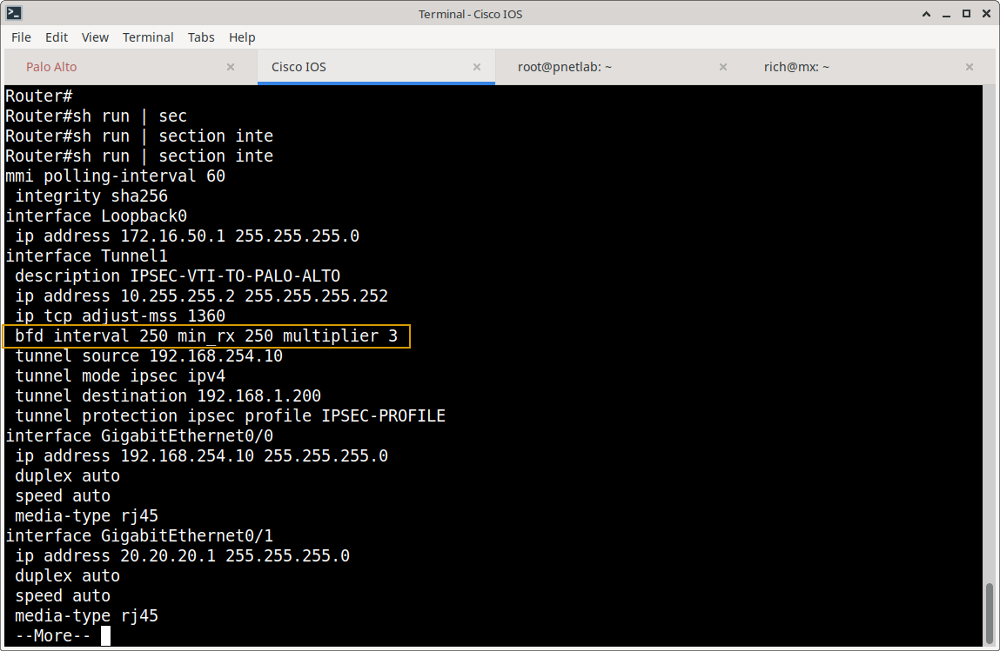

**BGP Configuration**

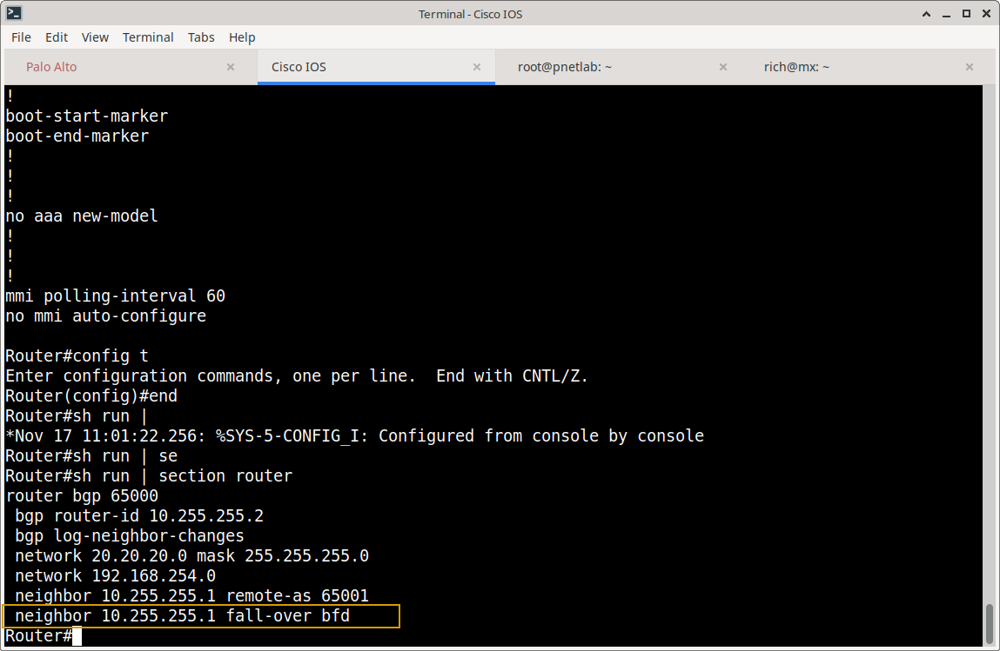

### Phase 2: Palo Alto Networks (PAN-OS 11.2.5) BFD Configuration

1. **Create BFD Profile (`Network > Network Profiles > BFD Profile`):**
   * **Name:** `BFD-250MS-PROFILE`
   * **Mode:** `Active`
   * **Desired Minimum Tx Interval (ms):** `250`
   * **Required Minimum Rx Interval (ms):** `250`
   * **Detection Time Multiplier:** `3`
   * **Hold Time (ms):** `0` | **Enable Multihop:** Unchecked
2. **Bind BFD to BGP Peer (`Network > Virtual Routers > VR-Perimeter > BGP`):**
   * Opened Peer Group `CSR-PEER-CONFIG` ➔ Peer **`CSR-PEER-2`** (`AS 65000`).
   * Under **Advanced**, set **BFD** to **`BFD-250MS-PROFILE`** and committed.

**BFD Profile**

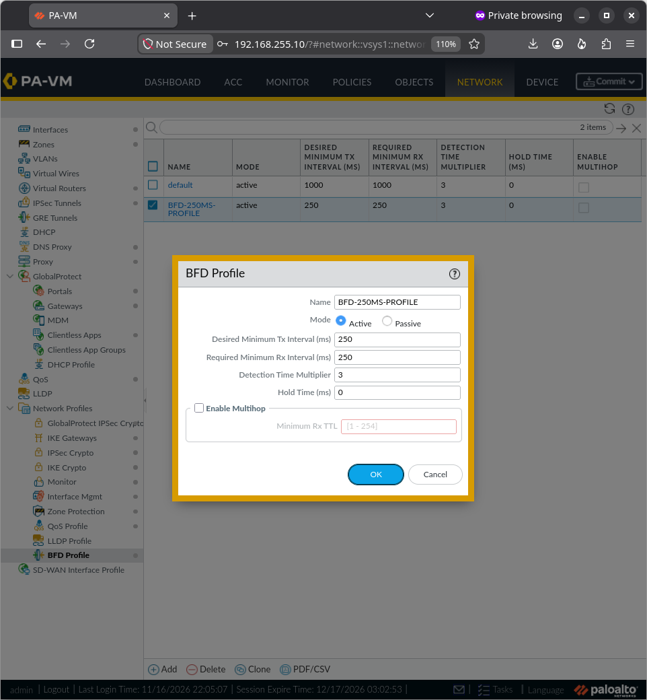

**Assigning BFD Profile**

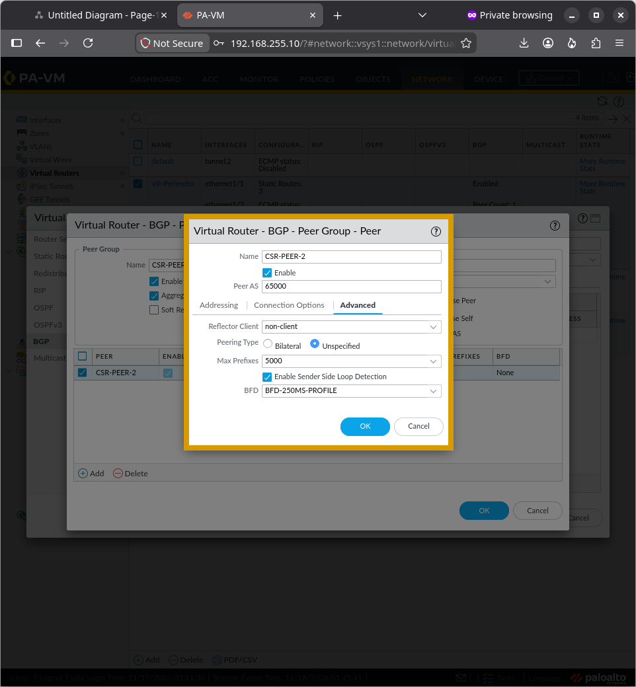

---

## Empirical Verification & Comparative Convergence Benchmark

### 1. Cross-Vendor BFD & eBGP Session Verification

#### A. Palo Alto BFD Session Telemetry (`show routing bfd summary` & `details`)

```text
admin@PA-VM> show routing bfd details

BFD Session ID: 1
  Version:             1
  Interface:           tunnel.1
  Protocol:            BGP
  Local IP Address:    10.255.255.1
  Neighbor IP Address: 10.255.255.2
  BFD profile:         BFD-250MS-PROFILE
  State (local/remote): up / up
  Discriminator (local/remote): 0x61900001 / 0x1
  Mode:                Active
  Desired Min Tx Interval:       250ms
  Required Min Rx Interval:      250ms
  Received Min Rx Interval:      250ms
  Negotiated Transmit Interval:  250ms
  Detect Multiplier:             3
  Detect time (exceeded):        750ms (79)
  Tx Control Packets (last):     602 (79ms ago)
  Rx Control Packets (last):     582 (105ms ago)
  Agent DP:                      Slot 1 - DP 0
  Errors:                        0
```
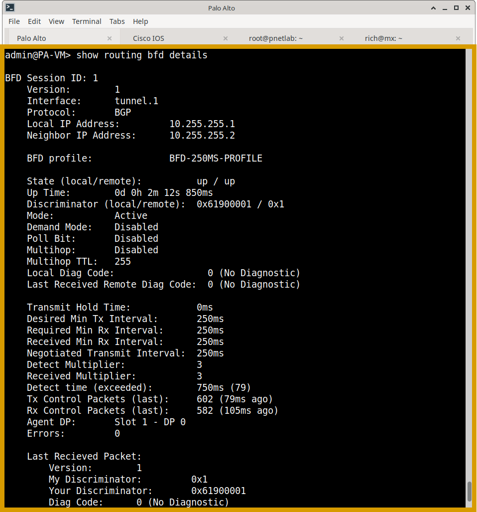

#### B. Cisco IOS BFD & BGP State (`show bfd neighbors` / `summary` / `sh ip bgp summary`)

```text
Router# show bfd neighbors

IPv4 Sessions
NeighAddr                              LD/RD         RH/RS     State     Int
10.255.255.1                           1/1636827137  Up        Up        Tu1

Router# show bfd summary
                         Session      Up    Down
Total                          1       1       0

Router# sh ip bgp summary
Neighbor        V           AS MsgRcvd MsgSent   TblVer  InQ OutQ Up/Down  State/PfxRcd
10.255.255.1    4        65001      20      21        3    0    0 00:07:19        0
```
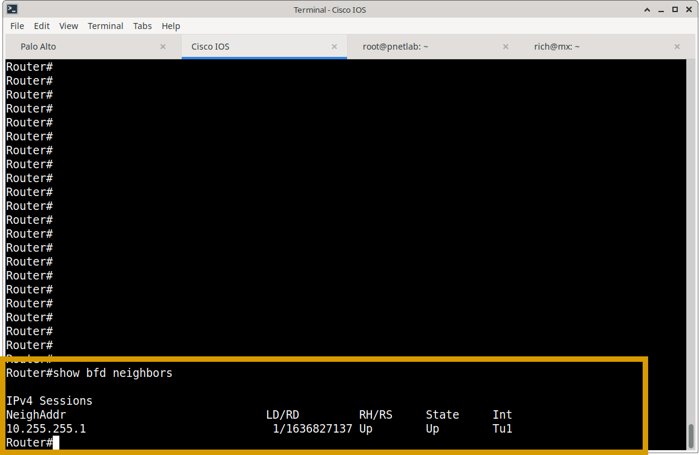

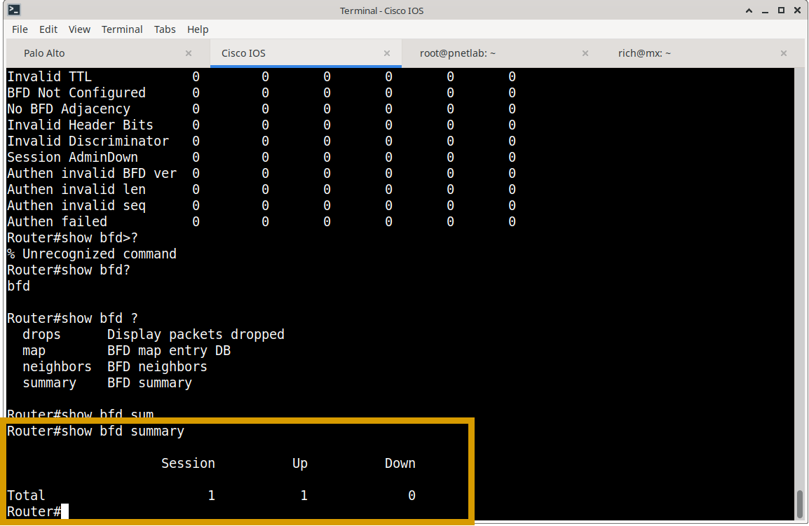

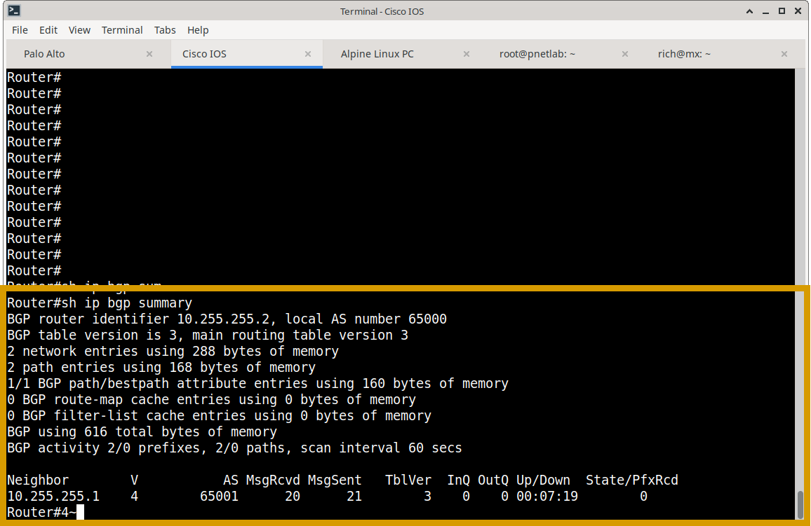

> **Cross-Vendor Synchronization Proof:** Cisco's Remote Discriminator (`1636827137`) converts directly to hexadecimal `0x61900001`, matching the Palo Alto's Local Discriminator with `0` BFD drop counters across both data planes.

---

### 2. Test A — Baseline Convergence Benchmark (BFD Disabled)

To establish a control baseline, BFD was disabled on both peers (`no bfd interval 250 min_rx 250 multiplier 3` and `no neighbor 10.255.255.1 fall-over bfd` on Cisco; `Disable BFD` on `CSR-PEER-2`), and `Tunnel1` was administratively shut down.

* **Cisco Tunnel Outage Injected:**
  ```text
  Jun  1 04:13:00.607: %BGP-5-NBR_RESET: Neighbor 10.255.255.1 reset (Interface flap)
  Jun  1 04:13:00.634: %BGP-5-ADJCHANGE: neighbor 10.255.255.1 Down Interface flap
  Jun  1 04:13:00.855: %CRYPTO-6-ISAKMP_ON_OFF: ISAKMP is OFF
  Jun  1 04:13:02.564: %LINK-5-CHANGED: Interface Tunnel1, changed state to administratively down
  ```
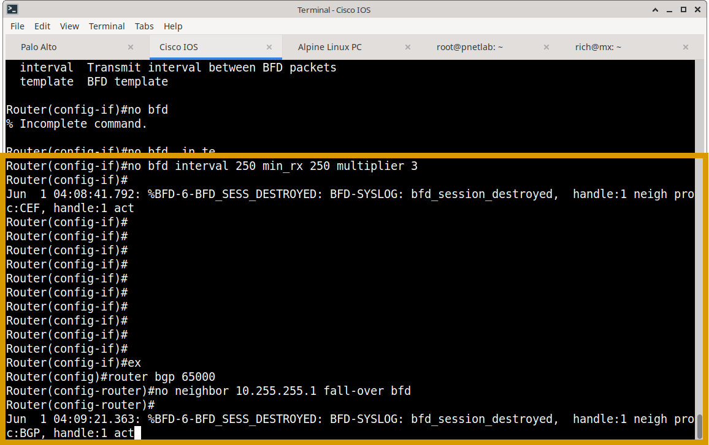

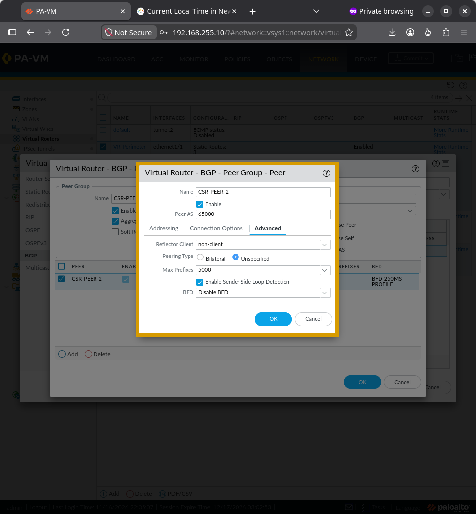
  
* **PA-VM System Log Audit (`Monitor > Logs > System`):**
  * **`04:13:06`** (`vpn` / `ipsec-key-delete`): IPsec SA deleted (`SPI:0xAEDE419C/0x64CDD0E2`).
  * **`04:13:18`** (`pbf` / `nh-down`): PBF rule `PBF-TO-CSR-OVERLAY` bypassed.
  * **`04:14:13`** (`routing` / `routed-BGP-peer-left-established`): `VR-Perimeter` finally tore down `CSR-PEER-2` (`10.255.255.2`).
* **Measured Baseline BGP Blackout:** **`67 seconds`** elapsed between IPsec tunnel deletion (`04:13:06`) and BGP peer teardown (`04:14:13`) while waiting for the `90s` BGP hold-timer to expire.

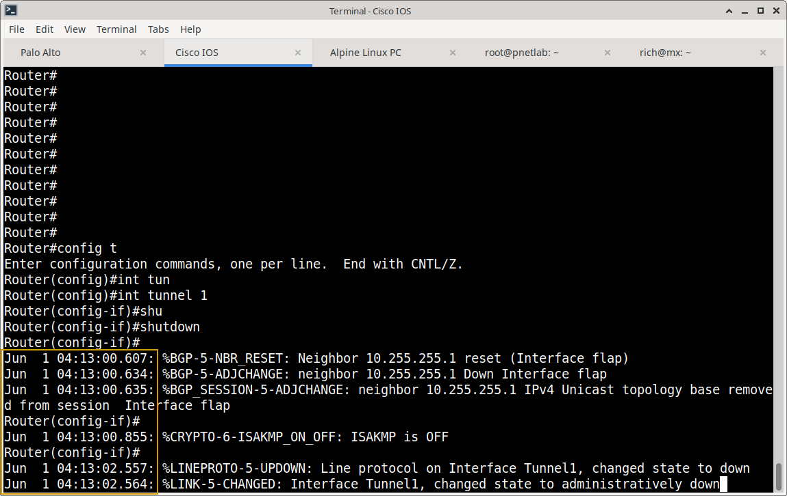

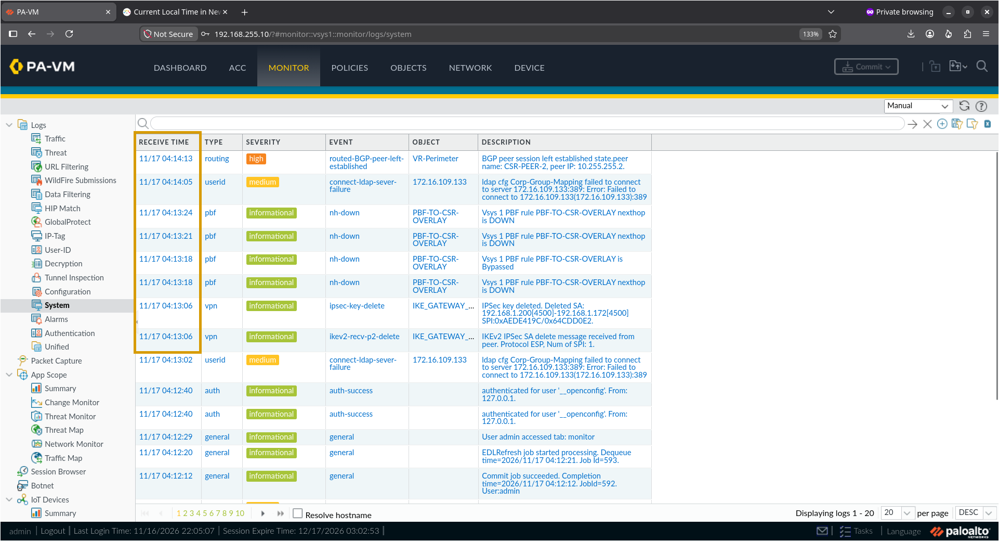

---

### 3. Test B — BFD-Accelerated Convergence Benchmark (`250 ms × 3 = 750 ms`)

With `BFD-250MS-PROFILE` active on `CSR-PEER-2` and `fall-over bfd` active on Cisco, the identical `Tunnel1` shutdown was executed.

* **Cisco Instantaneous BFD & BGP Teardown:**
  ```text
  Jun  1 04:05:49.522: %BGP-5-NBR_RESET: Neighbor 10.255.255.1 reset (Interface flap)
  Jun  1 04:05:49.544: %BGP-5-ADJCHANGE: neighbor 10.255.255.1 Down Interface flap
  Jun  1 04:05:49.547: %BFD-6-BFD_SESS_DESTROYED: BFD-SYSLOG: bfd_session_destroyed, ld:1 neigh proc:BGP, handle:1 act
  Jun  1 04:05:49.853: %CRYPTO-6-ISAKMP_ON_OFF: ISAKMP is OFF
  Jun  1 04:05:51.481: %LINK-5-CHANGED: Interface Tunnel1, changed state to administratively down
  ```
  
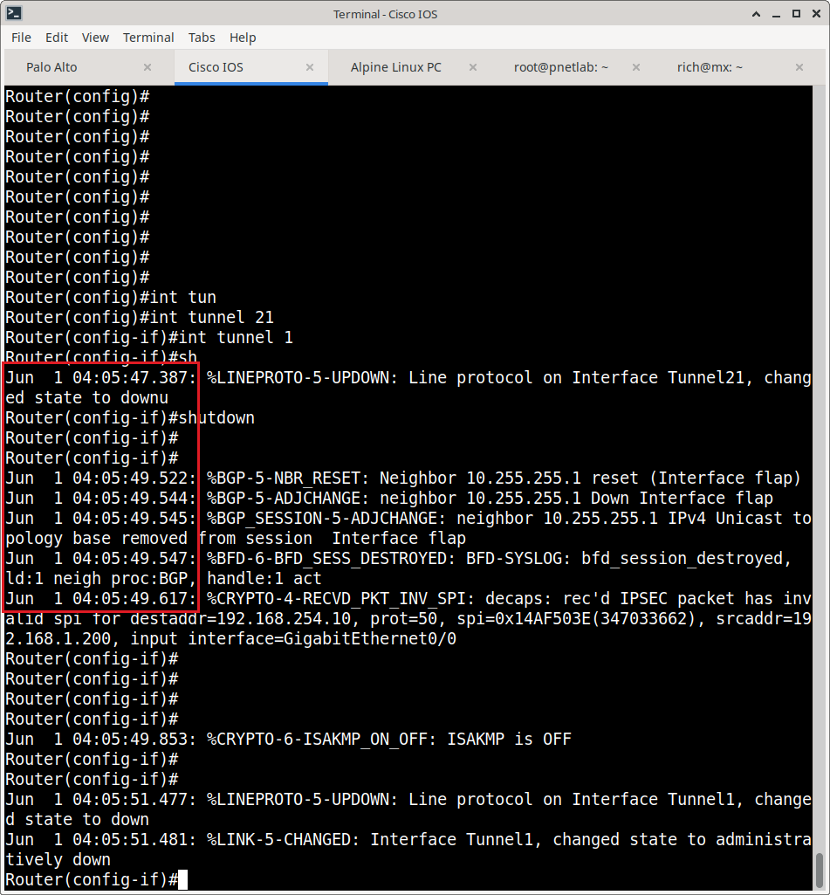
  
* **PA-VM Chronological System Log Audit (`Monitor > Logs > System`):**

| Timestamp | Type | Severity | Event | Description |
| :--- | :--- | :--- | :--- | :--- |
| **`04:05:51`** | `vpn` | Informational | `ipsec-key-delete` | IPsec tunnel SA deleted (`SPI:0xBCEE98BC/0x14AF503E`). |
| **`04:05:52`** | `bfd` | **High** | **`expired-time`** | `BFD control detection time expired for BFD session 1 to neighbor 10.255.255.2 on interface tunnel.1. Protocol: BGP` |
| **`04:05:52`** | `bfd` | **Critical** | **`session-state-change`** | `BFD state changed to Down for BFD session 1 to neighbor 10.255.255.2 on interface tunnel.1. Protocol: BGP` |
| **`04:05:53`** | `routing` | **High** | **`routed-BGP-peer-left-established`** | `VR-Perimeter`: `BGP peer session left established state. peer name: CSR-PEER-2, peer IP: 10.255.255.2.` |

* **Measured BFD Convergence Result:** **`2 seconds`** total log delta (`04:05:51` ➔ `04:05:53`), with BFD detection expiring at **`750 ms`** (`04:05:52`)—eliminating **65 seconds** of BGP hold-down blackout (**97.0% faster convergence**).

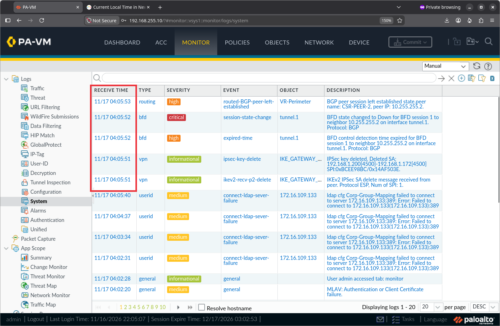

---

## Key Artifact Index

| Artifact File | Category | Technical Proof & Validation |
| :--- | :--- | :--- |
| **`creating-bfd-profile.png`** | PAN-OS Config | `BFD-250MS-PROFILE` configured in Active mode (`250ms` Tx/Rx, multiplier `3`). |
| **`assigning-bfd-profile.png`** | PAN-OS Config | Binding `BFD-250MS-PROFILE` to BGP peer on `VR-Perimeter`. |
| **`palo-cli-show-routing-bfd-details.png`** | PAN-OS CLI | `show routing bfd details` confirming `up / up`, `250ms` negotiated, `750ms` detect time. |
| **`palo-cli-show-routing-bfd-summary.png`** | PAN-OS CLI | `show routing bfd summary` showing `State: up`, `rState: up`, `Errors: 0`. |
| **`palo-cli-show-routing-protocol-bgp-peer.png`** | PAN-OS CLI | `show routing protocol bgp peer` verifying `CSR-PEER-2` (`Holdtime: 90`, `Keep-Alive: 30`). |
| **`cisco-ios-show-run-section-interface.png`** | Cisco Config | Running config confirming `bfd interval 250 min_rx 250 multiplier 3` on `Tunnel1`. |
| **`cisco-ios-show-run-section-router-bgp.png`** | Cisco Config | Running config confirming `neighbor 10.255.255.1 fall-over bfd`. |
| **`cisco-ios-show-bfd-neighbors.png`** | Cisco Telemetry | `show bfd neighbors` verifying `Up` state and synchronized discriminator `1636827137`. |
| **`cisco-ios-show-bfd-summary.png`** | Cisco Telemetry | `show bfd summary` confirming 1 active session, 0 down. |
| **`cisco-ios-sh-ip-bgp-summary.png`** | Cisco Telemetry | `sh ip bgp summary` verifying the eBGP adjacency is established. |
| **`no-bfd-test-removing-cisco-bfd.png`** | Baseline Test | Cisco console removing BFD configuration for the control test. |
| **`no-bfd-test-removing-cisco-bfd-2.png`** | Baseline Test | Additional view of Cisco BFD removal. |
| **`no-bfd-test-removing-bfd-palo-alto-peer-group.png`** | Baseline Test | PAN-OS GUI showing BFD disabled on the peer group. |
| **`no-bfd-test-removing-bfd-palo-alto.png`** | Baseline Test | PAN-OS GUI showing BFD profile unassigned. |
| **`no-bfd-test-timestamp-shutting-down-cisco-port.png`** | Baseline Proof | Cisco console shutting down `Tunnel1` after disabling BFD (`04:13:00`). |
| **`no-bfd-test-timestamp-palo-alto.png`** | Baseline Proof | System monitor proving BGP took **67s** (`04:13:06` ➔ `04:14:13`) to drop without BFD. |
| **`bfd-test-cisco-timestamp.png`** | BFD Test | Cisco console showing `%BFD-6-BFD_SESS_DESTROYED` triggering instant BGP teardown. |
| **`bfd-test-palo-alto-timestamp.png`** | BFD Proof | System monitor capturing `expired-time`, `session-state-change`, and BGP teardown in **2s**. |

---

### Portfolio Complete

You have successfully completed the **15-Project Master Palo Alto Networks Portfolio**. This capstone demonstrates enterprise-grade, sub-second BGP convergence over encrypted multi-vendor IPsec overlays, completing the full progression from Layer 7 Zero Trust and NetDevOps automation to advanced routing resilience.

---

[⬅️ Back to Palo Alto Networks Master Portfolio Overview](../README.md)
