# Enterprise SSL/TLS Forward Proxy Decryption & PKI Integration

An enterprise-grade implementation of outbound **SSL/TLS Forward Proxy Decryption** on Palo Alto Networks PAN-OS 11.2.5. This project documents the complete cryptographic lifecycle of intercepting, inspecting, and re-signing outbound TLS traffic. It demonstrates the elimination of encrypted blind spots, enforcement of strict TLS cipher/certificate profiles, validation of upstream certificate errors (expired and untrusted roots via BadSSL), and the implementation of regulatory compliance bypasses (GLBA/HIPAA) using custom URL categories.

Every flow transition, re-signed certificate chain, and session-level decryption flag was verified using browser security diagnostics, live traffic monitors, dedicated decryption logs, and dataplane CLI session audits (`show session all filter ssl-decrypt yes`).

---

## Architectural Workflow & Cryptographic Lifecycle

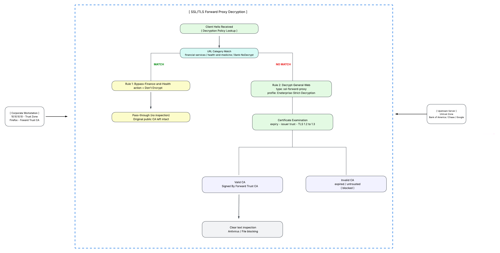

---

## The Business & Security Problem

Over 90% of modern enterprise internet traffic is encrypted via TLS. While encryption protects data privacy in transit, it introduces a severe enterprise security blind spot:
1. **Threat Evasion:** Malware delivery, Command-and-Control (C2) beaconing, and automated data exfiltration bypass perimeter defenses when concealed inside TLS tunnels.
2. **Security Profile Blindness:** Without decryption, deep packet inspection engines (Antivirus, Anti-Spyware, Vulnerability Protection, File Blocking) cannot scan the application payload.
3. **The Compliance Dilemma:** Firewalls cannot legally decrypt all traffic. Regulations such as HIPAA (healthcare) and GLBA/PCI-DSS (banking) mandate that sensitive user data remain private. Organizations must implement granular bypasses without compromising perimeter visibility.

---

## Implementation Stages

### Stage 1: Public Key Infrastructure (PKI) & CA Enrollment

Two dedicated Certificate Authorities were provisioned on the PA-VM:
* **`Enterprise-Forward-Trust-CA`:** Self-signed Root CA (RSA 2048-bit, SHA-256) designated with `Forward Trust Certificate` usage to dynamically mint proxy certificates for valid upstream destinations.
* **`Enterprise-Forward-Untrust-CA`:** Dedicated CA designated with `Forward Untrust Certificate` usage to issue warning certificates when upstream servers present invalid or self-signed certificates.

```text
! CLI Certificate Generation & Binding:
request certificate generate certificate-name Enterprise-Forward-Trust-CA name-format fqdn-or-ip-or-email common-name Corp-Decryption-Sub-CA algorithm RSA rsa-nbits 2048 digest sha256 ca yes
request certificate generate certificate-name Enterprise-Forward-Untrust-CA name-format fqdn-or-ip-or-email common-name Corp-Decryption-Untrusted-CA algorithm RSA rsa-nbits 2048 digest sha256 ca yes

set shared certificate Enterprise-Forward-Trust-CA default-flags forward-trust-certificate
set shared certificate Enterprise-Forward-Untrust-CA default-flags forward-untrust-certificate
commit
```
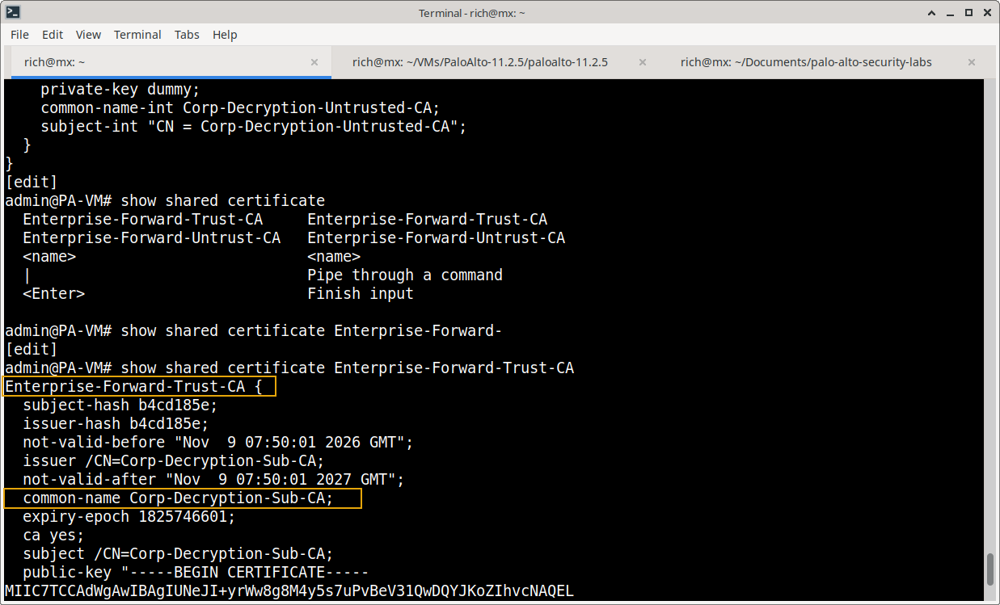

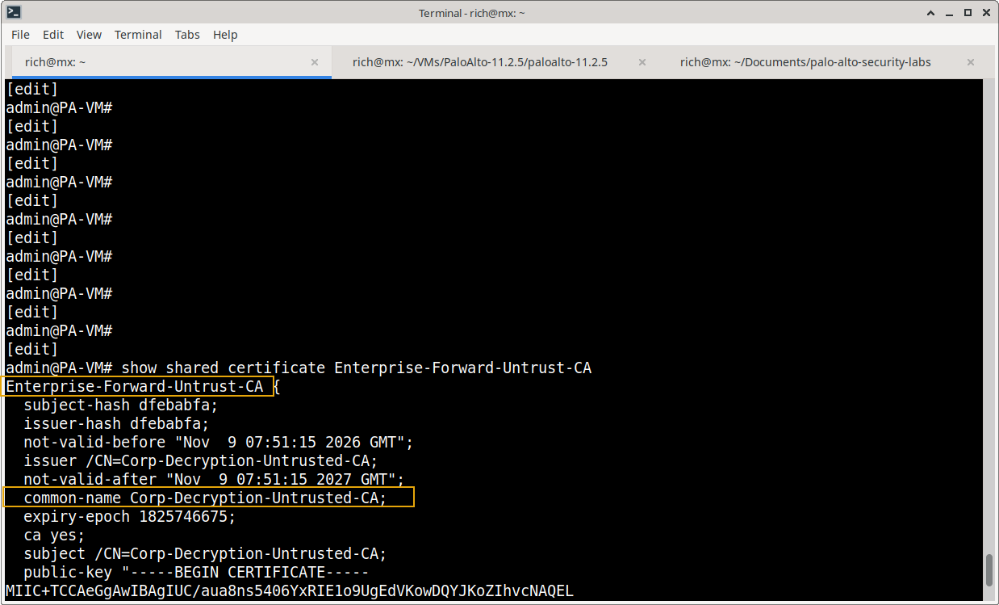

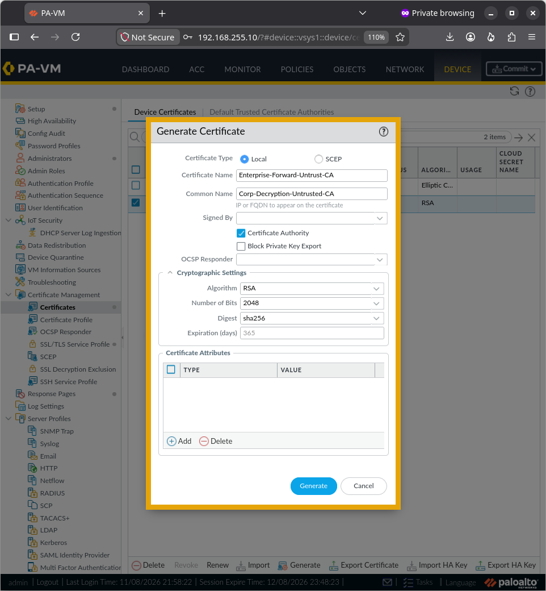

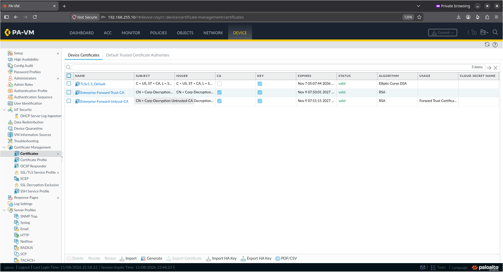

The public certificate of `Enterprise-Forward-Trust-CA` was exported and imported into the corporate workstation trust store (Firefox Authorities) to ensure trusted end-user transactions without browser disruption.

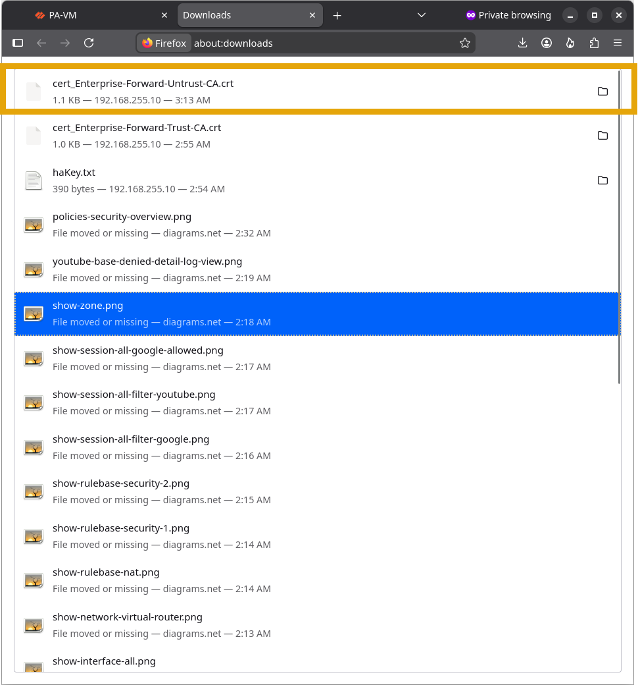

---

### Stage 2: Hardened Decryption Profile

An enterprise decryption profile named `Enterprise-Strict-Decryption` was configured to actively block insecure cryptographic parameters:

* **Server Certificate Verification:**
  * Block sessions with expired certificates.
  * Block sessions with untrusted issuers.
* **Unsupported Mode Checks:**
  * Block sessions with unsupported TLS versions (enforcing minimum **TLSv1.2**, maximum **TLSv1.3**).
  * Strip ALPN (Application-Layer Protocol Negotiation) to prevent protocol downgrade attacks.

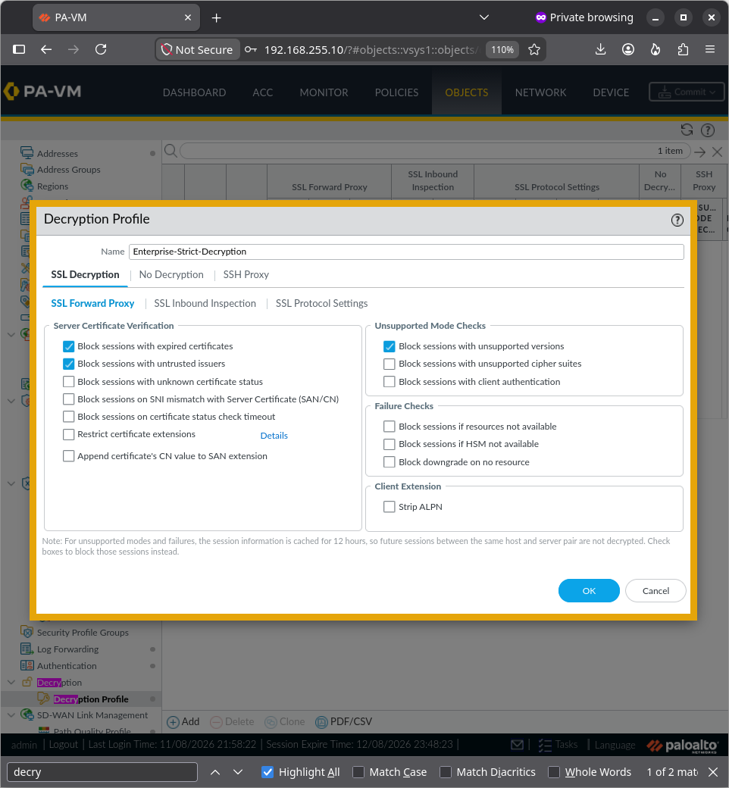

---

### Stage 3: Regulatory Compliance Bypass & Decryption Rulebase

To address compliance and privacy mandates, a custom URL category containing 51 institutional banking FQDNs (`Bank-NoDecrypt`) was combined with default PAN-OS categories (`financial-services`, `health-and-medicine`).

**Import File**

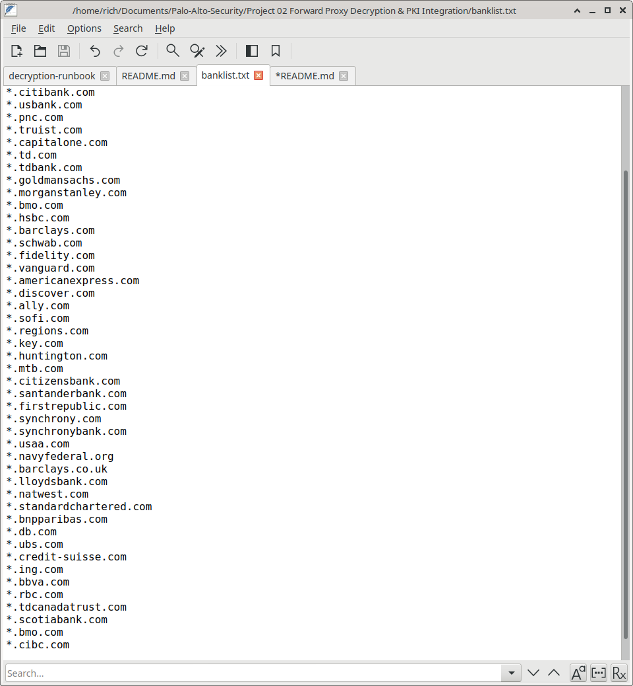

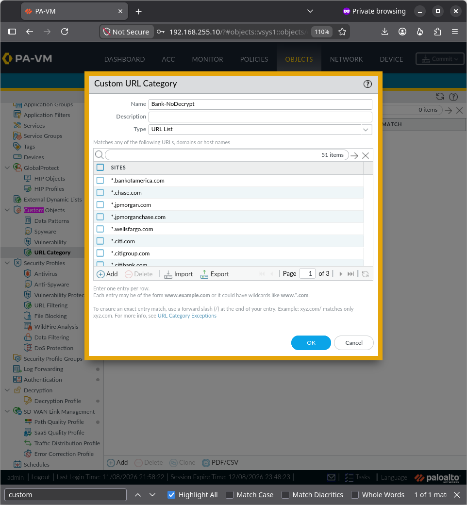

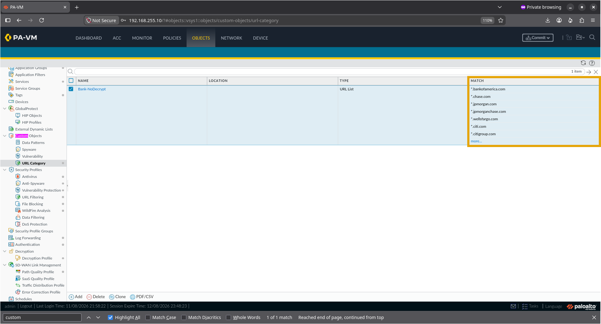

#### Decryption Policy Hierarchy:
1. **Rule 1: `Bypass-Finance-and-Health` (Top Priority)**
   * **Source:** `Trust` | **Destination:** `Untrust`
   * **URL Categories:** `financial-services`, `health-and-medicine`, `Bank-NoDecrypt`
   * **Action:** **`no-decrypt`**
2. **Rule 2: `Decrypt-General-Web` (Catch-All)**
   * **Source:** `Trust` | **Destination:** `Untrust`
   * **URL Categories:** `any`
   * **Action:** **`decrypt`** | **Type:** `ssl-forward-proxy`
   * **Profile:** `Enterprise-Strict-Decryption`

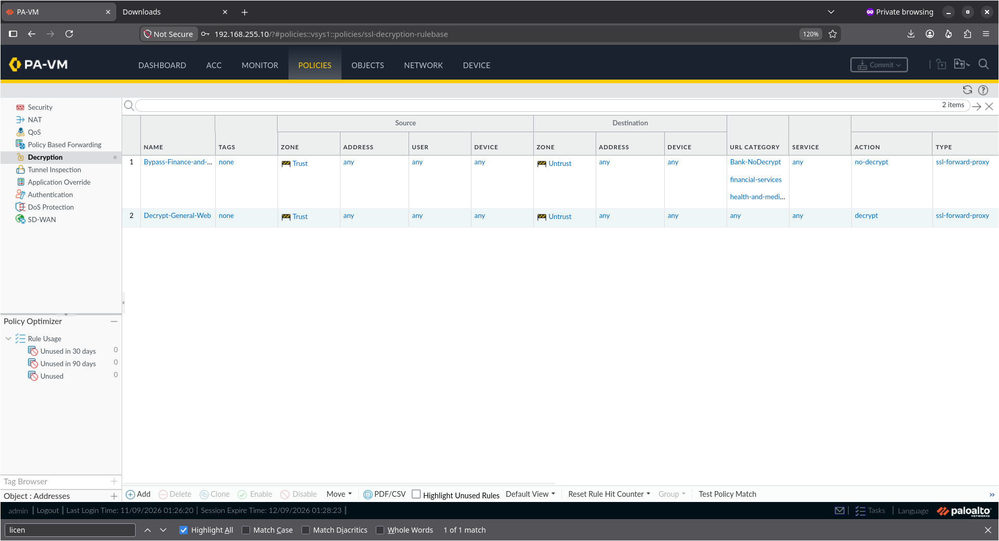

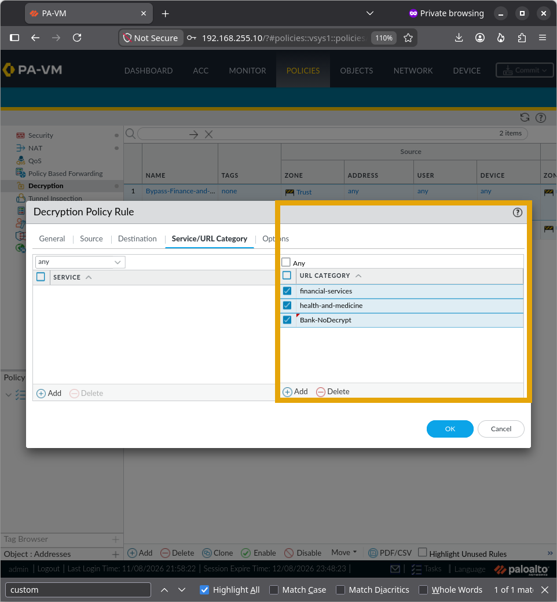


**Decrypt-General-Web**


---

## Multi-Phase Verification 

### 1. Inbound/Outbound SSL Interception (The Decryption Proof)
Navigating to general internet destinations (e.g., `google.com`) verified dynamic certificate generation.

* **Before Decryption Policy:** The browser received the native upstream certificate verified by `Google Trust Services`:
  
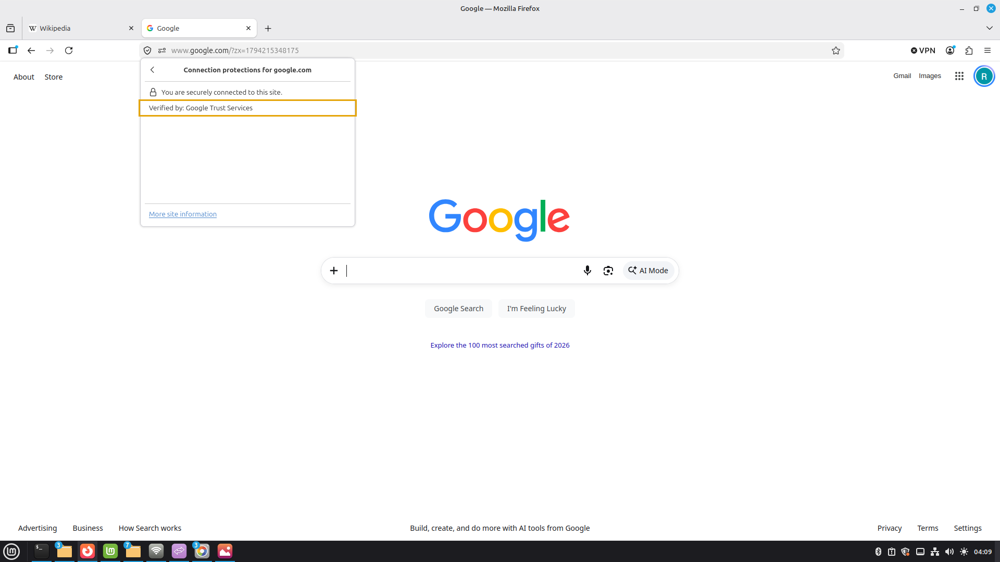
  


* **After Decryption Policy:** The browser received a re-signed certificate minted on-the-fly by the firewall:
  
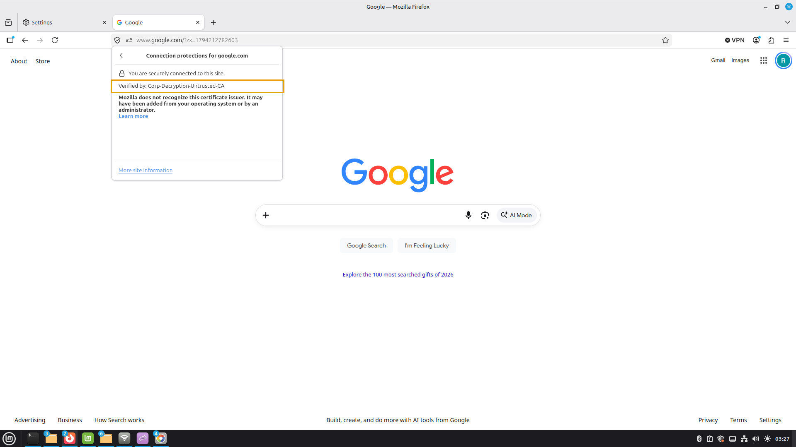


	
---

### 2. Upstream Certificate Security Enforcement (BadSSL Testbed)
To prove the firewall actively enforces cryptographic hygiene rather than blindly re-signing malicious payloads, targeted tests were executed against the `badssl.com` suite:

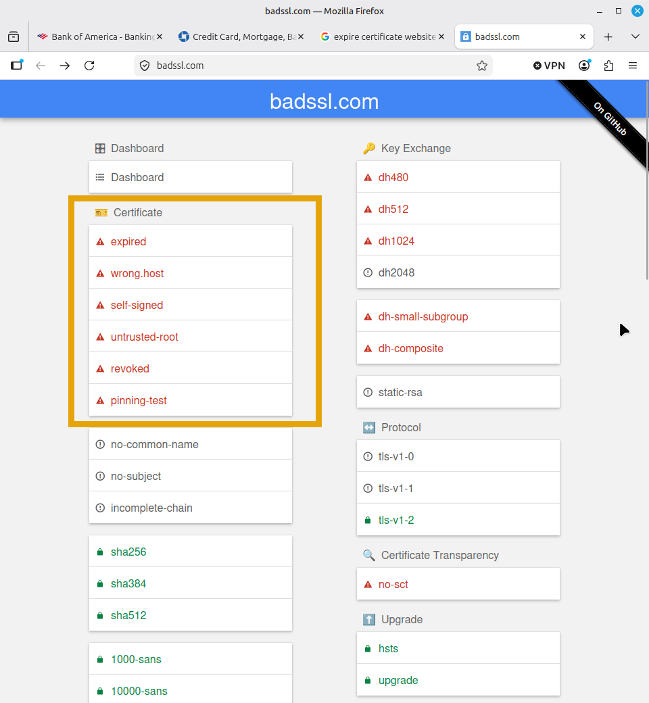

#### Test A: Untrusted Root Issuer (untrusted-root.badssl.com)
The upstream server presented a certificate issued by an unrecognized root authority. Rather than establishing a tunnel, the PA-VM intercepted the flow and served an inline security response page:

* **Status:** `untrusted`
* **Reason:** `untrusted issuer`
* **Action:** Connection dropped; corporate user presented with an un-bypassable administrative warning.


#### Test B: Expired Server Certificate (`expired.badssl.com`)
The upstream server presented an expired X.509 certificate. The PA-VM evaluated the validity timestamps against its system clock and blocked the connection:


* **Status:** `expired`
* **Reason:** `expired certificate`
* **Action:** Session terminated before cleartext delivery to the client.

---

### 3. Financial Compliance Bypass Validation (No-Decrypt Enforcement)
To verify that financial sessions were exempt from inspection, the client initiated transactions to Bank of America and Chase:

* **Bank of America (bankofamerica.com):**
 

  

  
  * **Verified By:** `DigiCert Inc` (Original public CA intact).
  * **Result:** Traffic flowed through the firewall without proxy interception, preserving end-to-end privacy.

* **Chase Bank (chase.com):**


  

  
  * **Verified By:** `DigiCert Inc` (Original public CA intact).
  * **Result:** Honored `Bypass-Finance-and-Health` rule; zero certificate substitution occurred.

---

### 4. Dataplane Flow Diagnostics & Hardware Session Audit

Running CLI diagnostics confirmed that general internet traffic was decrypted while financial traffic remained encrypted:

```text
admin@PA-VM> show session all filter ssl-decrypt yes

ID     Application   State   Type Flag  Src[Sport]/Zone/Proto (translated IP[Port])
                                        Dst[Dport]/Zone (translated IP[Port])
--------------------------------------------------------------------------------
8916   web-browsing  ACTIVE  FLOW *NS   10.10.10.10[52386]/Trust/6 (192.168.1.200[31841])
                                        52.85.61.111[443]/Untrust (52.85.61.111[443])
8575   web-browsing  ACTIVE  FLOW *NS   10.10.10.10[44238]/Trust/6 (192.168.1.200[34920])
                                        18.164.116.47[443]/Untrust (18.164.116.47[443])
8951   web-browsing  ACTIVE  FLOW *NS   10.10.10.10[50712]/Trust/6 (192.168.1.200[24775])
                                        13.32.241.49[443]/Untrust (13.32.241.49[443])
```

> **Engineering Diagnostic Nuance:** In PAN-OS, the asterisk (`*`) in the session flag column (`*NS`) indicates that the session is actively **decrypted** by the data plane. Regular NAT sessions show `NS`. Sessions with active SSL Forward Proxy show `*NS`.


#### PAN-OS Decryption Log Monitor
Inspecting **Monitor > Logs > Decryption** confirmed end-to-end session parameters:

* **Proxy Type:** `Forward`
* **Policy Name:** `Decrypt-General-Web`
* **Root Status:** `trusted`
* **Root Common Name:** Verified against authentic root anchors (e.g., `ISRG Root X1`).


---

### 5. Enabling L7 Threat Prevention Profiles

With cleartext visibility established, Layer 7 Security Profiles were attached to the production security rulebase to inspect the unencrypted stream for threats:


* **Antivirus:** `default` (Applied to HTTP, FTP, and SMB payloads).
* **Vulnerability Protection:** `default` (Inline exploit engine scanning decoded application traffic).

---

## Key Artifact Index

A curated index of the primary engineering proofs, telemetry audits, and verification artifacts:

| Artifact File | Category | Technical Proof & Validation |
| :--- | :--- | :--- |
| **`certificate-overview.png`** | PKI Infrastructure | Table of local CAs confirming Forward Trust and Forward Untrust usage flags. |
| **`decryption-profile.png`** | Security Profile | Profile enforcing TLS 1.2+ minimums and hard drops on expired/untrusted certs. |
| **`creating-custom-bank-url-filtering.png`** | Object Config | Definition of `Bank-NoDecrypt` custom URL category containing 51 banking domains. |
| **`policies-decryption-overview.png`** | Policy Config | Production decryption policy hierarchy displaying bypass rules preceding catch-all decrypt. |
| **`google-ca-details-before.png`** | Baseline Test | Browser certificate detail proving uninspected upstream cert (`Google Trust Services`). |
| **`google-ca-details-after.png`** | Primary Proof | Browser certificate detail verifying local proxy CA re-signing. |
| **`bad-ssl-untrusted.png`** | Threat Prevention | Inline PAN-OS block page proving termination of untrusted root certificates. |
| **`bad-ssl-test-expired-ca.png`** | Threat Prevention | Inline PAN-OS block page proving termination of expired SSL server certificates. |
| **`bank-of-america-ca-details.png`** | Compliance Proof | Certificate verification proving Bank of America was bypassed and untouched. |
| **`chase-ca-details.png`** | Compliance Proof | Certificate verification proving Chase was bypassed with public DigiCert CA intact. |
| **`show-session-ssl-decrypt-yes.png`** | Dataplane CLI | Session table confirming active decryption indicated by the `*NS` flow flag. |
| **`monitor-decryption-overview.png`** | Telemetry Log | Decryption log view auditing proxy type, policy match, and root trust status. |
| **`antivirus-addition.png`** | Threat Architecture | Attaching Antivirus and Vulnerability profiles to inspect cleartext streams. |

---
