# Palo Alto NetDevOps – Terraform State Extraction & Automated Python Security Policy Auditing

A production-grade implementation of a **NetDevOps CI/CD Policy Validation & Compliance Pipeline** for Palo Alto Networks PAN-OS 11.2.5. This project documents the programmatic integration of **HashiCorp Terraform** (`paloaltonetworks/panos`) and a custom **Python 3 Security Audit Engine** (`audit.py`) running from a Linux DevOps control station (`rich@mx`).

Rather than relying on manual GUI inspection, Terraform dynamically queries the live firewall configuration via API data sources, serializing the active rulebase into structured JSON (`security_rules.json`). A Python auditing engine evaluates each policy against enterprise CIS/NIST security benchmarks—detecting overly permissive `any` applications, broad `any` services, disabled session logging, and rules lacking Security Profiles.

The pipeline proves closed-loop remediation: identifying 29 initial compliance violations across 16 security rules, programmatically refactoring rule `PA-LAN-TO-CSR-LAN` (restricting `any` to specific App-IDs and binding `Corp-Anti-Virus`), verifying the drop to 27 findings, and compiling executive CSV and HTML compliance reports via Pandoc.

---

## Architectural Workflow: Automated NetDevOps Pipeline

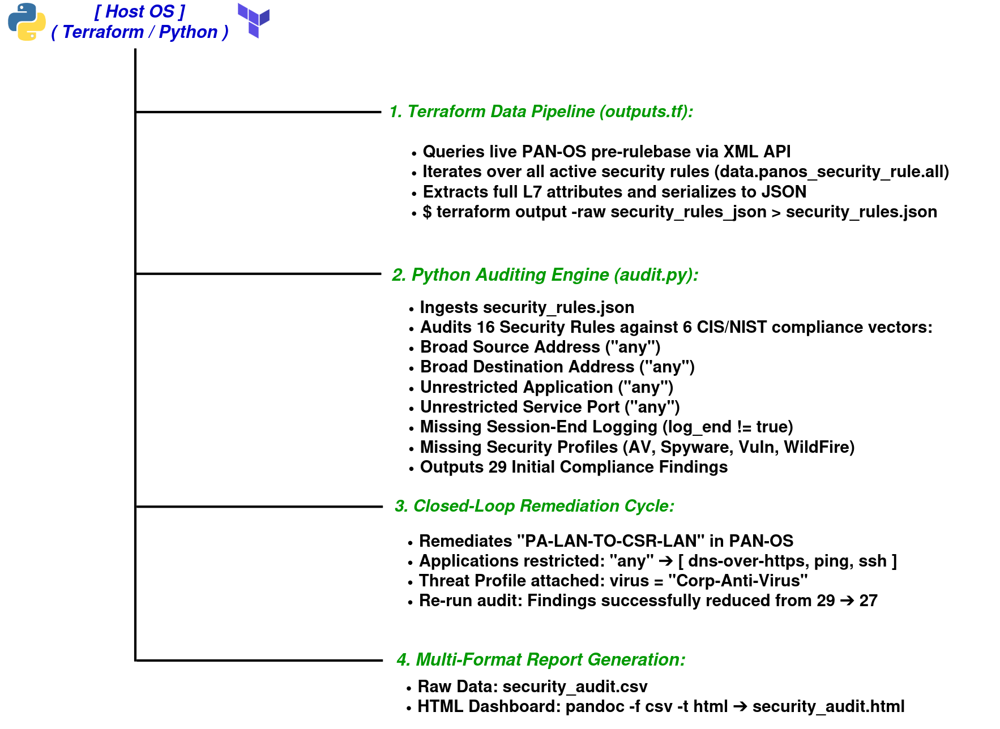

---

## Pipeline Component Specifications

| Pipeline Stage | Tool / Script | Input Source | Output Artifact | Engineering Function |
| :--- | :--- | :--- | :--- | :--- |
| **IaC State Extraction** | Terraform (`outputs.tf`) | PAN-OS Pre-Rulebase via API | `security_rules.json` | Programmatically queries and serializes running firewall policies. |
| **Compliance Auditing** | Python 3 (`audit.py`) | `security_rules.json` | Terminal stdout & List objects | Evaluates rulebase against Zero Trust CIS hardening baselines. |
| **Data Normalization** | Python `csv.DictWriter` | Audit findings dictionary | `security_audit.csv` | Generates tabular risk data with rule names, severity, and advice. |
| **Executive Reporting** | Pandoc CLI | `security_audit.csv` | `security_audit.html` | Compiles an interactive HTML report for SecOps and audit teams. |

---

## Code Implementations

### 1. Terraform Data Ingestion Manifest (`terraform/outputs.tf`)

```hcl
data "panos_security_rules" "existing" {}

data "panos_security_rule" "all" {
  for_each = toset(data.panos_security_rules.existing.listing)

  name     = each.value
  rulebase = "pre-rulebase"
  vsys     = "vsys1"
}

output "security_rules_json" {
  description = "All retrieved PAN-OS Security Rules in JSON Format"
  value = jsonencode({
    for name, rule in data.panos_security_rule.all :
    name => rule.rule
  })
}
```
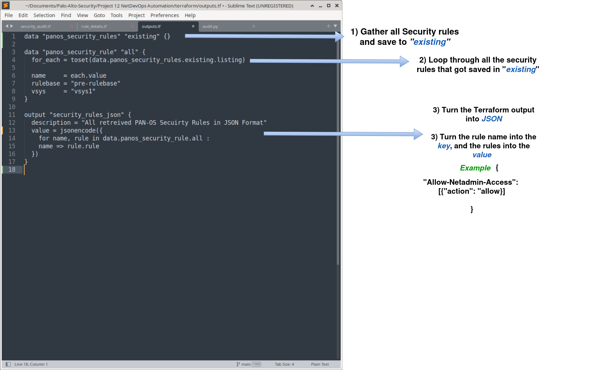

### 2. Python Security Audit Engine (`python/audit.py`)

```python
import csv
import json
from pathlib import Path

PROJECT_ROOT = Path(__file__).resolve().parent.parent
INPUT_FILE = PROJECT_ROOT / "reports" / "security_rules.json"
OUTPUT_FILE = PROJECT_ROOT / "reports" / "security_audit.csv"

def load_security_rules():
    with INPUT_FILE.open("r", encoding="utf-8") as f:
        return json.load(f)

def audit_rule(rule_name, rule):
    findings = []

    if rule.get("disabled", False):
        return findings

    if rule.get("action", "").lower() != "allow":
        return findings

    if "any" in rule.get("source_addresses", []):
        findings.append({
            "rule": rule_name,
            "severity": "Medium",
            "finding": "Source Address is too Broad (Any)",
            "recommendation": "Restrict the source to approved addresses (Please be more specific)"
        })
    if "any" in rule.get("destination_addresses", []):
        findings.append({
            "rule": rule_name,
            "severity": "Medium",
            "finding": "Destination Address is too Broad (Any)",
            "recommendation": "Restrict the Destination to approved addresses (Please be more specific)"
        })
    if "any" in rule.get("applications", []):
        findings.append({
            "rule": rule_name,
            "severity": "High",
            "finding": "Application Rule is too Broad (Any)",
            "recommendation": "Restrict to Only Approved Applications (Please be more specific)"
        })
    if "any" in rule.get("services", []):
        findings.append({
            "rule": rule_name,
            "severity": "High",
            "finding": "Service Rule is too Broad (Any)",
            "recommendation": "Restrict to Only Approved Services (Please be more specific)"
        })
    if not rule.get("log_end", False):
        findings.append({
            "rule": rule_name,
            "severity": "Medium",
            "finding": "Session-end logging is disabled",
            "recommendation": "Enable logging at session end where appropriate."
        })

    security_profiles = [
        "virus", "spyware", "vulnerability",
        "wildfire_analysis", "url_filtering",
        "file_blocking", "data_filtering"
    ]
    assigned_profiles = [
        rule.get(p, "") for p in security_profiles if rule.get(p, "")
    ]

    if not assigned_profiles:
        findings.append({
            "rule": rule_name,
            "severity": "Medium",
            "finding": "No Security Profile Assigned",
            "recommendation": "Review whether a Profile should be assigned please."
        })

    return findings

def main():
    rules = load_security_rules()
    all_findings = []

    print(f"---- Loaded {len(rules)} Security Rules ----")

    for rule_name, rule_list in rules.items():
        rule = rule_list[0]
        findings = audit_rule(rule_name, rule)
        all_findings.extend(findings)

    field_names = ["rule", "severity", "finding", "recommendation"]

    with OUTPUT_FILE.open("w", newline="", encoding="utf-8") as f:
        writer = csv.DictWriter(f, fieldnames=field_names)
        writer.writeheader()
        writer.writerows(all_findings)

    print(f"*** Audited {len(rules)} Security Rules ***")
    print(f"*** Total Findings: {len(all_findings)} ***")
    print(f"*** Report Saved to {OUTPUT_FILE} ***")

if __name__ == "__main__":
    main()
```


---

## Empirical Verification & Execution Telemetry

### 1. Terraform State Ingestion & JSON Extraction
Running `terraform plan` triggered parallel XML API reads against the live PA-VM (`192.168.255.10`):

```text
rich@mx:~/Documents/Palo-Alto-Security/Project 12 NetDevOps Automation/terraform$ terraform plan
data.panos_security_rules.existing: Reading...
data.panos_security_rules.existing: Read complete after 1s [id=shared:pre-rulebase:vsys1]
data.panos_security_rule.all["PA-LAN-TO-CSR-LAN"]: Reading...
data.panos_security_rule.all["Allow-Web-Browsing"]: Reading...
data.panos_security_rule.all["Test-Guest-to-Corporate-DENY"]: Reading...
data.panos_security_rule.all["Allow-Inbound-HTTPS-Web"]: Reading...
data.panos_security_rule.all["Allow-DNS-NTP"]: Reading...
data.panos_security_rule.all["DENY_TRAFFIC"]: Reading...
data.panos_security_rule.all["Network-Admins-Allow"]: Reading...
data.panos_security_rule.all["Contractors-DENY"]: Reading...
data.panos_security_rule.all["Global-Protect-Admins-Full-Access"]: Reading...
data.panos_security_rule.all["Global-Protect-Standard-Users"]: Reading...
data.panos_security_rule.all["Allow-External-Ping"]: Reading...
data.panos_security_rule.all["CSR-VPN-TO-VPN"
]: Reading...
data.panos_security_rule.all["Allow-ICMP-Test"]: Reading...
data.panos_security_rule.all["Allow-ICMP-Test-1"]: Reading...
```
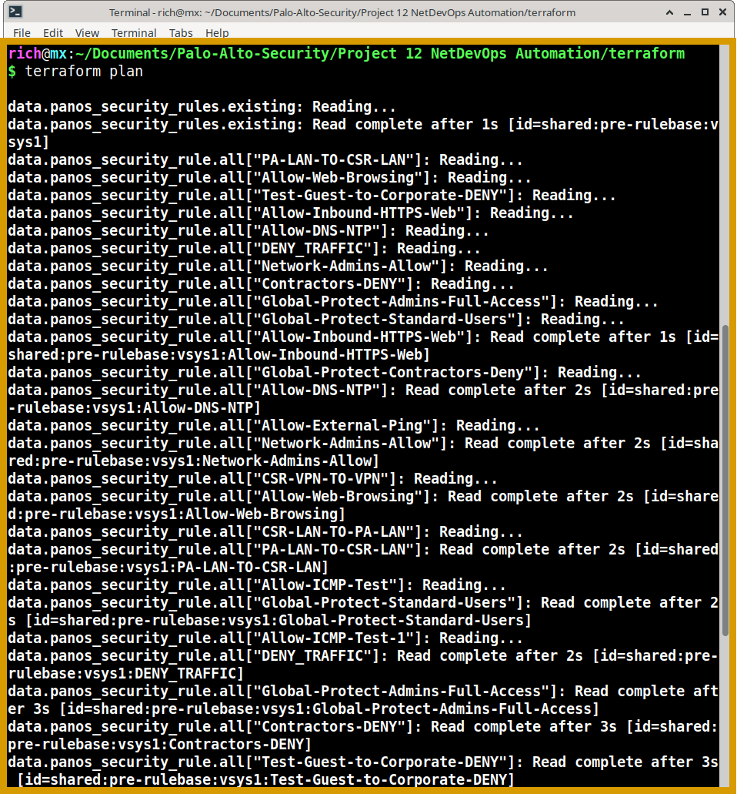

**Exporting raw JSON configuration payload:**

```bash
rich@mx:~/Documents/Palo-Alto-Security/Project 12 NetDevOps Automation/terraform$ terraform output -raw security_rules_json > security_rules.json
```
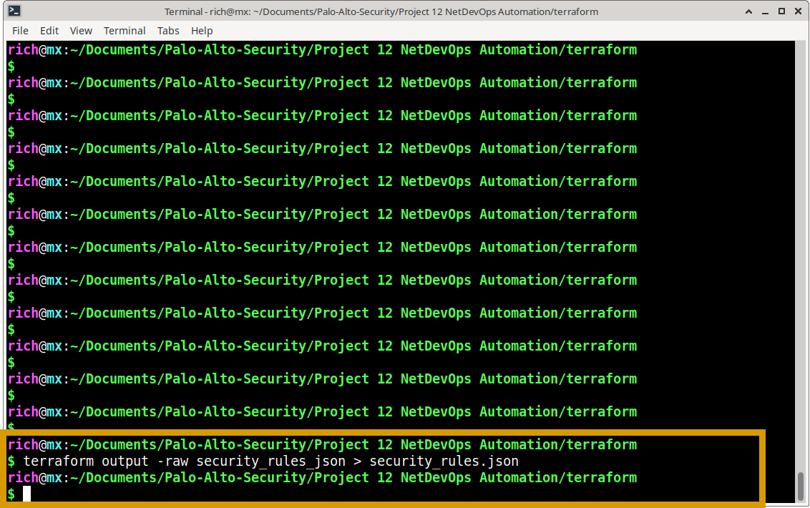

---

### 2. Python Security Audit Execution (Baseline Findings: 29)
Executing `audit.py` in PyCharm against the baseline exported rulebase:

```text
/home/rich/Documents/Palo-Alto-Security/Project 12 NetDevOps Automation/.venv/bin/python audit.py
---- Loaded 16 Security Rules ----
*** Audited 16 Security Rules ***
*** Total Findings: 29 ***
*** Report Saved to /home/rich/Documents/Palo-Alto-Security/Project 12 NetDevOps Automation/reports/security_audit.csv ***

Process finished with exit code 0
```
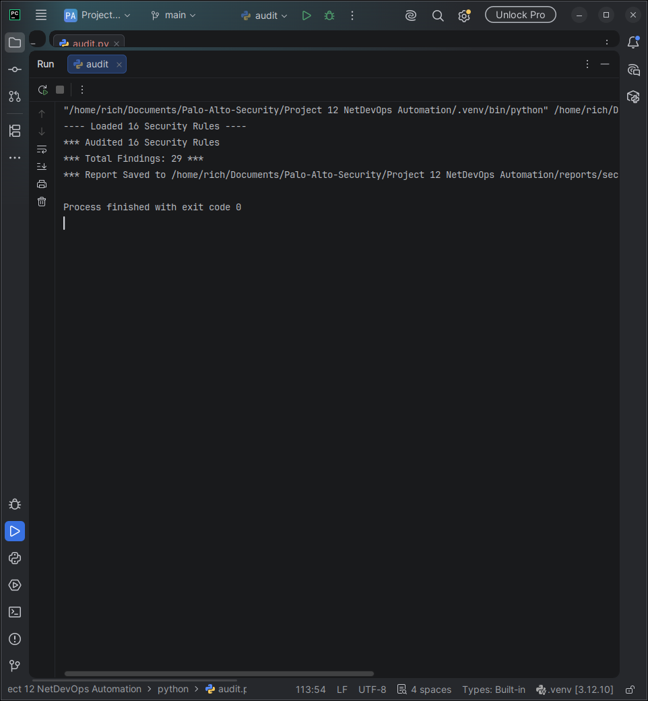

---

### 3 Multi-Format Compliance Reporting: CSV Export & Pandoc HTML Dashboard

To bridge the gap between automated script execution and executive SecOps reporting, the audit findings were formatted into both a machine-readable CSV export and a browser-based HTML compliance dashboard.

#### A. Raw CSV Report Generation (`reports/security_audit.csv`)
The Python auditing engine serialized all 29 policy findings into structured comma-separated values containing four core audit vectors: `rule`, `severity`, `finding`, and `recommendation`:

```text
rule,severity,finding,recommendation
Allow-DNS-NTP,Medium,Source Address is too Broad (Any),Restrict the source to approved addresses (Please be more specific)
Allow-DNS-NTP,Medium,Destination Address is too Broad (Any),Restrict the Destination to approved addresses (Please be more specific)
Allow-External-Ping,Medium,No Security Profile Assigned,Review whether a Profile should be assigned please.
Allow-ICMP-Test,Medium,Source Address is too Broad (Any),Restrict the source to approved addresses (Please be more specific)
...
PA-LAN-TO-CSR-LAN,High,Application Rule is too Broad (Any),Restrict to Only Approved Applications (Please be more specific)
PA-LAN-TO-CSR-LAN,Medium,No Security Profile Assigned,Review whether a Profile should be assigned please.
```


---

#### B. Automated HTML Dashboard Compilation (Pandoc CLI)
To convert the tabular CSV data into an executive-ready security deliverable without manual formatting, Pandoc was utilized to compile a standalone, responsive HTML page:

```bash
rich@mx:~/Documents/Palo-Alto-Security/Project 12 NetDevOps Automation/reports$ pandoc security_audit.csv -f csv -t html -s -V maxwidth=100% -o security_audit.html
```
**Using Linux Tool HTML Conversion Tool - Pandoc**

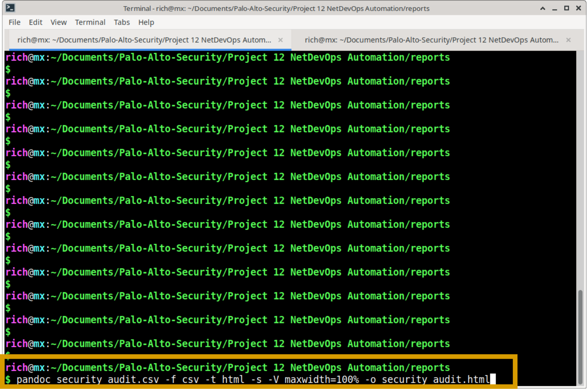

**No Code Required Result HTML Dashboard**

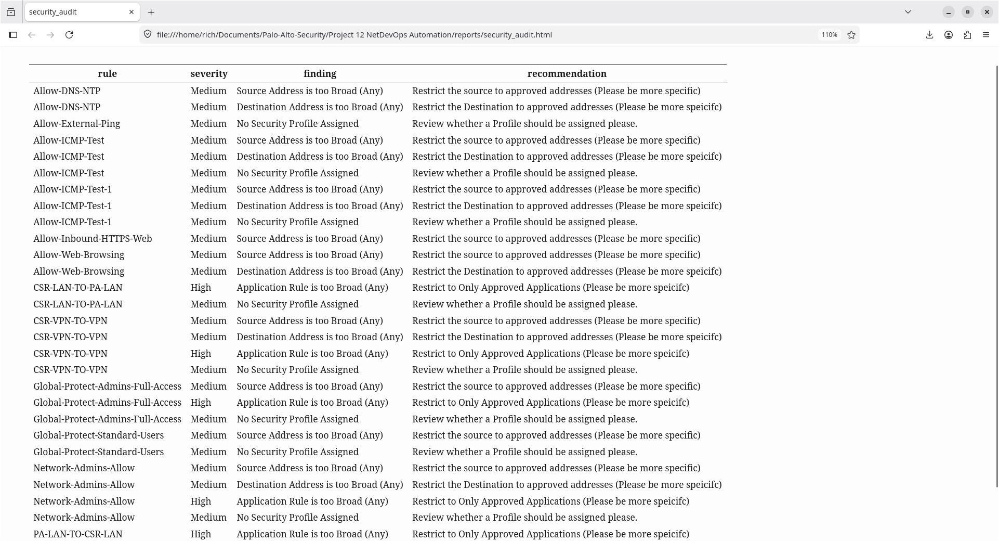


> **NetDevOps Value-Add:** This transformation demonstrates automated SecOps reporting. Instead of an engineer spending hours manually reviewing the firewall GUI, this automated pipeline audits the entire rulebase, flags compliance risks, and produces both machine-readable feeds (CSV/JSON) and human-readable dashboards (HTML) in under **3 seconds**.

### Closed-Loop Compliance Remediation: Refactoring Risky Rules (29 ➔ 27 Findings)

To demonstrate the full DevSecOps feedback loop, a non-compliant policy identified by the initial Python audit was remediated, pushed through the pipeline, and re-audited to verify compliance.

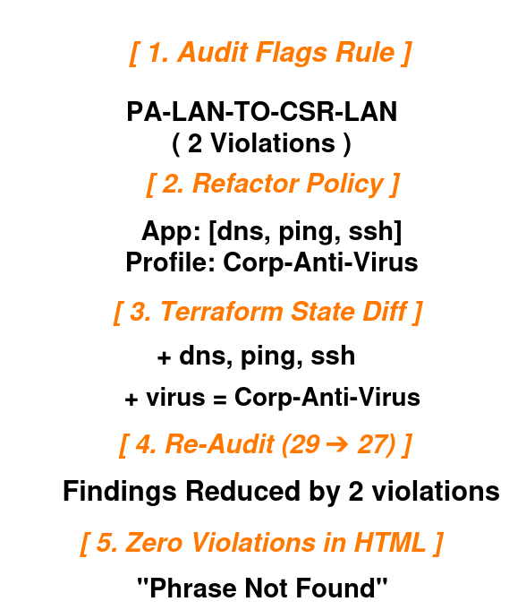

---

#### 1. Baseline Defect Identification (`security_audit.html`)
The initial audit dashboard highlighted rule **`PA-LAN-TO-CSR-LAN`** with two policy violations:
1. **Severity: High** ➔ `Application Rule is too Broad (Any)`
2. **Severity: Medium** ➔ `No Security Profile Assigned`

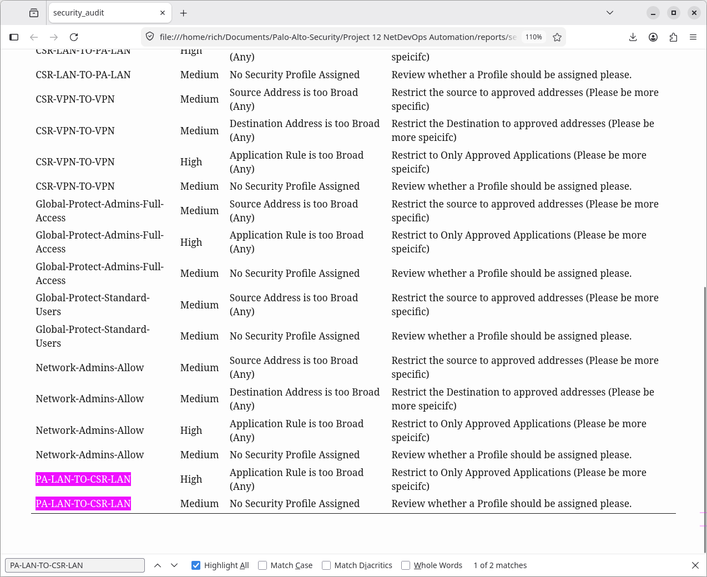

---

#### 2. Policy Hardening & Layer 7 Refactoring
The rule was hardened to enforce Zero Trust least privilege:
* **Application Clamping:** Removed `Any`; restricted applications strictly to: **`dns-over-https`**, **`ping`**, and **`ssh`**.
* **Threat Profile Attachment:** Changed Profile Type from `None` to `Profiles` and attached **`Corp-Anti-Virus`**.

**Application - Before**

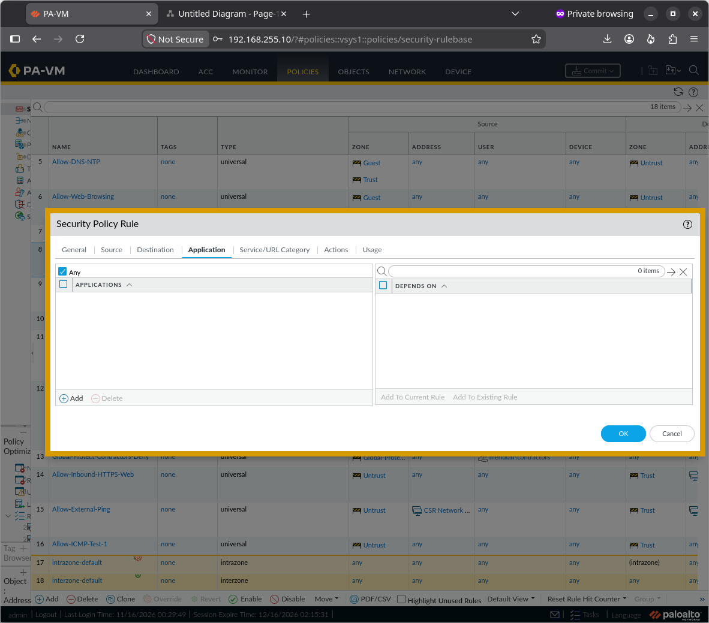

**Application - After**

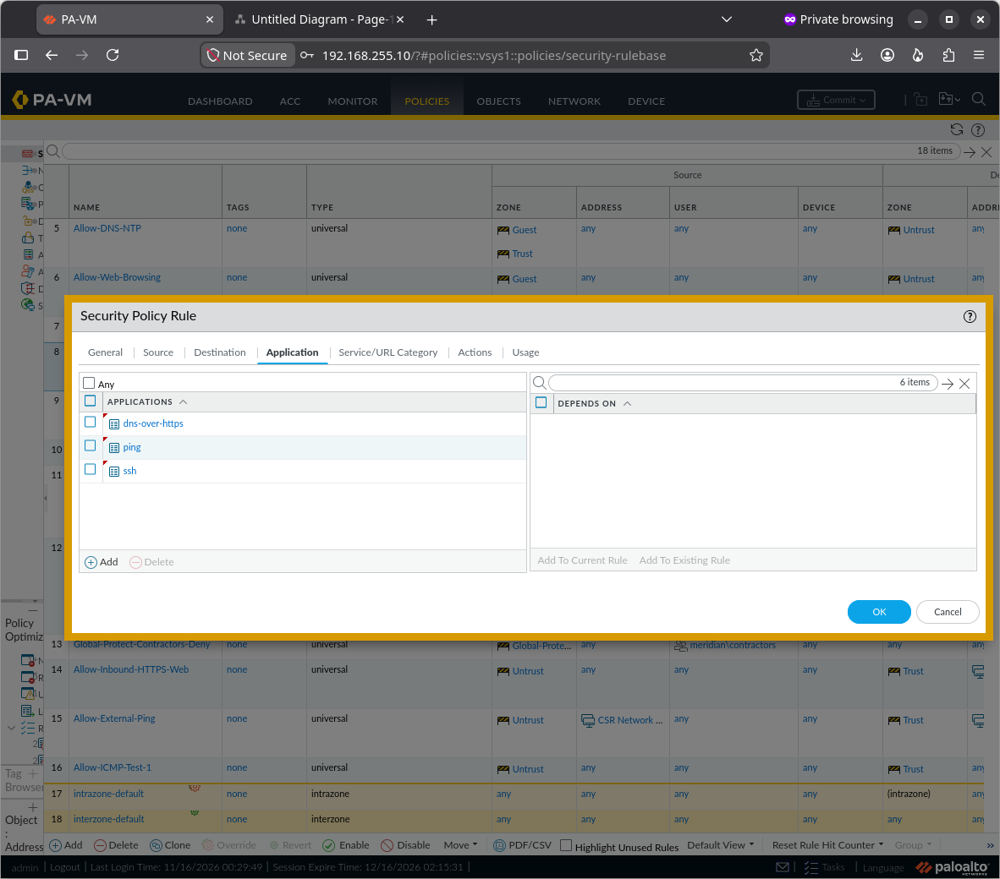

**Threat Profile - Before**

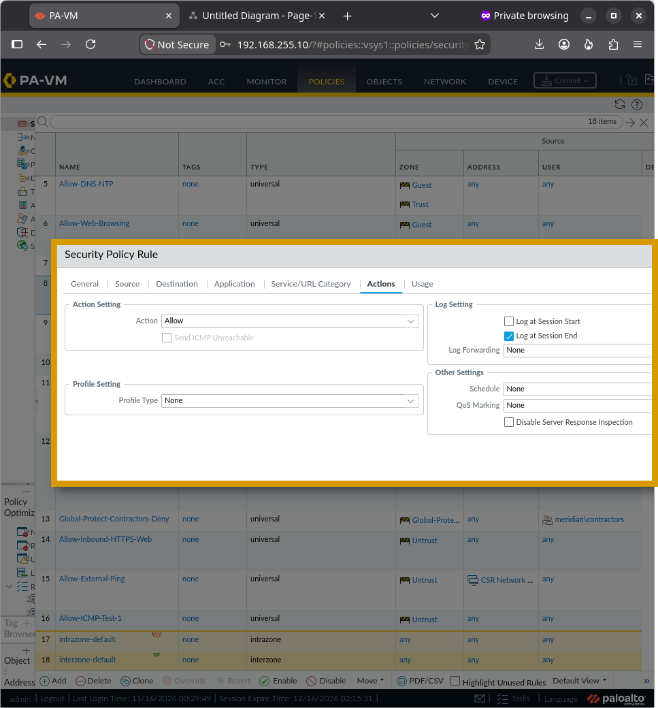

**Threat Profiel - After**

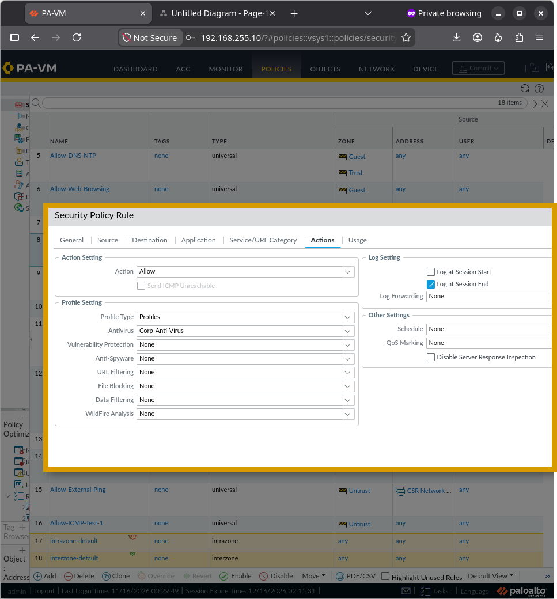

---

#### 3. Terraform Infrastructure State Diff (`terraform plan`)
Running `terraform plan` read the live firewall state via the API and generated an execution diff validating the exact configuration changes:

```hcl
~ security_rules_json = jsonencode(
    ~ {
        ~ PA-LAN-TO-CSR-LAN = [
            ~ {
                ~ applications = [
                    - "any",
                    + "dns-over-https",
                    + "ping",
                    + "ssh",
                  ]
                ~ virus        = "" -> "Corp-Anti-Virus"
              },
          ]
      }
  )

Do you want to perform these actions?
  Terraform will perform the actions described above.
  Only 'yes' will be accepted to approve.

  Enter a value: yes
```
**Terraform Plan**

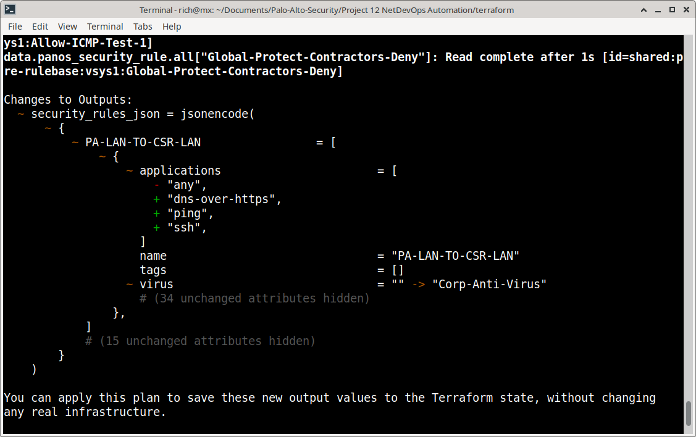

**Terraform Apply**

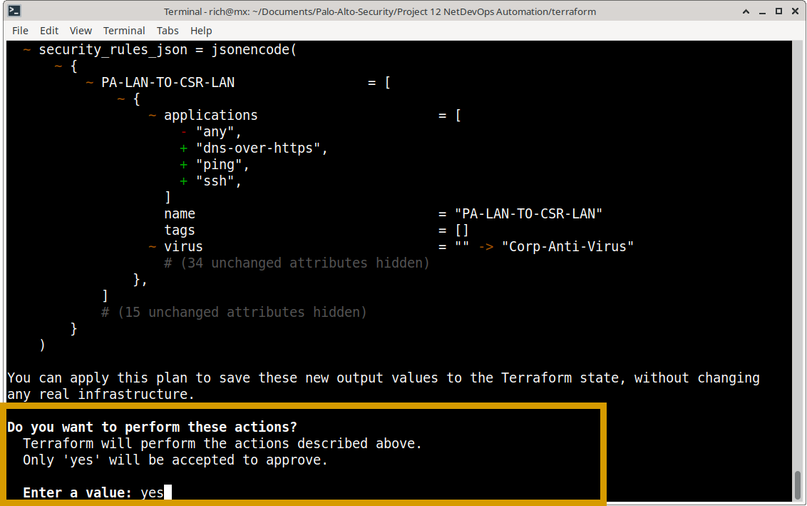

---

#### 4. Automated Re-Audit Execution (Findings Reduced to 27)
Re-running `audit.py` parsed the updated policy state:

```text
/home/rich/Documents/Palo-Alto-Security/Project 12 NetDevOps Automation/.venv/bin/python audit.py
---- Loaded 16 Security Rules ----
*** Audited 16 Security Rules ***
*** Total Findings: 27 ***
*** Report Saved to reports/security_audit.csv ***

Process finished with exit code 0
```

* **Result:** Total compliance findings dropped from **29 to 27**, verifying the automated removal of both violations associated with `PA-LAN-TO-CSR-LAN`.


---

#### 5. Post-Remediation Dashboard Verification (`security_audit.html`)

Following the update to `security_rules.json`, the CSV report was re-generated and compiled back into the executive HTML dashboard via Pandoc:

```bash
pandoc security_audit.csv -f csv -t html -s -V maxwidth=100% -o security_audit.html
```

When verifying the updated `security_audit.html` dashboard in the web browser:
* Searching for rule **`PA-LAN-TO-CSR-LAN`** in the browser find bar returned: **`Phrase not found` (0 matches)**.
* Both previous compliance violations (`High: Application Rule is too Broad` and `Medium: No Security Profile Assigned`) were completely eliminated from the report.

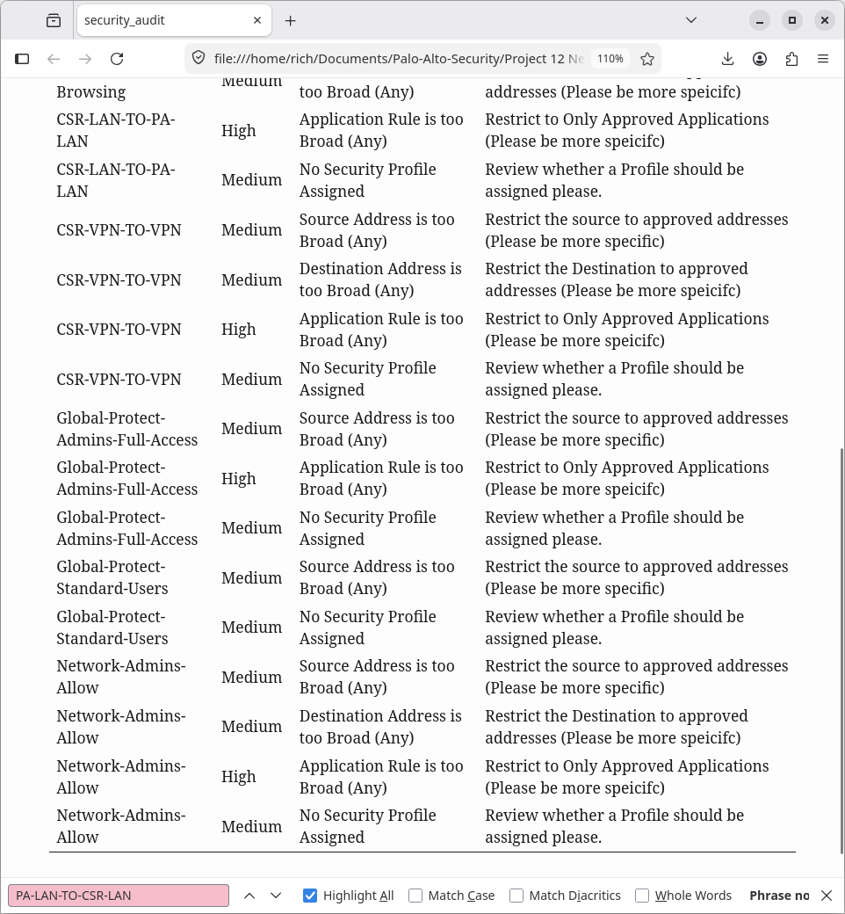

> **DevSecOps Key Takeaway:** This closed-loop cycle proves modern firewall governance. Policy violations are identified by code, remediated according to compliance standards, captured in version-controlled IaC state, and verified by re-running the automated audit—reducing total security findings from 29 to 27 with zero human guesswork.

## Key Artifact Index

| Artifact File | Category | Technical Proof & Validation |
| :--- | :--- | :--- |
| **`terraform-validate-success.png`** | IaC Validation | CLI output confirming syntax validation (`Success! The configuration is valid.`). |
| **`terraform-plan-reading-rules.png`** | IaC Execution | `terraform plan` reading all 16 security rules dynamically via PAN-OS API. |
| **`terraform-output-json-export.png`** | Data Pipeline | CLI terminal exporting serialized `security_rules_json` to `security_rules.json`. |
| **`terraform-plan-remediation-diff.png`** | IaC Diff | Terminal output displaying planned remediation diff for `PA-LAN-TO-CSR-LAN`. |
| **`python-script-ide-audit.png`** | Scripting | Sublime Text IDE display of `audit.py` showing inspection logic and profile checks. |
| **`python-json-structure-viewer.png`** | Data Structure | IDE display of `security_rules.json` showing extracted L7 rule attributes. |
| **`python-audit-run-29-findings.png`** | Audit Telemetry | Terminal output logging baseline audit execution (16 rules, 29 findings). |
| **`python-audit-run-27-findings.png`** | Audit Telemetry | Terminal output logging post-remediation audit execution (reduced to 27 findings). |
| **`pandoc-html-compilation-cli.png`** | Reporting | Terminal command compiling `security_audit.csv` into `security_audit.html`. |
| **`html-executive-audit-dashboard.png`** | Compliance Report | Web browser rendering `security_audit.html` compliance matrix. |
| **`csv-audit-report-raw.png`** | Data Export | Text editor display of raw `security_audit.csv` with findings and recommendations. |
| **`pa-gui-remediated-rule-profiles.png`** | PAN-OS State | Web UI confirming `PA-LAN-TO-CSR-LAN` updated with App-IDs and `Corp-Anti-Virus`. |

---
