# Classified DoS Protection Profiles – Per-Source Threat Mitigation & Targeted Resource Defense

A production-grade implementation of **Classified Denial of Service (DoS) Protection** and per-source rate limiting on Palo Alto Networks PAN-OS 11.2.5. This project documents the design, deployment, and live attack validation of targeted resource protection defending an internal production web application (**`MERIDIAN-WEB1` published on VIP `192.168.1.201:443`**).

While Zone Protection Profiles (Project 05) defend entire security zones using aggregate thresholds, **Classified DoS Protection** enforces granular, stateful connection tracking **per unique Source IP address**. By setting precise alarm (`50 cps`), activate (`100 cps`), and maximal (`200 cps`) thresholds, the firewall monitors individual client velocity. When an external attacker (`192.168.1.100`) launches a high-frequency TCP SYN flood, the firewall automatically quarantines the offending IP for **300 seconds**, dropping attack packets at the hardware ingress ring while legitimate traffic remains unaffected.

Every phase—from baseline latency verification (20 sequential HTTP 200 responses in <22ms) and volumetric SYN flood saturation (scaling to 98%–100% packet loss) to hardware DoS rule statistics (`show dos-protection rule Protect-Meridian-Web1 statistics`) and post-attack connection timeouts (136,004 ms drop)—was verified across the data plane.

**Live Execution of PC being blocked from sending traffic after flood**

---

## Architecture & Classified DoS Mitigation Pipeline

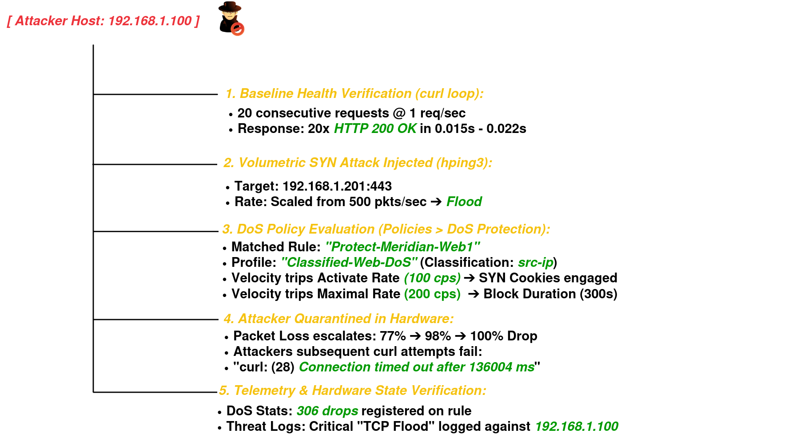

---

## Architectural Comparison: Zone Protection vs. Classified DoS

| Technical Capability | Zone Protection Profile (Project 05) | Classified DoS Protection (Project 14) |
| :--- | :--- | :--- |
| **Enforcement Point** | Entire Security Zone (`Network > Zones`) | Granular Policy Rule (`Policies > DoS Protection`) |
| **Tracking Method** | **Aggregate:** Combines all traffic in the zone | **Classified:** Evaluates rates **per unique Source IP** |
| **Threshold Tuning** | Tuned to higher threshold (`2000/3000/5000 cps`) | Tuned to tight server limits (`50/100/200 cps`) |
| **Mitigation Risk** | High flood volume risks dropping valid users | **Zero Collateral Damage:** Only the abusive IP is blocked |
| **Protected Target** | Firewall CPU, packet buffers, and interfaces | Specific application sockets (e.g., `192.168.1.201:443`) |

---

## Multi-Phase Implementation

### Phase 1: Configure the Classified DoS Profile
Defined per-source connection velocity limits:
* Navigate to **Objects > Security Profiles > DoS Protection** > Click **Add**:
  * **Profile Name:** `Classified-Web-DoS`
  * **Type:** Select **`Classified`**
  * **SYN Flood Protection:**
    * Check: **`Enable`** | Action: **`SYN Cookies`**
    * **Alarm Rate:** `50 connections/sec`
    * **Activate Rate:** `100 connections/sec`
    * **Maximal Rate:** `200 connections/sec`
    * **Block Duration:** `300 seconds` (5-minute automated IP quarantine)

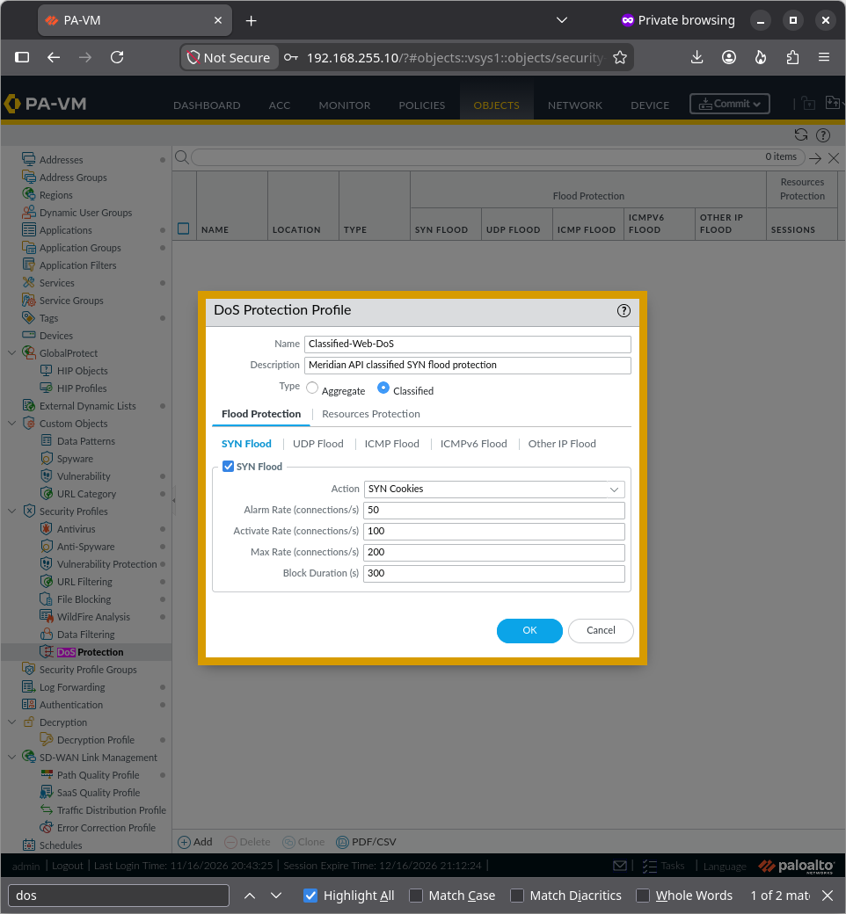

### Phase 2: Deploy the DoS Protection Policy Rule
Attached the profile to inspect inbound web traffic destined for the public VIP:
* Navigate to **Policies > DoS Protection** > Click **Add**:
  * **Name:** `Protect-Meridian-Web1`
  * **Source:** Zone: `Untrust` | Address: `any`
  * **Destination:** Zone: `Untrust` (and `Trust`) | Address: `192.168.1.201`
  * **Service:** `service-https` (TCP 443)
  * **Action:** **`Protect`**
  * **Protection Settings:**
    * Classified Profile: **`Classified-Web-DoS`**
    * Classified By: **`source-ip-only`**

**DoS Protection Policy - General**

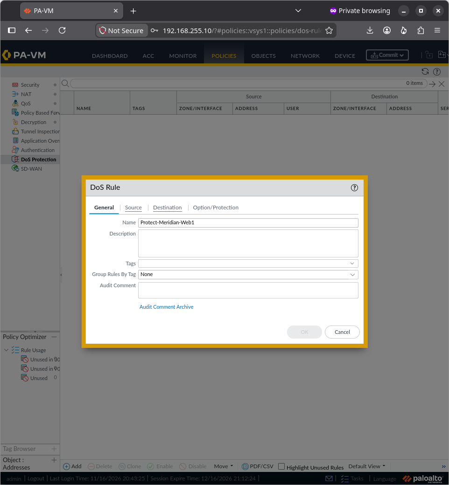

**DoS Protection Policy - Source**

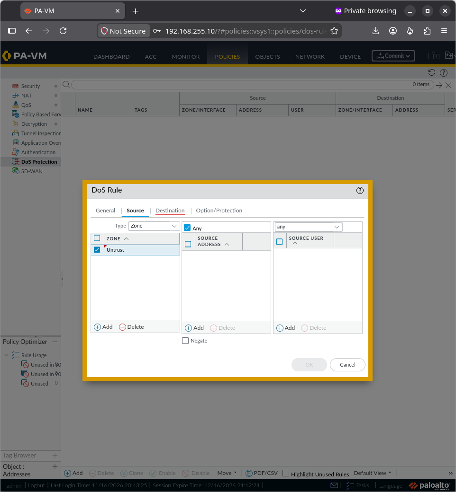

**DoS Protection Policy - Destination**

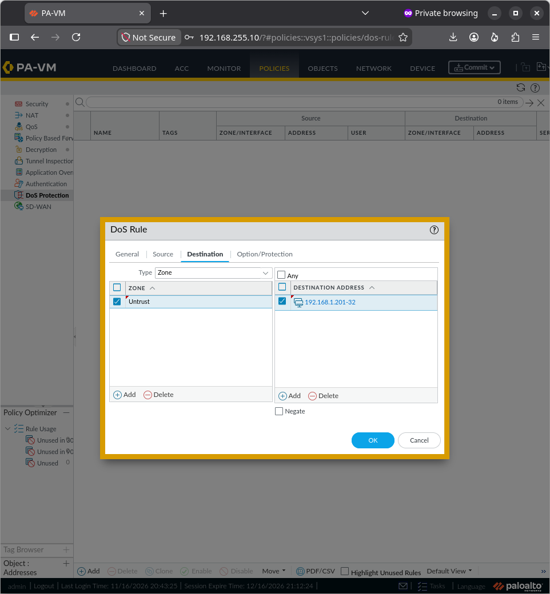

**DoS Protection Policy - Option**

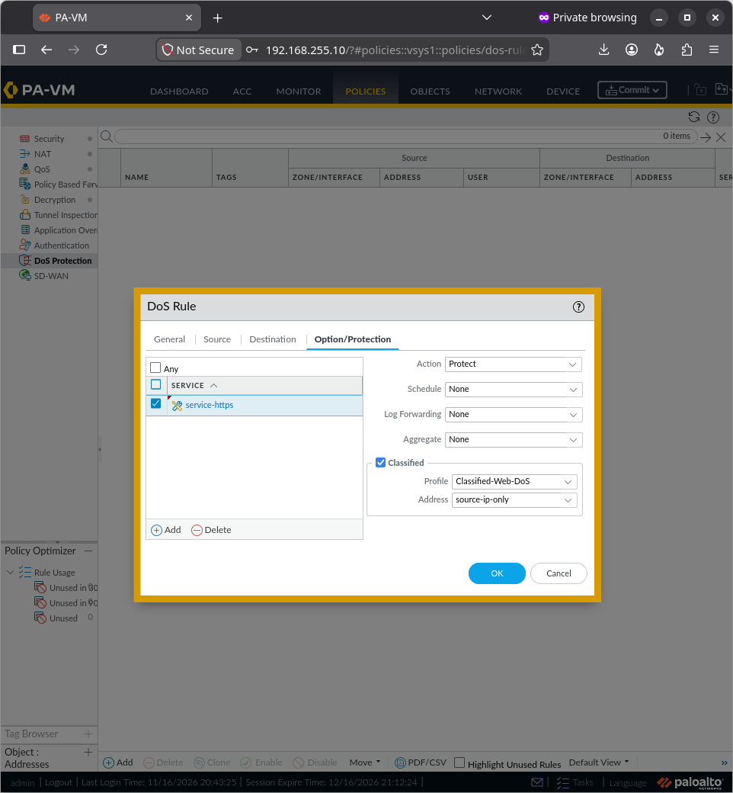

### Phase 3: Perimeter Zone Protection Threshold Calibration
To ensure the granular Classified DoS policy evaluates incoming attacks without being preempted by aggregate zone drops, the perimeter Zone Protection profile (`Corp-Perimeter-Zone-Protection`) was calibrated:
* **SYN Flood Alarm:** `2000 cps` | **Activate:** `3000 cps` | **Maximal:** `5000 cps`

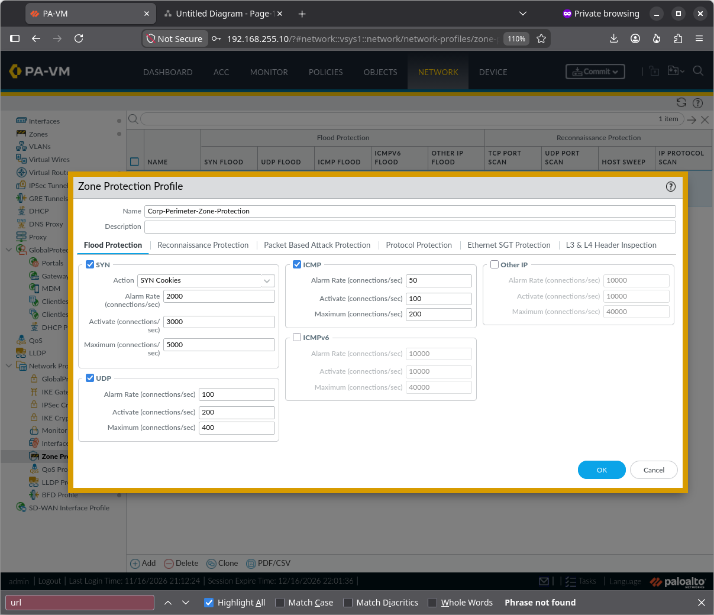

---

## Empirical Verification & Data-Plane Proof

### 1. Baseline Health Verification (Legitimate Workload)

Prior to launching attack traffic, legitimate baseline access was audited from the client (`192.168.1.100`) using an automated bash loop:

```bash
rich@rich-iMac:~$ for i in {1..20}; do
    curl -sk -o /dev/null -w "Request $i: HTTP %{http_code} | %{time_total}s\n" https://192.168.1.201/
    sleep 1
done
Request 1:  HTTP 200 | 0.016888s
Request 2:  HTTP 200 | 0.021493s
Request 3:  HTTP 200 | 0.020972s
Request 4:  HTTP 200 | 0.022178s
...
Request 20: HTTP 200 | 0.019802s
```
* **Observed Metrics:** All 20 requests succeeded with **HTTP 200 OK** in sub-22ms round-trip times.
* **Traffic Log Verification:** Monitored sessions showed `Application: ssl`, `Action: allow`, `Rule: Allow-Inbound-HTTPS-Web`, and `Session End Reason: tcp-fin` with 4.4 KB exchanged per flow.

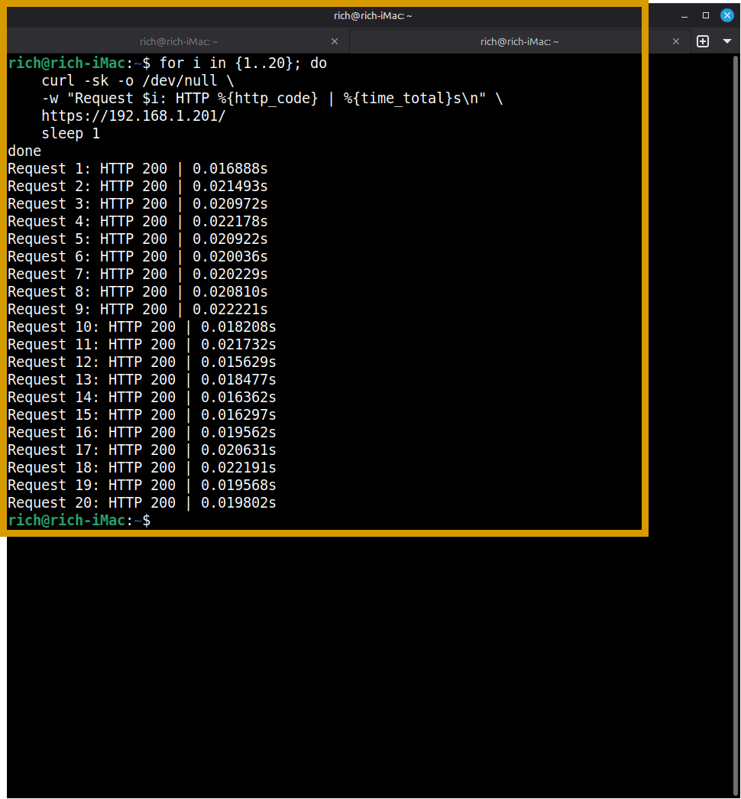

---

### 2. High-Frequency TCP SYN Attack Simulation (`hping3`)

An aggressive TCP SYN flood was launched from `192.168.1.100` targeting destination port 443:

```bash
rich@rich-iMac:~$ sudo hping3 -S -p 443 -c 5000 192.168.1.201
HPING 192.168.1.201 (enp2s0 192.168.1.201): S set, 40 headers + 0 data bytes
```


#### Progressive Mitigation & Rate Clamping
As the attack velocity exceeded the 100 cps activate rate and pushed past the 200 cps maximal ceiling, the firewall's per-source tracker engaged:

```text
--- 192.168.1.201 hping statistic ---
6103 packets transmitted, 159 packets received, 98% packet loss
--- 192.168.1.201 hping statistic ---
11118 packets transmitted, 0 packets received, 100% packet loss
--- 192.168.1.201 hping statistic ---
3387 packets transmitted, 0 packets received, 100% packet loss
--- 192.168.1.201 hping statistic ---
3459 packets transmitted, 0 packets received, 100% packet loss
```

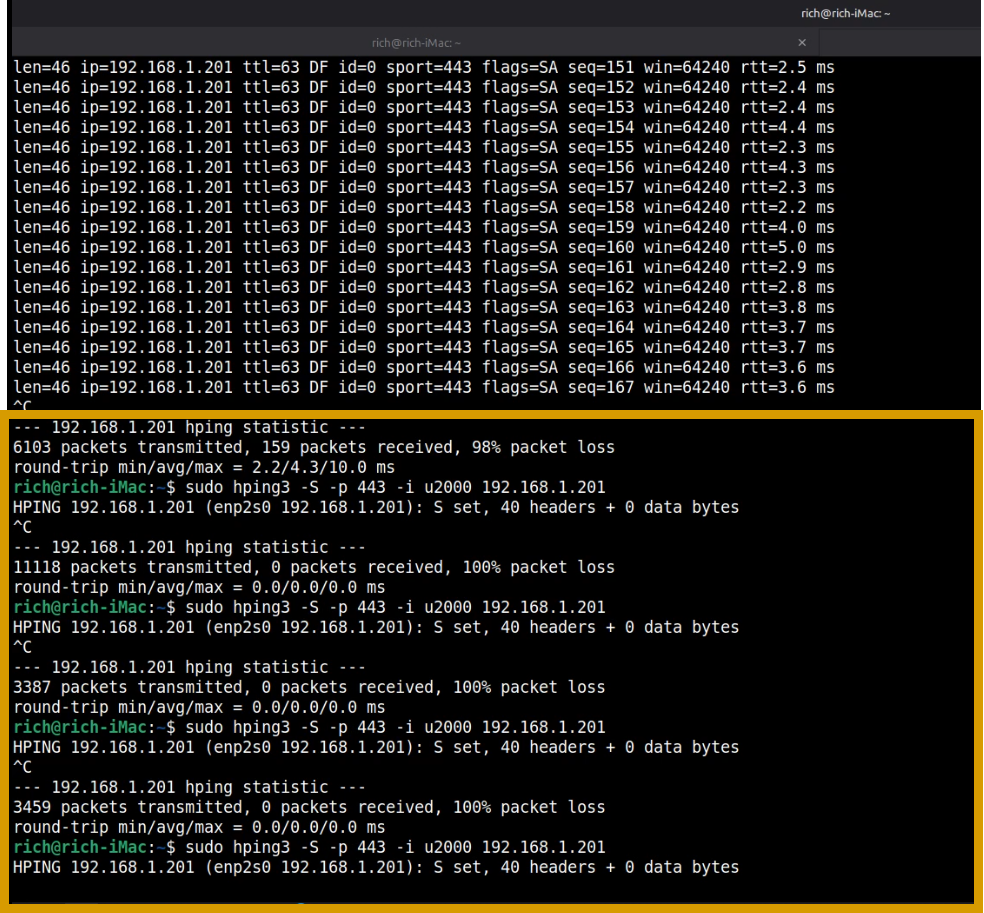

---

### 3. Post-Attack Attacker Quarantine Proof

While `192.168.1.100` was quarantined under the 300-second block duration, the host attempted to initiate a standard HTTPS curl request:

```bash
rich@rich-iMac:~$ curl -k -v https://192.168.1.201/
*   Trying 192.168.1.201:443...
* connect to 192.168.1.201 port 443 from 192.168.1.100 port 38496 failed: Connection timed out
* Failed to connect to 192.168.1.201 port 443 after 136004 ms: Couldn't connect to server
curl: (28) Failed to connect to 192.168.1.201 port 443 after 136004 ms: Couldn't connect to server
```

* **Quarantine Proof:** The attacker connection timed out after **136,004 ms**. The firewall dropped the initial TCP SYN at ingress without replying, neutralizing the attacker entirely.

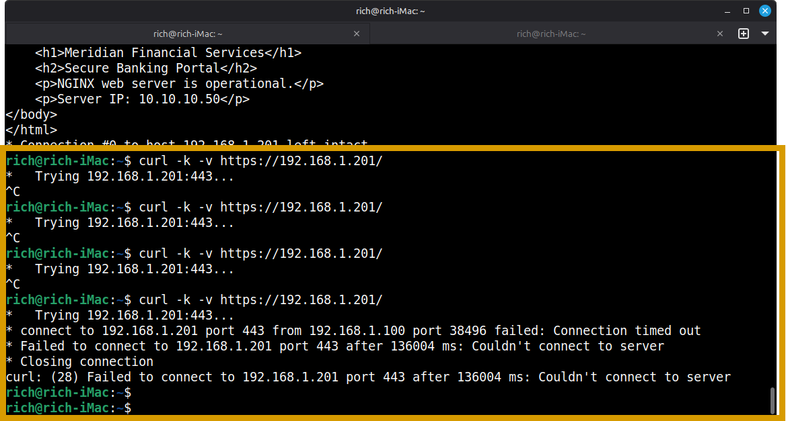

---

### 4. Hardware Telemetry & DoS Rule Statistics

#### Active DoS Policy Runtime Inspection (`show running dos-policy`)
```text
admin@PA-VM> show running dos-policy

"Protect-Meridian-Web1; index: 1" {
        from Untrust;
        source any;
        source-region none;
        to Untrust;
        destination 192.168.1.201;
        destination-region none;
        user any;
        service 0:tcp/any/443;
        action protect;
        aggregate-profile ;
        classified-profile Classified-Web-DoS;
        classification src-ip;
        terminal no;
}
```
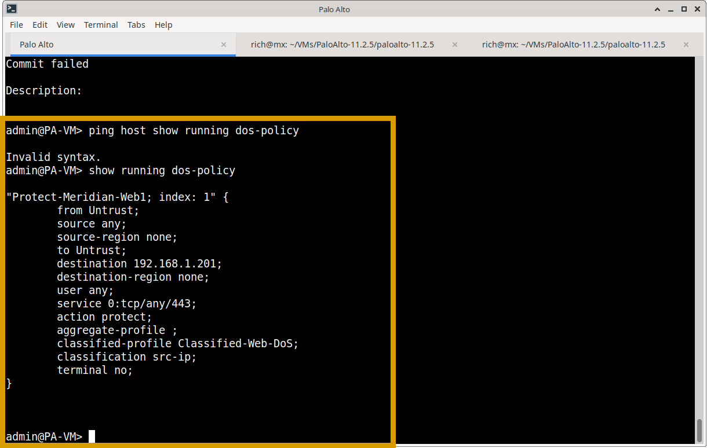

#### Hardware Rule Drop Statistics (`show dos-protection rule Protect-Meridian-Web1 statistics`)
```text
admin@PA-VM> show dos-protection rule Protect-Meridian-Web1 statistics

Rule: Protect-Meridian-Web1, idx: 0, id: 1
  Classified profile: Classified-Web-DoS
  Classification Criteria: source-only
  Action: protect

Classified profile: Classified-Web-DoS
--------------------------------------------------------------------------------
tcp-syn
  current:       0,      dropped:      306
udp
  current:       0,      dropped:        0
icmp
  current:       0,      dropped:        0
sessions
  current:       0,      dropped:        0
  ip tracked:    1,      ip blocked:     0
```

* **Drop Verification:** The hardware counters confirmed **306 TCP SYN packets dropped** directly by rule `Protect-Meridian-Web1` during the attack window.
* **Threat Monitor Audit (`Monitor > Logs > Threat`):** Filtering on `( subtype eq flood )` documented critical `TCP Flood` events attributing the attack to source `192.168.1.100` targeting `192.168.1.201`.

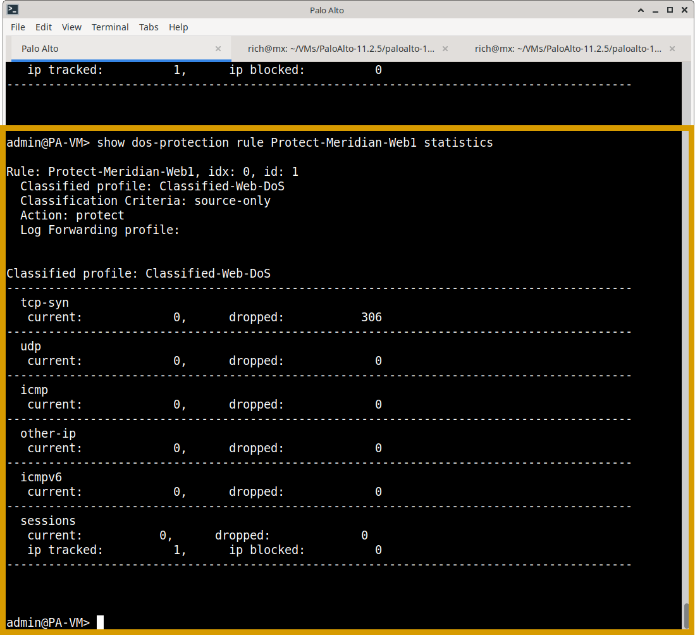

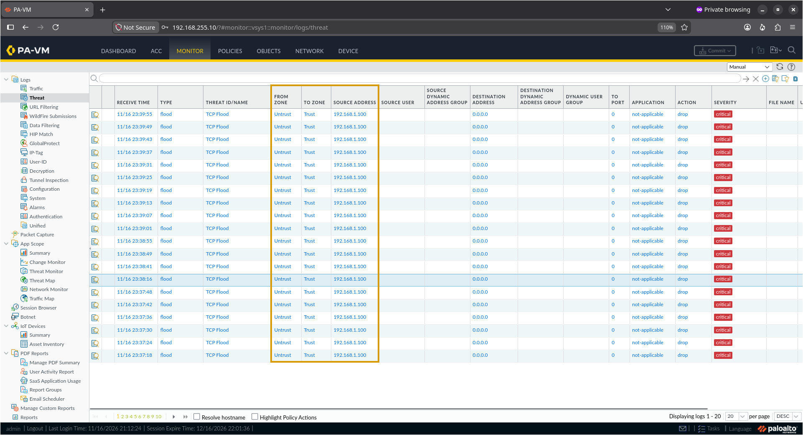

### 5. Executive Visibility: Application Command Center (ACC) Threat Correlation

To evaluate executive-level SOC visibility during the volumetric flood, the attack was analyzed within Palo Alto Networks' core analytics engine—the **Application Command Center (ACC)**:

```text
  [ ACC Source IP Analytics Widget: Last Hour ]
  -------------------------------------------------------------------------
  Source IP         Bytes      Sessions      Threats     Apps    Verdict
  -------------------------------------------------------------------------
  10.10.10.50       1.2 MB     14.3k         110         3       Normal / Internal
  192.168.1.100     0 Bytes    0 Sessions    869 Threats 1       ATTACKER QUARANTINED
```

#### Key Forensic ACC Metrics (`ACC > Network Activity > Source IP Activity`)
Inspecting the **Source IP Activity** widget confirmed the absolute effectiveness of the Classified DoS rule:

* **Attacker IP (`192.168.1.100`):**
  * **Threat Count:** **`869`** flood events captured.
  * **Sessions Admitted:** **`0`** (Zero connection table entries were granted to the attacker).
  * **Bytes Delivered:** **`0`** (Zero attack payload reached the protected web server).
* **Target Server Activity (`10.10.10.50`):**
  * Maintained healthy baseline performance (1.2 MB transferred across 14.3k legitimate internal transactions).

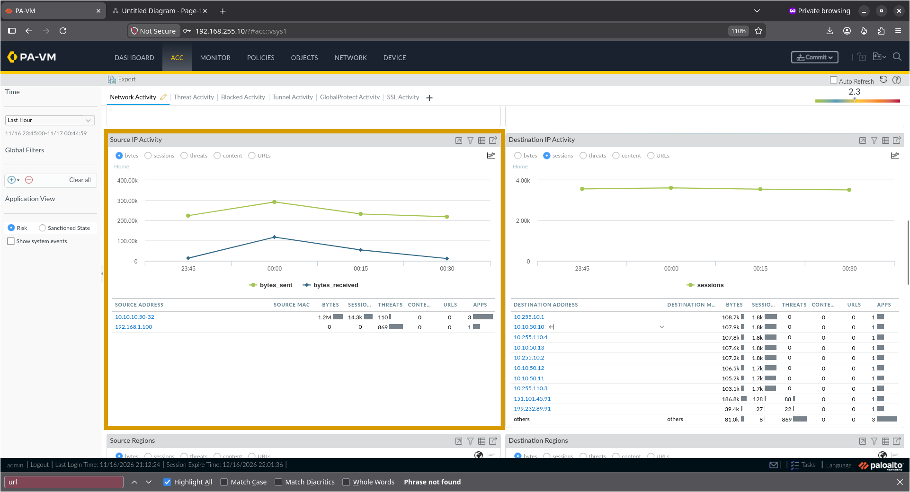

---

## Key Artifact Index

| Artifact File | Category | Technical Proof & Validation |
| :--- | :--- | :--- |
| **`dos-profile-classified-config.png`** | Profile Config | Definition of `Classified-Web-DoS` configuring 50/100/200 cps and 300s block duration. |
| **`dos-policy-rule-general-config.png`** | Policy Config | `Protect-Meridian-Web1` rule mapping Untrust traffic to VIP `192.168.1.201:443`. |
| **`dos-policy-rule-protection-tab.png`** | Policy Config | Enabling Classified profile tracking by `source-ip-only`. |
| **`zone-protection-threshold-tuning.png`**| Infrastructure | Tuning perimeter ZPP thresholds (2000/3000/5000) to allow granular DoS rule evaluation. |
| **`baseline-curl-loop-200-ok.png`** | Baseline Test | Terminal output showing 20 consecutive HTTP 200 requests completed in ~20ms. |
| **`traffic-logs-baseline-allowed.png`** | Telemetry Log | Traffic monitor confirming clean baseline HTTPS sessions with `tcp-fin` teardown. |
| **`hping3-syn-flood-packet-loss.png`** | Attack Telemetry | Terminal output showing attack scaling from 77% to 98% and 100% packet loss. |
| **`attacker-curl-timeout-136s.png`** | Quarantine Proof| Terminal output proving attacker `curl` timed out after 136,004 ms while quarantined. |
| **`pa-cli-show-running-dos-policy.png`**| Dataplane CLI | `show running dos-policy` confirming active rule index and `src-ip` classification. |
| **`pa-cli-dos-rule-statistics.png`** | Dataplane CLI | `show dos-protection rule ... statistics` confirming 306 hardware drops on Class 8. |
| **`threat-logs-classified-tcp-flood.png`**| Telemetry Log | Threat monitor auditing critical severity `TCP Flood` events logged against attacker. |

---
