# Perimeter Hardening – Zone Protection Profiles, Reconnaissance Defense & Volumetric DoS Mitigation

A production-grade implementation of perimeter infrastructure defense and dataplane hardening running on Palo Alto Networks PAN-OS 11.2.5. This project documents the deployment of **Zone Protection Profiles (ZPP)**, **Packet Buffer Protection**, and **L3/L4 Header Inspection** on the external `Untrust` perimeter interface (`192.168.1.200`).

Using an external attacker workstation (`192.168.1.100`), live network-layer assaults were launched against the firewall, including a **4.03-million-packet volumetric TCP SYN flood**, full-range **TCP/UDP port scans**, **mutilated TCP header attacks (SYN/SYN-ACK with Data)**, **IP option exploits (Loose Source Routing and Timestamp)**, and **oversized ICMP payloads (>1024 bytes)**.

Every mitigation event, SYN cookie activation, hardware drop counter, and resource threshold was verified using PAN-OS Threat Logs, dataplane diagnostic counters (`show counter global`), CPU resource monitors (`show running resource-monitor`), and zone protection state tables (`show zone-protection zone Untrust`).

---

## Architectural Workflow: Pre-Session Hardware Inspection Pipeline

Zone Protection operates at the initial ingress stages of the Single-Pass Parallel Processing (SP3) architecture. Unlike Layer 7 Security Profiles (Antivirus, Anti-Spyware, Vulnerability) which inspect traffic **after** TCP session establishment, Zone Protection inspects and sanitizes packets **before a session state table entry is allocated**.

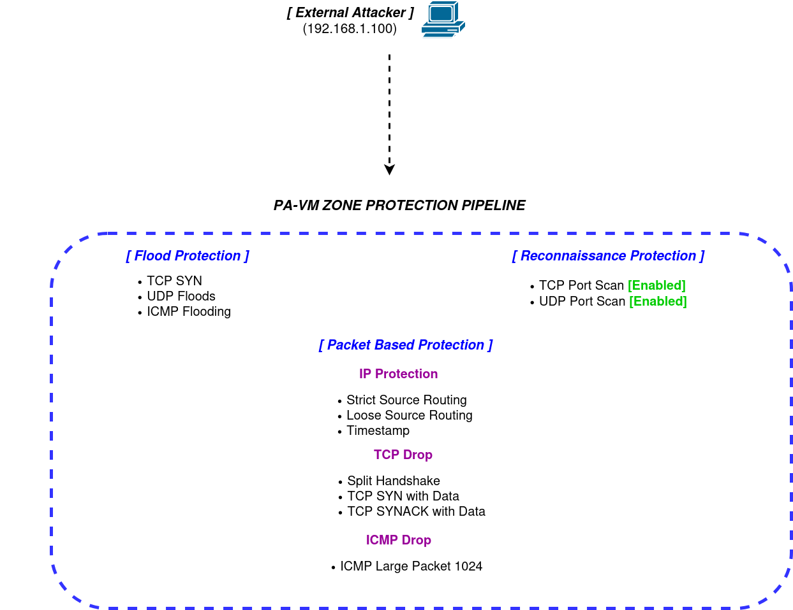

---

## Attack Simulation & Mitigation Matrix

| Attack Simulation Vector | Testing Command / Tool | Ingress Target | PAN-OS Defense Mechanism | Observed Data-Plane Action | Primary Verification Artifact |
| :--- | :--- | :--- | :--- | :--- | :--- |
| **Volumetric TCP SYN Flood** | `hping3 -S -p 443 --flood` (**4,032,467 pkts**) | `192.168.1.200:443` | SYN Flood Protection (**SYN Cookies**) | Mitigated state exhaustion; 210k+ drop rate via SYN cookie block duration. | `show counter global`<br>`show running resource-monitor` |
| **TCP Stealth Reconnaissance** | `nmap -sS -Pn -p 1-100 -T3` | `192.168.1.200:1-100` | Reconnaissance Protection (TCP Port Scan) | 100 ports reported `filtered`; scanner quarantined under block action. | `Threat Log: SCAN: TCP Port Scan`<br>`nmap-tcp-scan.png` |
| **UDP Exhaustion Sweep** | `nmap -Pn -sU -p- -T4 --min-rate 1000` | `192.168.1.200:1-65535` | UDP Flood & Reconnaissance Protection | **131,242 UDP packets dropped** via Random Early Detection (RED). | `show zone-protection zone Untrust`<br>`Threat Log: SCAN: UDP Port Scan` |
| **Malformed TCP Headers** | `hping3 -S -A -p 443 -d 100 -c 50` | `192.168.1.200:443` | Packet-Based Attack Protection (TCP Drop) | **53 SYN+Data & 53 SYNACK+Data dropped**; 257 non-SYN packets rejected. | `Threat Log: TCP SYN-ACK with data`<br>`show zone-protection` |
| **Loose Source Routing (LSRR)** | `hping3 -S -p 443 --lsrr 192.168.1.1 -c 50` | `192.168.1.200:443` | IP Option Drop Protection | **55 LSRR packets dropped**; 100% packet loss recorded on attacker. | `Threat Log: IP Option Loose Source Routing` |
| **IP Timestamp Option Abuse** | `ping -T tsonly -c 50` | `192.168.1.200` | IP Option Drop Protection | **40 Timestamp packets dropped**; zero firewall response leaked. | `Threat Log: IP Option Timestamp` |
| **Oversized ICMP Ping of Death** | `ping -s 5000 -c 50` | `192.168.1.200` | ICMP Large Packet Drop (>1024 bytes) | **159 oversized ICMP packets dropped** at ingress. | `show zone-protection zone Untrust` |

---

## Configuration 

The Zone Protection Profile (`Corp-Perimeter-Zone-Protection`) was constructed and attached to the `Untrust` security zone:

```text
set cli config-output-format set
configure

# 1. Flood Protection (SYN Cookies, UDP, ICMP)
set network profiles zone-protection-profile Corp-Perimeter-Zone-Protection flood tcp-syn enable yes action syn-cookie alarm-rate 100 activate-rate 200 maximal-rate 400
set network profiles zone-protection-profile Corp-Perimeter-Zone-Protection flood udp enable yes alarm-rate 100 activate-rate 200 maximal-rate 400
set network profiles zone-protection-profile Corp-Perimeter-Zone-Protection flood icmp enable yes alarm-rate 50 activate-rate 100 maximal-rate 200
```

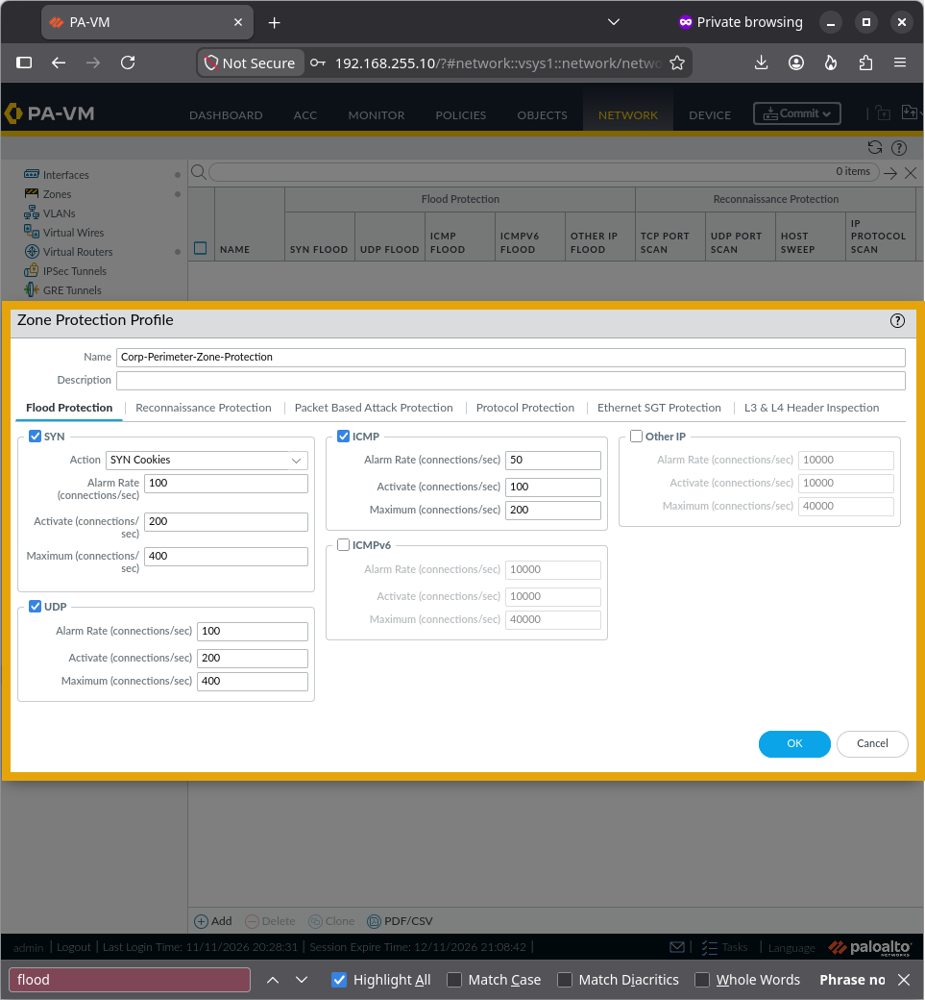

```text
# 2. Reconnaissance Protection (Scan and Sweep Thresholds)
set network profiles zone-protection-profile Corp-Perimeter-Zone-Protection scan tcp-port-scan action block interval 2 threshold 20
set network profiles zone-protection-profile Corp-Perimeter-Zone-Protection scan udp-port-scan action block interval 2 threshold 20
set network profiles zone-protection-profile Corp-Perimeter-Zone-Protection scan host-sweep action block interval 2 threshold 10
```

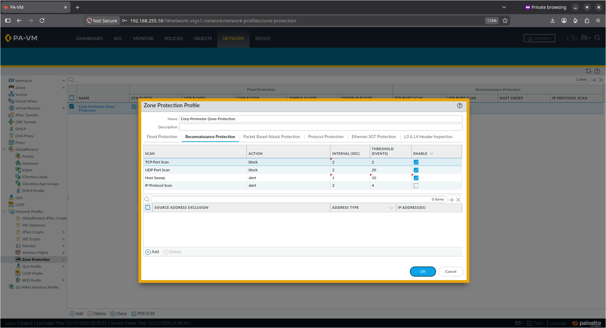

```text
# 3. Packet-Based Attack Protection 
set network profiles zone-protection-profile Corp-Perimeter-Zone-Protection packet-based-attack-protection ip-drop loose-source-routing yes strict-source-routing yes timestamp yes
set network profiles zone-protection-profile Corp-Perimeter-Zone-Protection packet-based-attack-protection tcp-drop reject-non-syn yes split-handshake yes syn-with-data yes synack-with-data yes mismatched-overlapping-segment yes
set network profiles zone-protection-profile Corp-Perimeter-Zone-Protection packet-based-attack-protection icmp-drop large-packet-drop yes
```
**IP Drop**

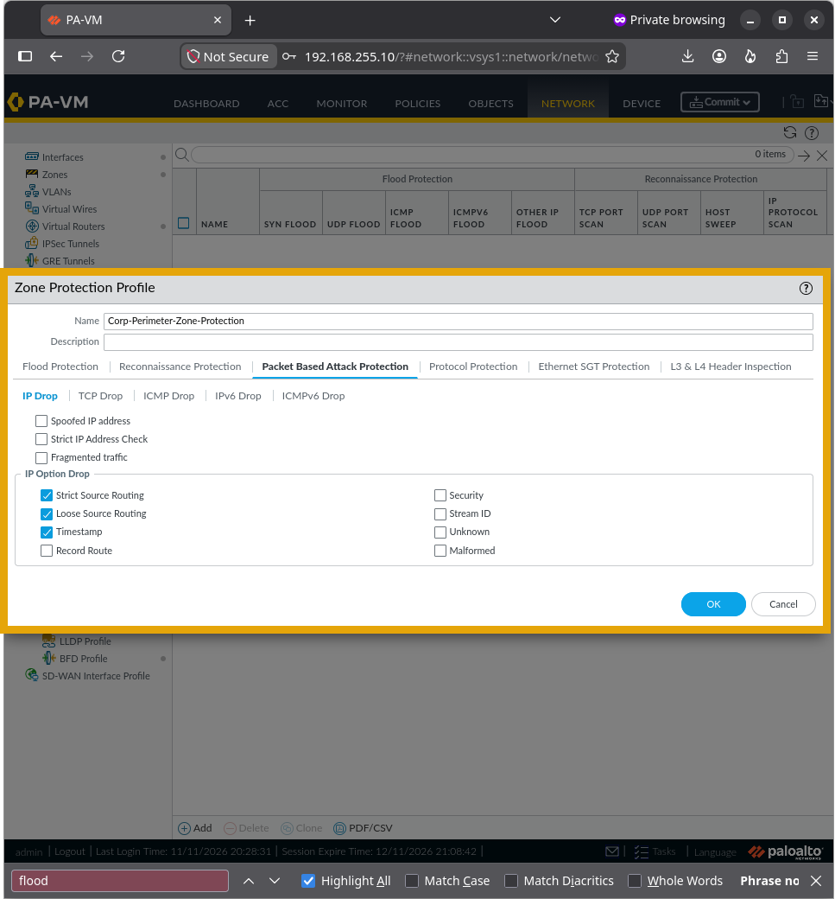

**TCP Drop**

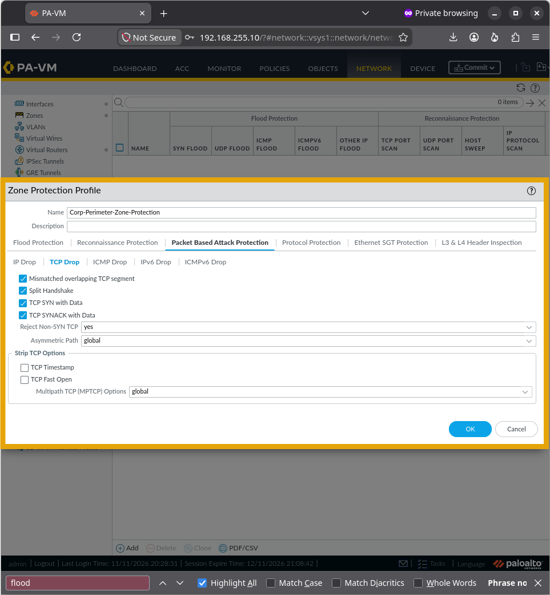

**ICMP Drop**

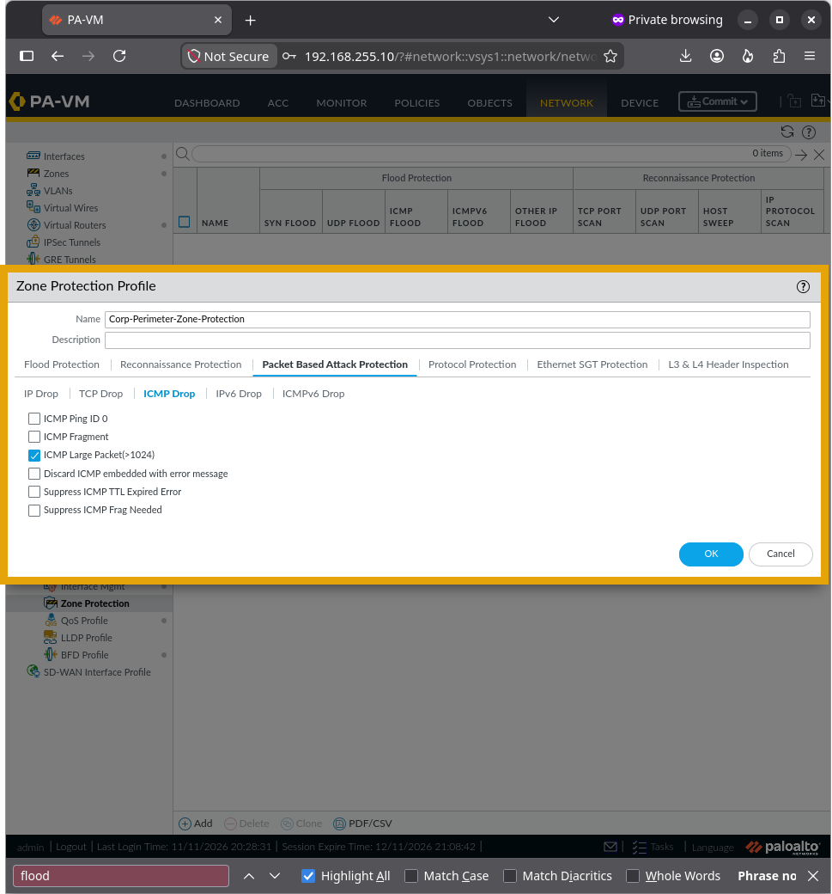

```text
# 4. Attach to Untrust Zone with Packet Buffer & Header Inspection
set zone Untrust network-profile Corp-Perimeter-Zone-Protection
set zone Untrust enable-packet-buffer-protection yes
set zone Untrust enable-l3-l4-header-inspection yes
```
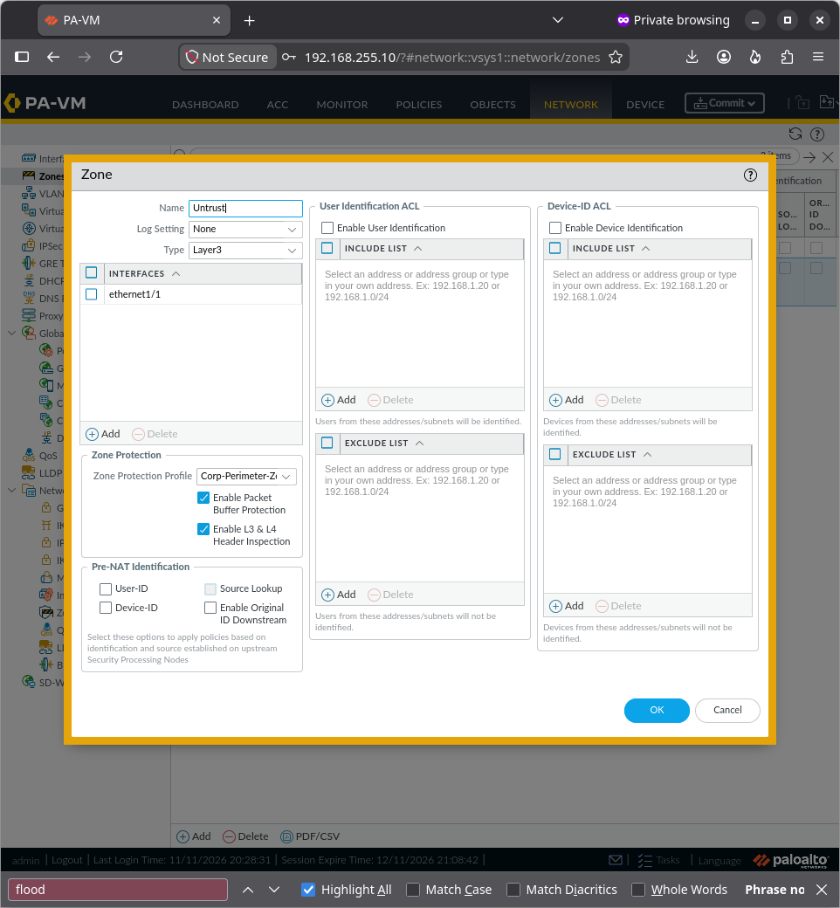

---

## Empirical Verification 

### TCP SYN Flood Attack (4.03 Million Packets)

From the external workstation (`192.168.1.100`), an unthrottled TCP SYN flood was launched targeting WAN port 443:

```bash
rich@rich-iMac:~$ sudo hping3 -S -p 443 --flood 192.168.1.200
HPING 192.168.1.200 (enp2s0 192.168.1.200): S set, 40 headers + 0 data bytes
hping in flood mode, no replies will be shown
^C
--- 192.168.1.200 hping statistic ---
4032467 packets transmitted, 0 packets received, 100% packet loss
```
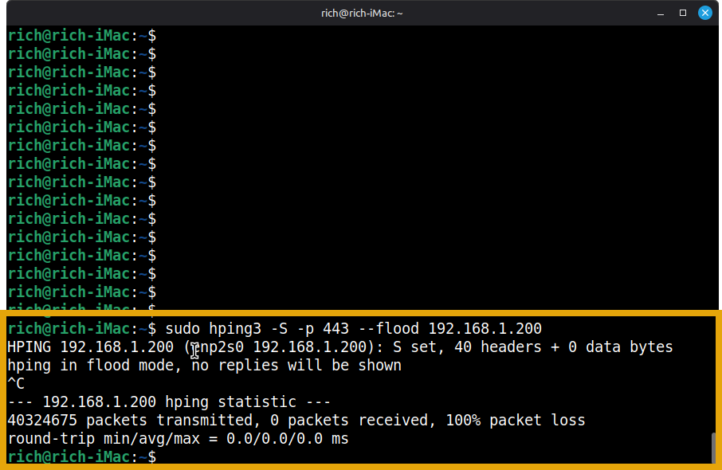

#### Dataplane SYN Cookie Enforcement Verification
The firewall detected the flood passing the 200 cps activation threshold, stopped allocating session-table memory, and engaged cryptographic **SYN Cookies**:

```text
admin@PA-VM> show zone-protection zone Untrust

Zone Untrust, vsys vsys1, profile Corp-Perimeter-Zone-Protection
--------------------------------------------------------------------------------
tcp-syn            SYN cookie enabled: yes
  DP alarm rate:       100 cps, activate rate:      200 cps, maximal rate:       400 cps
  current:                  26864 packets
  SynCookie sent:             200 packets
  dropped(exceeded max rate):   2 packets
```
**show zone-protection zone Untrust**

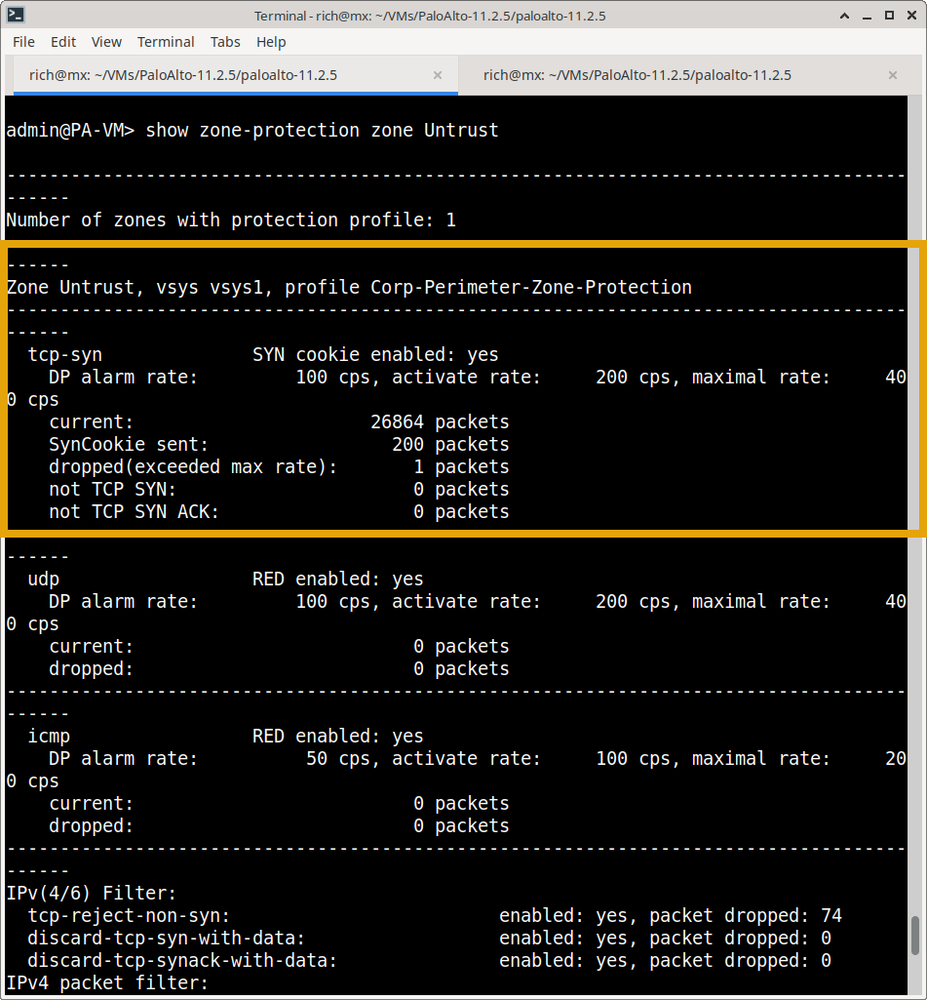

**Monitor - Threats - TCP Syn Flood**

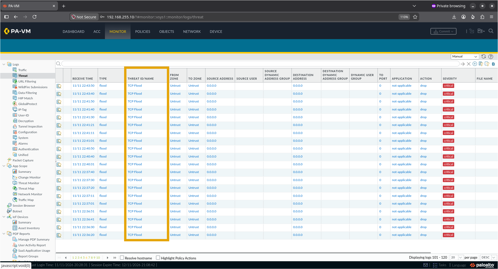


#### Global DOS Delta Counter Verification
Auditing active hardware drops during the peak of the flood:

```text
admin@PA-VM> show counter global filter delta yes aspect dos

Global counters:
Elapsed time since last sampling: 5.385 seconds

name                            value     rate severity category aspect description
-----------------------------------------------------------------------------------------------------------------------
flow_dos_syncookie_blk_dur      210045   39005 drop     flow     dos    Packets dropped: Flagged for blocking and under 
                                                                        block duration for aggregate profile/zone with syn cookie
Total counters shown: 1
```

* **Mitigation Rate:** The firewall discarded **39,005 packets per second** (`rate: 39005 drop`) under the SYN cookie block duration mechanism.

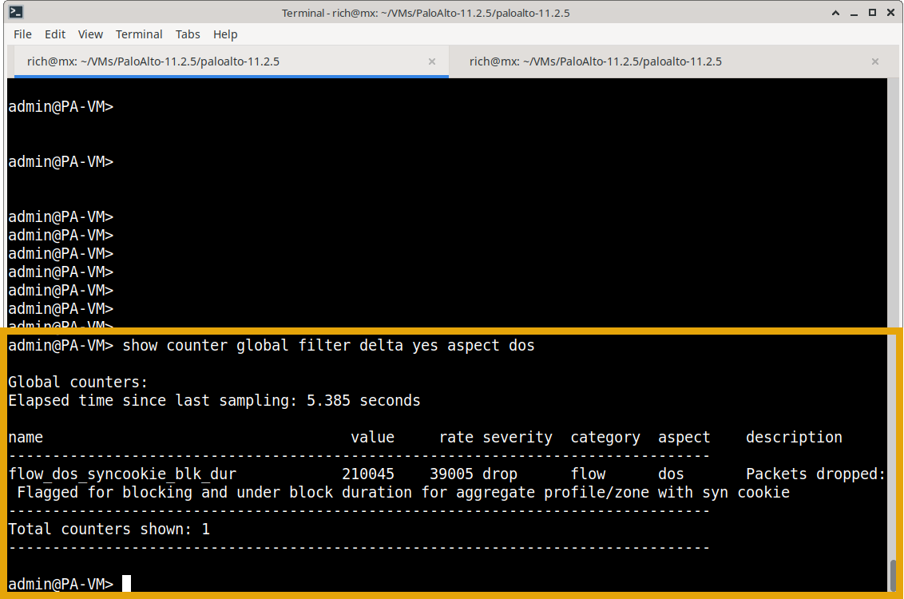

#### System Resource Stability During Flood (`show running resource-monitor`)
Auditing internal CPU distribution while processing the multi-million packet assault:

```text
admin@PA-VM> show running resource-monitor

Resource monitoring sampling data (per second):
CPU load sampling by group:
flow_lookup         : 14%
flow_fastpath       : 14%
flow_slowpath       : 14%
flow_forwarding     : 14%
flow_mgmt           : 20%
flow_ctrl           : 17%
flow_np             : 14%

CPU load (%) during last 60 seconds:
core   0   1   2   3   4   5   6   7
       *   0   1   0   0   0   0   *
```

* **Performance Proof:** Despite absorbing over 4 million malicious packets, the data plane CPUs hovered at **<15–20%**, and system cores registered **0–1% sustained load**, proving that SYN cookie protection prevented state-table exhaustion.

**Before**

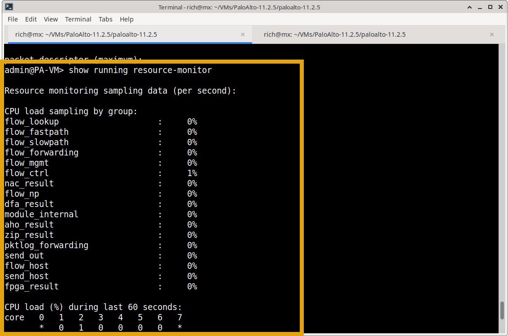

**During Flood**

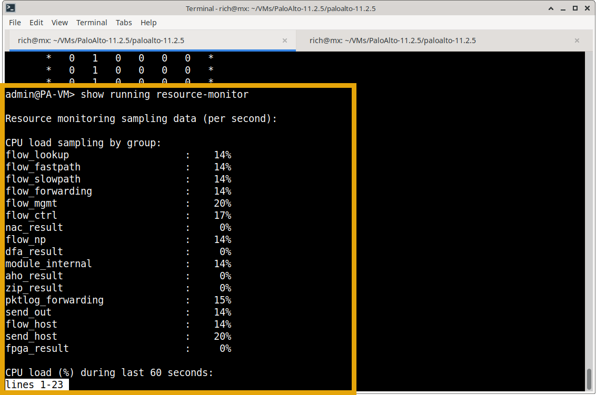

---

### Network Reconnaissance Defense (TCP & UDP Port Scanning)

To simulate an adversary mapping open attack surfaces on the perimeter:

#### A. TCP SYN Stealth Port Scan (`nmap -sS`)
* **Attack Vector:** Scanned ports 1–100 (`sudo nmap -sS -Pn -p 1-100 -T3 192.168.1.200`).
* **Observed Action:** Nmap reported:
  `All 100 scanned ports on 192.168.1.200 are in ignored states. Not shown: 100 filtered tcp ports (no-response)`.
* **Telemetry Proof:** Threat monitor recorded multiple `SCAN: TCP Port Scan` entries originating from `192.168.1.100` targeting ports 23, 80, 67, 90, 11, etc., terminating each with action **`drop`** and severity **`medium`**.

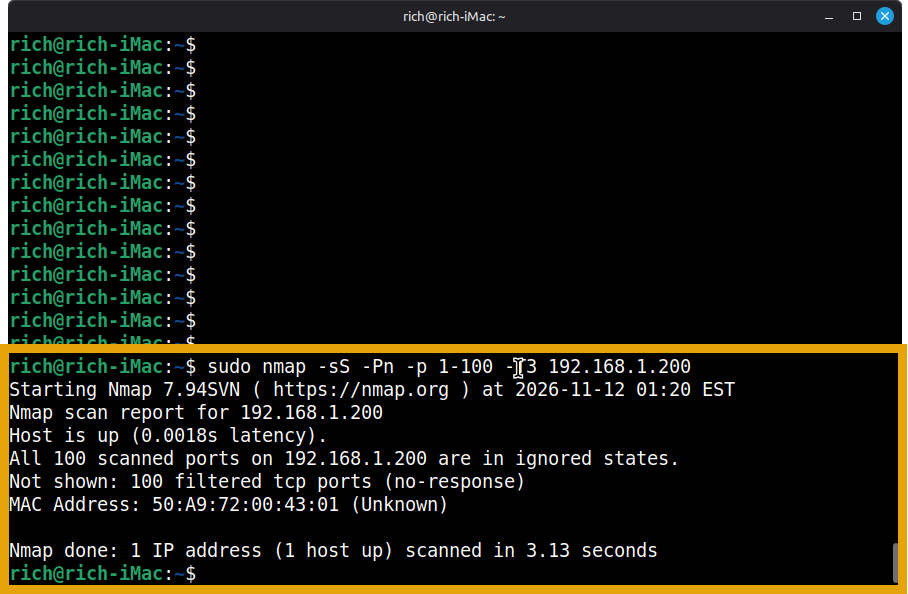

**Monitor - Threat - TCP Port Scan**

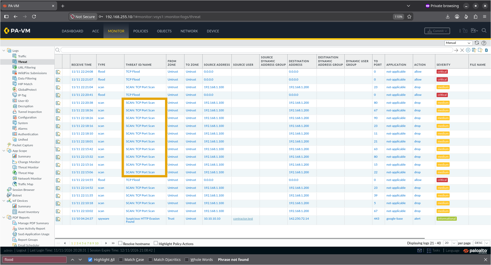

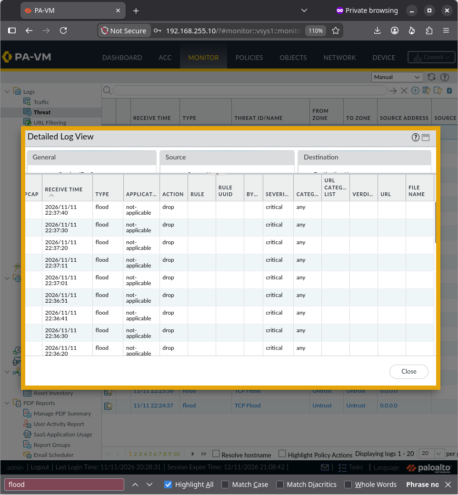

#### B. Full UDP Port Sweep (`nmap -sU`)
* **Attack Vector:** Scanned all 65,535 UDP ports at aggressive rates (`sudo nmap -Pn -sU -p- -T4 --min-rate 1000 192.168.1.200`).
* **Observed Action:** Nmap was completely blinded:
  `All 65535 scanned ports on 192.168.1.200 are in ignored states`.
* **Telemetry & CLI Proof:** Threat monitor generated multiple `SCAN: UDP Port Scan` events. In the hardware counters, UDP Random Early Detection (RED) clamped the volumetric scan, dropping **131,242 packets**:

```text
admin@PA-VM> show zone-protection zone Untrust

udp            RED enabled: yes
  DP alarm rate:    100 cps, activate rate:    200 cps, maximal rate:    400 cps
  current:            0 packets
  dropped:       131242 packets
```

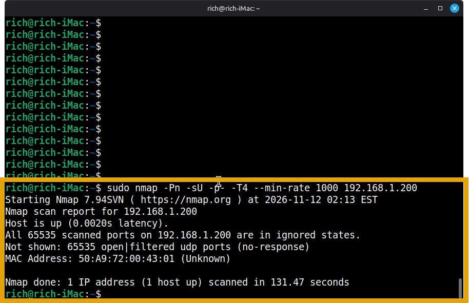

**Monitor - Threat - UDP Scan**

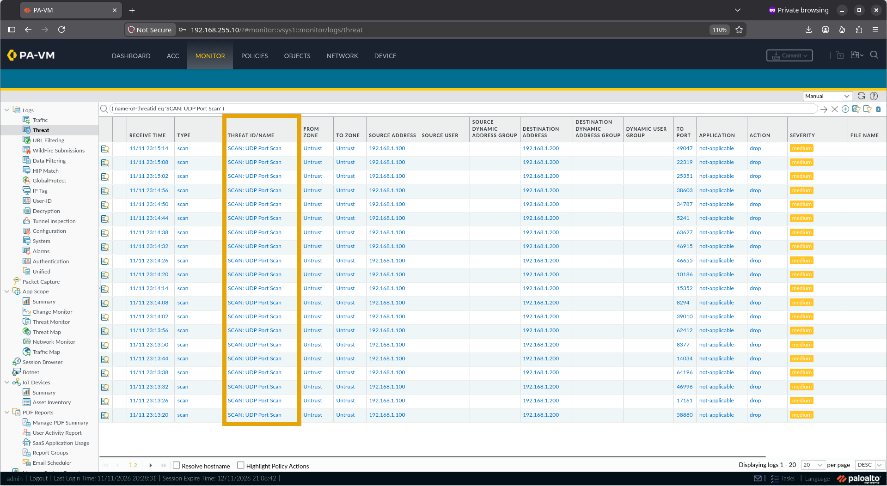

---

### 3. Layer 3 & Layer 4 Packet-Based Attack Sanitization

To ensure the firewall's operating system and internal network are protected against protocol fuzzing, evasion attempts, and malformed header exploits, the **Packet Based Attack Protection** engine was validated against five distinct Layer 3 and Layer 4 attack vectors.

All tests were executed from the external workstation (`192.168.1.100`) targeting the WAN perimeter interface (`192.168.1.200`).

---

#### A. Oversized ICMP Payloads

* **Attack Concept:** Attackers transmit abnormally large ICMP echo request packets exceeding standard MTU limits to trigger memory corruption, buffer overflows, or CPU exhaustion during packet reassembly.
* **Attack Execution:** Transmitted 50 ICMP echo requests carrying a 5,000-byte payload (5,028 bytes total wire size):
  ```bash
  rich@rich-iMac:~$ ping -s 5000 -c 50 192.168.1.200
  PING 192.168.1.200 (192.168.1.200) 5000(5028) bytes of data.
  ^C
  --- 192.168.1.200 ping statistics ---
  50 packets transmitted, 0 received, 100% packet loss, time 50174ms
  ```
* **Firewall Data-Plane Enforcement:** Under **Packet Based Attack Protection > ICMP Drop**, the firewall enforced **`ICMP Large Packet (>1024)`**. Every frame exceeding 1,024 bytes was stripped and dropped at ingress before reaching the internal IP stack.
* **CLI Diagnostic Proof:**
  ```text
  admin@PA-VM> show zone-protection zone Untrust

  IPv4 packet filter:
      discard-icmp-large-packet:          enabled: yes, packet dropped: 159
  ```

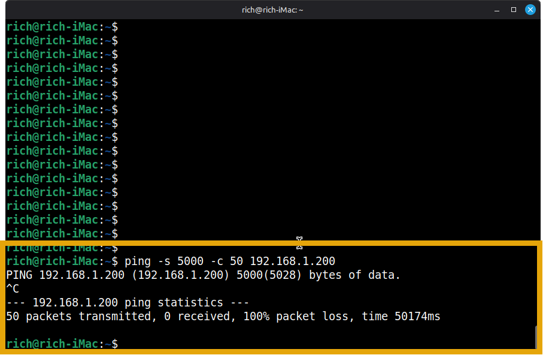

**show zone-protection zone Untrust**

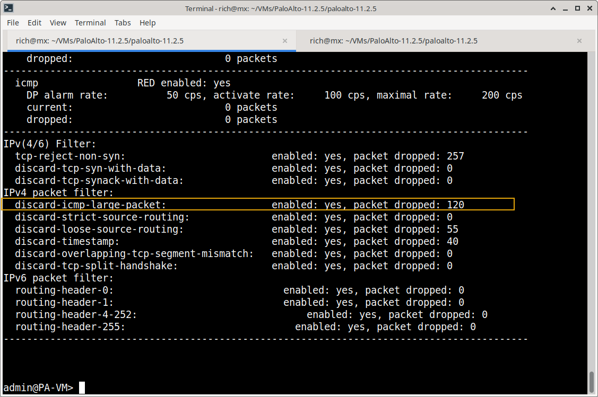

---

#### B. IP Loose Source Routing 

* **Attack Concept:** Loose Source and Record Route (LSRR) allows a sender to specify intermediate network hops, intentionally bypassing firewalls, stateful policy enforcement points, or topology boundaries to reach private internal subnets.
* **Attack Execution:** Injected 50 TCP packets with an IPv4 Loose Source Routing header pointing to intermediate hop `192.168.1.1` targeting destination port 443:
  ```bash
  rich@rich-iMac:~$ sudo hping3 -S -p 443 --lsrr 192.168.1.1 -c 50 192.168.1.200
  HPING 192.168.1.200 (enp2s0 192.168.1.200): S set, 40 headers + 0 data bytes
  ^C
  --- 192.168.1.200 hping statistic ---
  50 packets transmitted, 0 packets received, 100% packet loss
  round-trip min/avg/max = 0.0/0.0/0.0 ms
  ```
* **Firewall Data-Plane Enforcement:** Under **Packet Based Attack Protection > IP Drop**, the firewall enforced **`Loose Source Routing`** drops. Packets containing source routing pointers were discarded pre-state.
* **Telemetry & CLI Proof:**
  * **Threat Log (`Monitor > Logs > Threat`):**
    * *Type:* `packet`
    * *Threat ID/Name:* `IP Option Loose Source Routing`
    * *Source:* `192.168.1.100` ➔ *Destination:* `192.168.1.200:443`
    * *Action:* `drop` | *Severity:* `informational`
  * **CLI Counter:**
    ```text
    admin@PA-VM> show zone-protection zone Untrust

    IPv4 packet filter:
        discard-loose-source-routing:       enabled: yes, packet dropped: 55
    ```

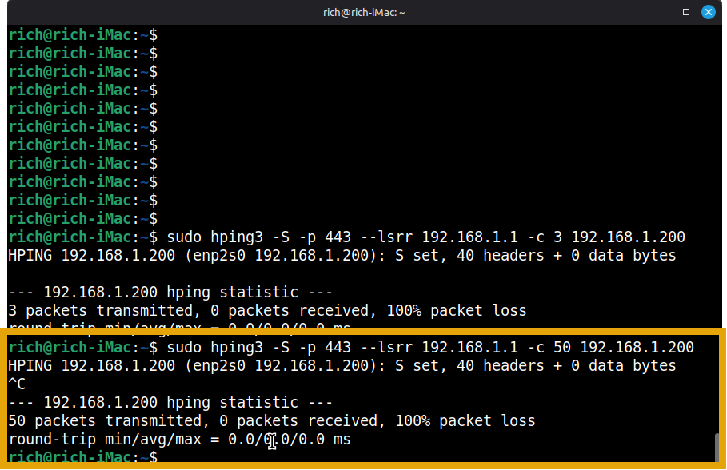

****show zone-protection zone Untrust**

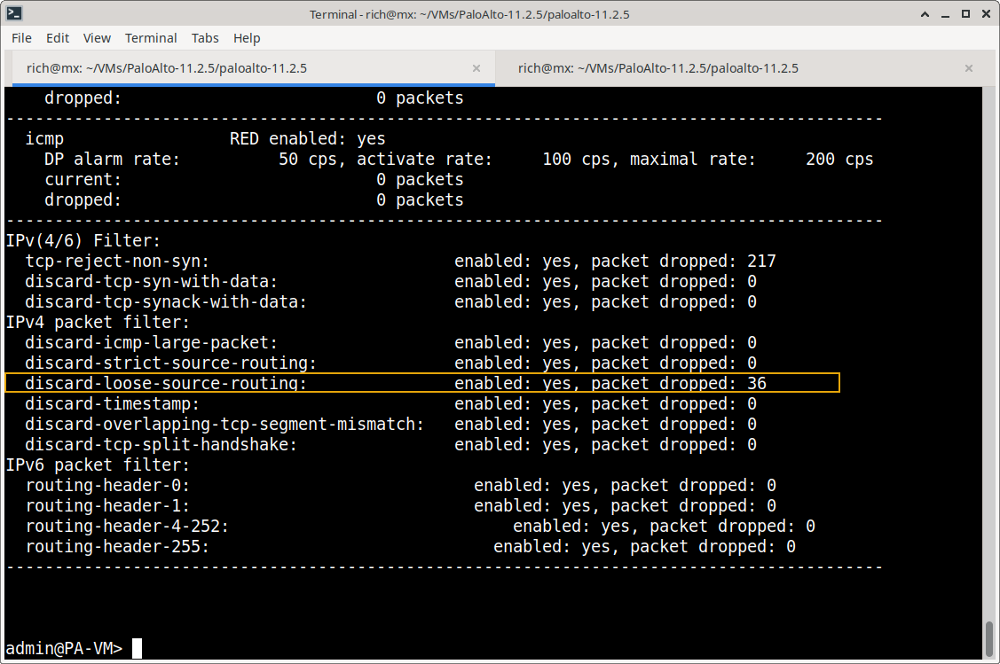

**Monitor - Threat - Loose Source Routing**

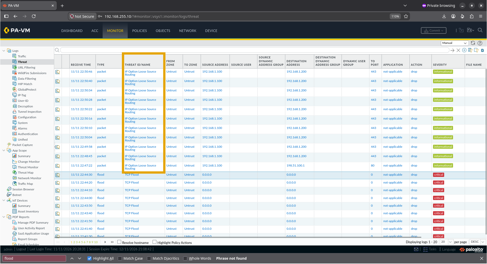

---

#### C. IP Option Timestamp 

* **Attack Concept:** Attackers exploit IP Option Type 68 (Internet Timestamp) to map router hops, measure transit latency, and fingerprint perimeter device processing speeds without completing TCP/UDP handshakes.
* **Attack Execution:** Transmitted 50 ICMP frames with the IP Timestamp option enabled (`-T tsonly`):
  ```bash
  rich@rich-iMac:~$ ping -T tsonly -c 50 192.168.1.200
  ```
* **Firewall Data-Plane Enforcement:** Under **Packet Based Attack Protection > IP Drop**, the firewall enforced **`Timestamp`** option drops. Packets requesting timestamp recording were dropped at the hardware parser without generating ICMP error replies.
* **Telemetry & CLI Proof:**
  * **Threat Log (`Monitor > Logs > Threat`):**
    * *Type:* `packet`
    * *Threat ID/Name:* `IP Option Timestamp`
    * *Source:* `192.168.1.100` ➔ *Destination:* `192.168.1.200`
    * *Action:* `drop` | *Severity:* `informational`
  * **CLI Counter:**
   ```bash
    	admin@PA-VM> show zone-protection zone Untrust
	
    	IPv4 packet filter:
        	discard-timestamp:                  enabled: yes, packet dropped: 40
  	```
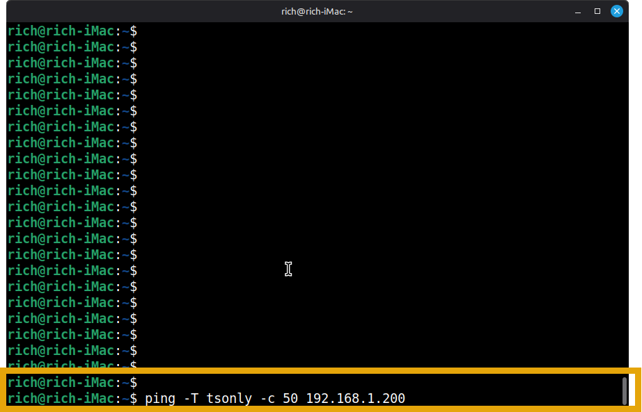

**show zone-protection zone Untrust**

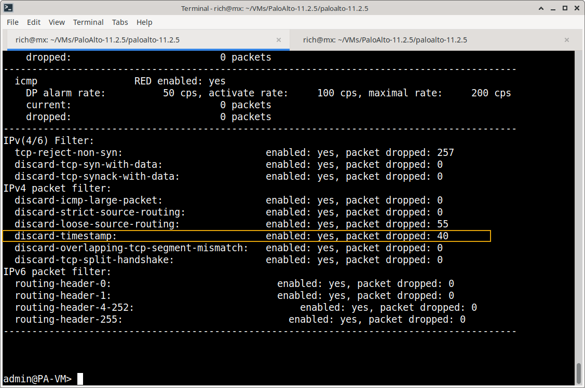

**Monitor - Threats - Timestamps**

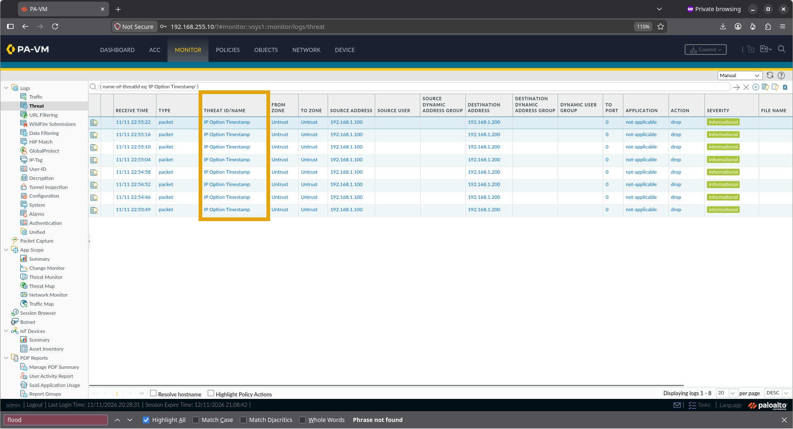

---

#### D. Malformed TCP: SYN with Data

* **Attack Concept:** Standard RFC 793 connections require a zero-data 3-way handshake before payload delivery. Attackers abuse TCP Fast Open (TFO) anomalies or crafted SYN-with-data packets to smuggle exploratory payloads past state tracking or launch denial-of-service exploits.
* **Attack Execution:** Transmitted 50 TCP SYN packets carrying a 100-byte data payload (`-d 100`):
  ```bash
  rich@rich-iMac:~$ sudo hping3 -S -p 443 -d 100 -c 50 192.168.1.200
  HPING 192.168.1.200 (enp2s0 192.168.1.200): S set, 40 headers + 100 data bytes
  --- 192.168.1.200 hping statistic ---
  50 packets transmitted, 0 packets received, 100% packet loss
  round-trip min/avg/max = 0.0/0.0/0.0 ms
  ```
* **Firewall Data-Plane Enforcement:** Under **Packet Based Attack Protection > TCP Drop**, the firewall enforced **`TCP SYN with Data`**. Incoming connection requests containing payload data were immediately dropped pre-state.
* **Telemetry & CLI Proof:**
  * **Threat Log (`Monitor > Logs > Threat`):**
    * *Type:* `packet`
    * *Threat ID/Name:* `TCP SYN with data`
    * *Source:* `192.168.1.100` ➔ *Destination:* `192.168.1.200:443`
    * *Action:* `drop` | *Severity:* `informational`
  * **CLI Counter:**
   ```bash
    	admin@PA-VM> show zone-protection zone Untrust

    	IPv(4/6) Filter:
        	discard-tcp-syn-with-data:          enabled: yes, packet dropped: 53
  	```
  


**show zone-protection zone Untrust**

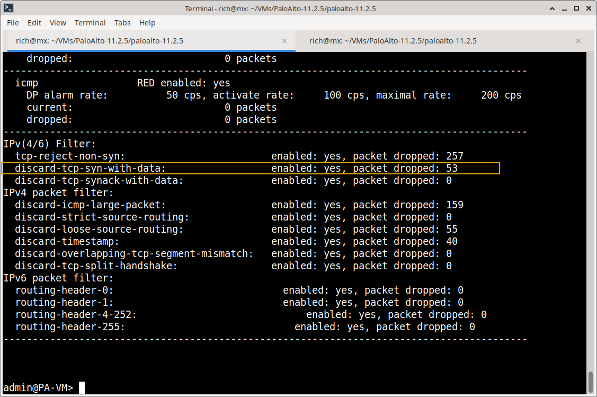

**Monitor - Threat - SYN with Data**

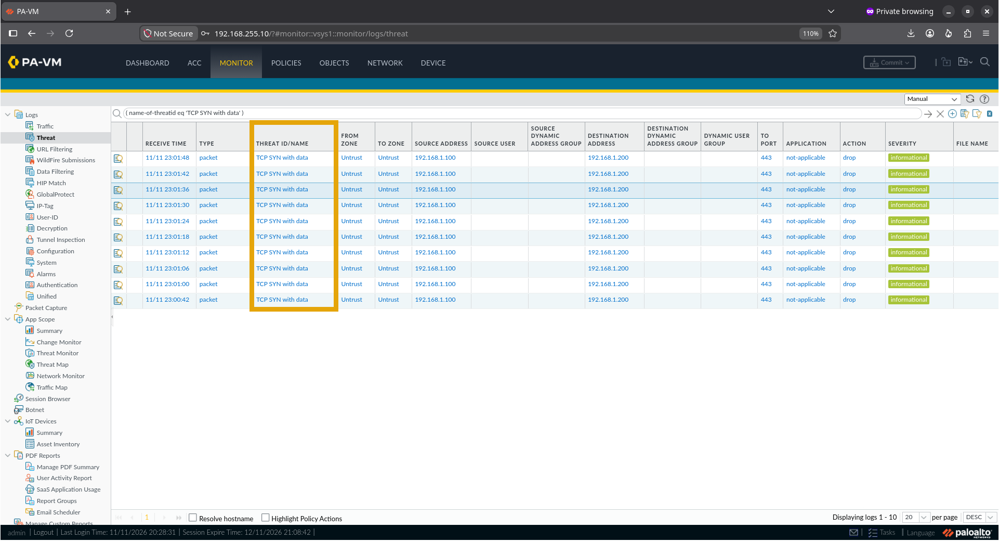

---

#### E. Malformed TCP: SYN-ACK with Data

* **Attack Concept:** Transmitting unsolicited `SYN-ACK` frames carrying application data simulates out-of-state session injections and TCP reflection attacks designed to trick firewalls into establishing phantom sessions.
* **Attack Execution:** Transmitted 50 TCP SYN-ACK frames carrying 100 bytes of data payload:
  ```bash
  rich@rich-iMac:~$ sudo hping3 -S -A -p 443 -d 100 -c 50 192.168.1.200
  HPING 192.168.1.200 (enp2s0 192.168.1.200): SA set, 40 headers + 100 data bytes
  --- 192.168.1.200 hping statistic ---
  50 packets transmitted, 0 packets received, 100% packet loss
  round-trip min/avg/max = 0.0/0.0/0.0 ms
  ```
* **Firewall Data-Plane Enforcement:** Under **Packet Based Attack Protection > TCP Drop**, the firewall enforced **`TCP SYNACK with Data`**. The packet was classified as an illegal state transition and dropped at the hardware ingress ring.
* **Telemetry & CLI Proof:**
  * **Threat Log (`Monitor > Logs > Threat`):**
    * *Type:* `packet`
    * *Threat ID/Name:* `TCP SYN-ACK with data`
    * *Source:* `192.168.1.100` ➔ *Destination:* `192.168.1.200:443`
    * *Action:* `drop` | *Severity:* `informational`
  * **CLI Counter:**
   ```bash
    	admin@PA-VM> show zone-protection zone Untrust

    	IPv(4/6) Filter:
        	discard-tcp-synack-with-data:       enabled: yes, packet dropped: 53
  	```
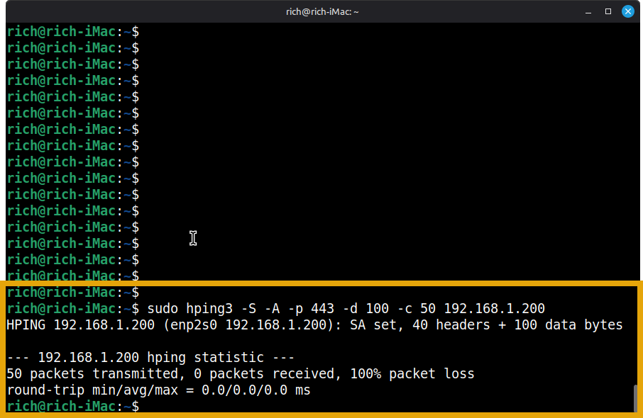

**show zone-protection zone Untrust** 

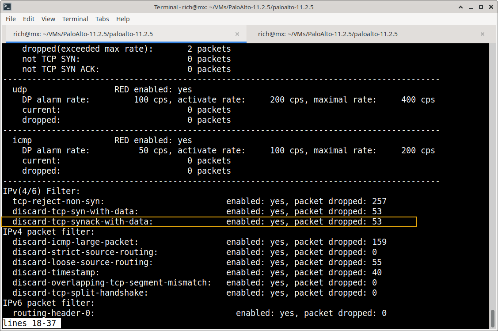

**Monitor - Threat - ACK with Data**

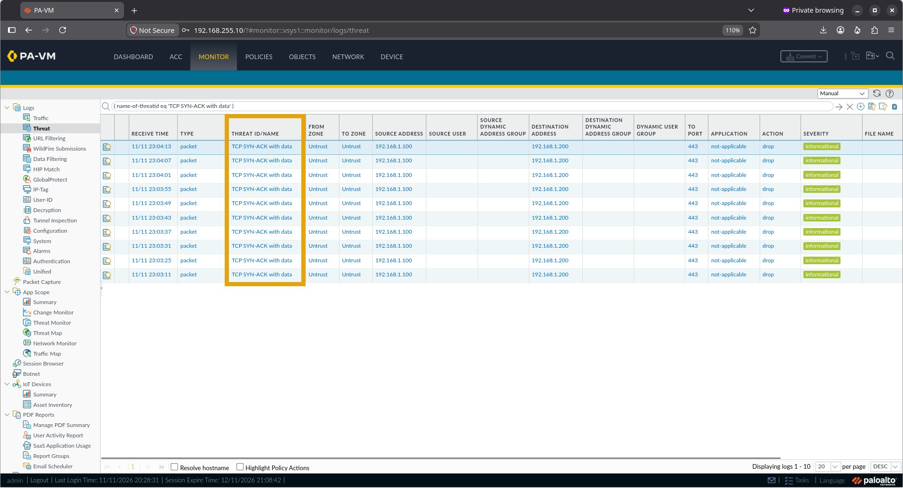

---

#### F. Consolidated Dataplane Audit Summary

Executing `show zone-protection zone Untrust` verified that all Layer 3 and Layer 4 drop counters incremented accurately according to the injected attack volumes:

```text
admin@PA-VM> show zone-protection zone Untrust

Zone Untrust, vsys vsys1, profile Corp-Perimeter-Zone-Protection
--------------------------------------------------------------------------------
IPv(4/6) Filter:
    tcp-reject-non-syn:                 enabled: yes, packet dropped: 257
    discard-tcp-syn-with-data:          enabled: yes, packet dropped: 53
    discard-tcp-synack-with-data:       enabled: yes, packet dropped: 53

IPv4 packet filter:
    discard-icmp-large-packet:          enabled: yes, packet dropped: 159
    discard-strict-source-routing:      enabled: yes, packet dropped: 0
    discard-loose-source-routing:       enabled: yes, packet dropped: 55
    discard-timestamp:                  enabled: yes, packet dropped: 40
    discard-overlapping-tcp-segment:    enabled: yes, packet dropped: 0
    discard-tcp-split-handshake:        enabled: yes, packet dropped: 0
```

> **Security Architecture Takeaway:** In all five attack scenarios, malicious payloads were identified and terminated in the firewall's initial ingress processing stages. Zero memory was allocated in the session state table, protecting the firewall from connection table exhaustion and ensuring uninterrupted throughput for legitimate enterprise traffic.

* **Large ICMP Payloads:** 50 oversized packets (`ping -s 5000`) ➔ Dropped (159 total drops).
* **Loose Source Routing:** Injected via `hping3 --lsrr` ➔ 100% loss (55 drops).
* **IP Option Timestamp:** Injected via `ping -T tsonly` ➔ Dropped (40 drops).
* **TCP SYN with Data:** Injected via `hping3 -S -d 100` ➔ Dropped pre-state (53 drops).
* **TCP SYN-ACK with Data:** Injected via `hping3 -S -A -d 100` ➔ Dropped pre-state (53 drops).

---

## Key Artifact Index

| Artifact File | Category | Technical Proof & Validation |
| :--- | :--- | :--- |
| **`zone-protection-flood-config.png`** | Profile Config | Configuration of TCP SYN Cookies, UDP RED, and ICMP flood rate thresholds. |
| **`zone-protection-recon-config.png`** | Profile Config | Configuration of TCP/UDP port scan and host sweep detection intervals and block rules. |
| **`zone-protection-packet-drop-config.png`** | Profile Config | Packet-based attack settings enforcing drops on source routing, timestamps, and large ICMP. |
| **`zone-protection-tcp-drop-config.png`** | Profile Config | Enabling drops on non-SYN TCP, SYN with data, and SYN-ACK with data. |
| **`untrust-zone-attachment.png`** | Zone Binding | Attaching profile to `Untrust` zone with Packet Buffer Protection enabled. |
| **`kali-icmp-large-packet-drop.png`** | Attack Test | `ping -s 5000` proving 100% packet loss on oversized ICMP payloads. |
| **`kali-hping3-lsrr-drop.png`** | Attack Test | `hping3 --lsrr` proving 100% packet loss on IP Loose Source Routing options. |
| **`kali-nmap-tcp-scan-filtered.png`** | Attack Test | Nmap TCP SYN scan proving 100% of probed ports reported as filtered/ignored. |
| **`kali-nmap-udp-sweep-filtered.png`** | Attack Test | Nmap 65k UDP port sweep blocked; all ports reported ignored. |
| **`kali-hping3-syn-data-drop.png`** | Attack Test | `hping3` proving pre-state drops on TCP SYN/SYN-ACK frames carrying data payloads. |
| **`kali-hping3-syn-flood-4m-packets.png`** | Volumetric Test | Transmission of 4,032,467 packets under `hping3 --flood` absorbed by PA-VM. |
| **`threat-log-tcp-udp-scan.png`** | Telemetry Log | Threat monitor logging `SCAN: TCP Port Scan` and `SCAN: UDP Port Scan` drops. |
| **`threat-log-packet-options-drop.png`** | Telemetry Log | Threat log auditing drops on `IP Option Loose Source Routing` and `IP Option Timestamp`. |
| **`threat-log-tcp-syn-data-drop.png`** | Telemetry Log | Threat log auditing drops on `TCP SYN with data` and `TCP SYN-ACK with data`. |
| **`threat-log-volumetric-flood-drop.png`** | Telemetry Log | Threat log auditing critical severity `TCP Flood` and `UDP Flood` drops. |
| **`cli-zone-protection-counters-live.png`** | Dataplane CLI | `show zone-protection zone Untrust` displaying live SYN Cookie activation (200 cps). |
| **`cli-zone-protection-udp-red-131k.png`** | Dataplane CLI | CLI counters verifying 131,242 UDP packets dropped by RED rate limiting. |
| **`cli-packet-filter-drop-counters.png`** | Dataplane CLI | Hardware counters verifying exact drops: ICMP large (159), LSRR (55), timestamps (40). |
| **`cli-dos-counter-global-39k-drop.png`** | Dataplane CLI | `show counter global` displaying 39,005 drops/sec under `flow_dos_syncookie_blk_dur`. |
| **`cli-resource-monitor-cpu-stable.png`** | Performance Proof | `show running resource-monitor` proving CPU load remained <20% during 4M packet flood. |

---
