# Policy-Based Forwarding (PBF), Active Path Monitoring & SLA-Driven WAN Failover

A production-grade implementation of **Policy-Based Forwarding (PBF)**, **Active Path Health Monitoring**, and automated **Multi-Path WAN Failover** on Palo Alto Networks PAN-OS 11.2.5. This project documents the transition from standard destination-based routing (FIB) to dynamic, SLA-probed traffic steering between the corporate Trust network (`10.10.10.0/24`) and a remote Cisco CSR datacenter network (`20.20.20.0/24`).

Traffic destined for `20.20.20.0/24` is prioritized over an encrypted Route-Based IPsec VTI tunnel (`tunnel.1`). An active health monitor continuously probes the remote VTI gateway (`10.255.255.2`) using sub-second ICMP keepalives. When a physical or logical tunnel drop is injected on the Cisco router, PAN-OS detects the SLA breach, revokes the PBF rule, and dynamically reroutes traffic to a floating backup path across the physical underlay with zero manual intervention.

Every state transition was validated using hop-by-hop traceroute comparative traces, CLI PBF operational tables (`show pbf rule all`), Cisco IOS interface flap logs, continuous ICMP sequence audits, and wire-level Wireshark packet captures.

---

## Architecture & Multi-Path Failover Workflow

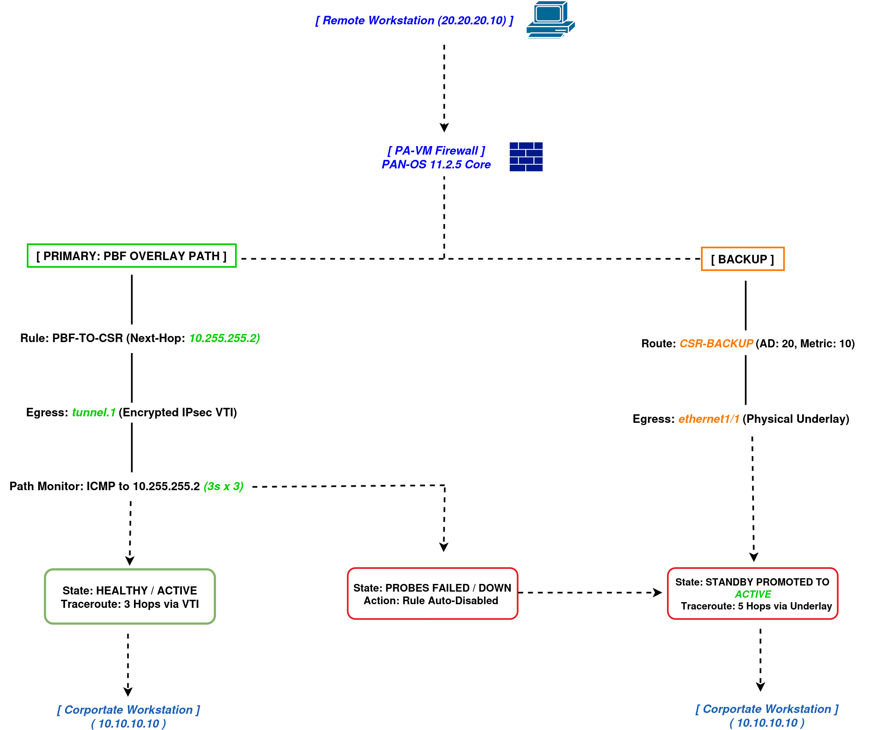

---

## Architectural & Routing Specifications

| Component | Setting / Parameter | Operational & Architectural Function |
| :--- | :--- | :--- |
| **Primary Path (PBF)** | `PBF-TO-CSR` (Egress: `tunnel.1`) | Overrides the FIB; steers all traffic for `20.20.20.0/24` into the IPsec tunnel. |
| **PBF Next-Hop** | `10.255.255.2` (Cisco VTI Interface) | Point-to-point IPsec tunnel gateway endpoint. |
| **Active Path Monitor** | Profile: `CSR-Monitor` (Target: `10.255.255.2`) | Transmits ICMP keepalive probes every 3 seconds to test end-to-end SLA health. |
| **Failure Threshold** | **Interval: 3 sec \| Threshold: 3** | Declares path dead after 9 seconds of unacknowledged probes. |
| **Action on Failure** | **`Disable` / `Fail Over`** | Revokes the PBF policy route from the dataplane forwarding table. |
| **Backup Path (FIB)** | Route: `CSR-BACKUP` via `ethernet1/1` | Floating static route (`Admin Distance: 20`, `Metric: 10`) in Virtual Router `default`. |
| **Backup Next-Hop** | `192.168.1.200` ➔ `192.168.1.172` | Routes traffic across physical transit core if the encrypted tunnel drops. |

---

## Multi-Phase Implementation 

### Phase 1: Configure Path Monitor Profile & PBF Policy
1. **Monitor Profile (`CSR-Monitor`):**
   * Action: **`Fail Over`**
   * Interval: **`3 seconds`** | Threshold: **`3 retries`**
2. **Policy-Based Forwarding Rule (`PBF-TO-CSR`):**
   * **Source:** Zone `Trust` | Address `10.10.10.0/24`
   * **Destination:** Address `20.20.20.0/24`
   * **Forwarding:**
     * Action: **`Forward`** | Egress Interface: **`tunnel.1`**
     * Next Hop: **`10.255.255.2`**
     * Monitor: Checked | IP: **`10.255.255.2`**
     * Action on Unreachable: **`Disable this rule if nexthop/monitor ip is unreachable`**

**Monitor Profile**

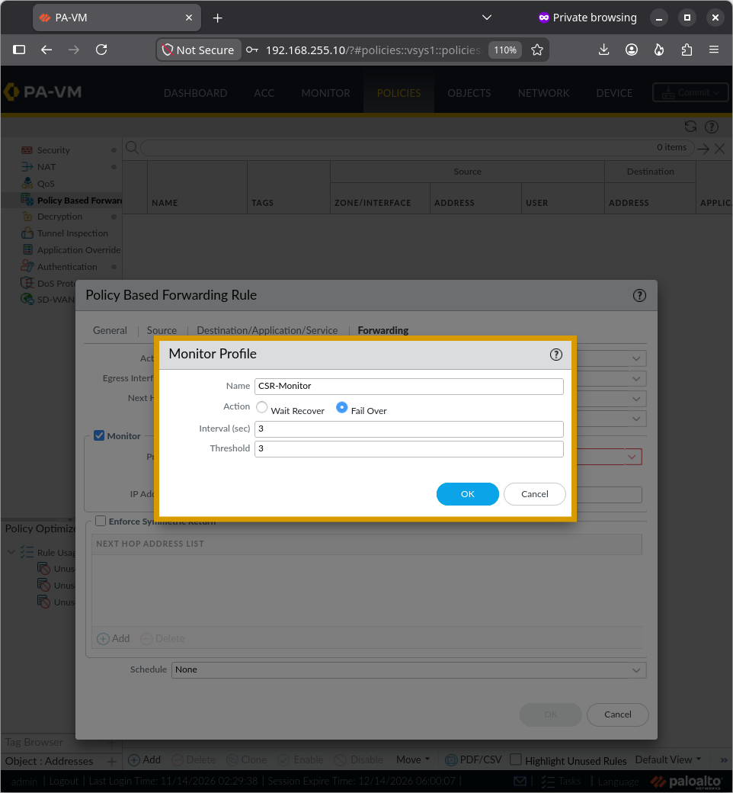

**Creating PBF - General Tab**

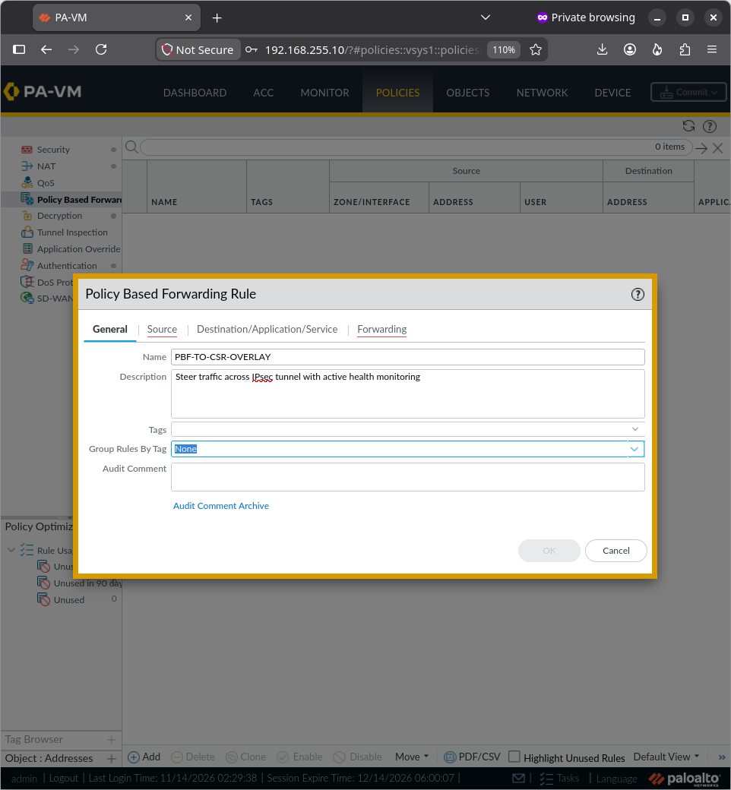

**Creating PBF - Source Tab**

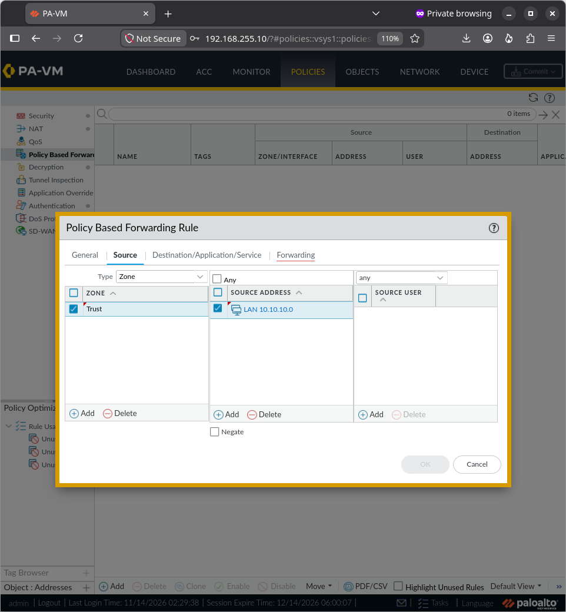

**Creating PBF - Destination Tab**

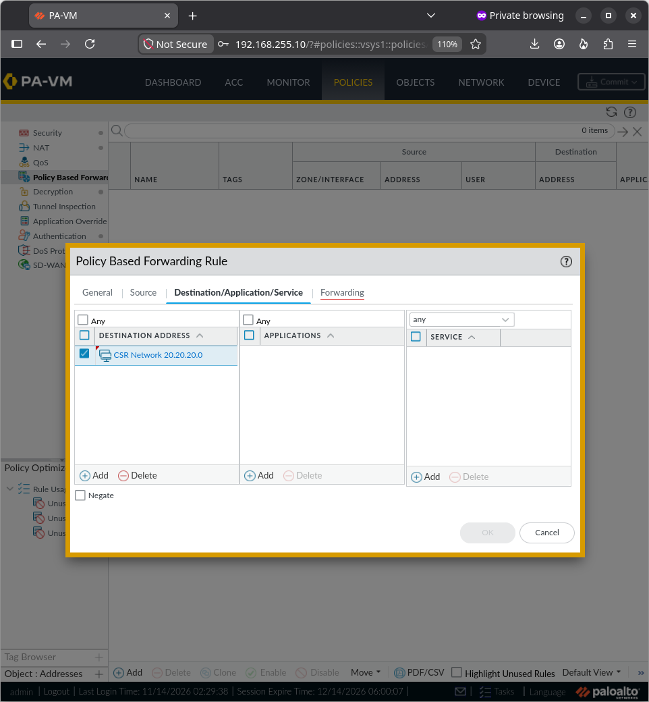

**Creating PBF - Forwarding Tab**

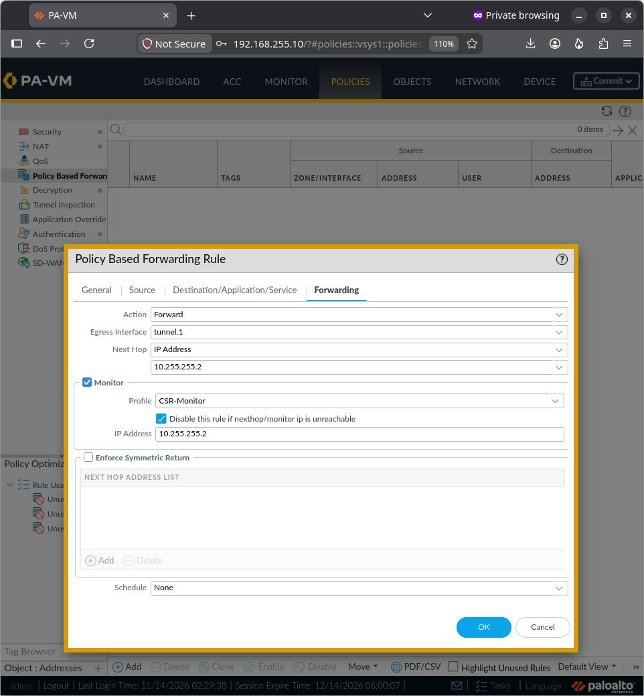


### Phase 2: Configure Floating Backup Route in Virtual Router
To prevent packet blackholing when PBF disables, a secondary static route was injected into the routing table:
* **Name:** `CSR-BACKUP`
* **Destination:** `20.20.20.0/24`
* **Interface:** `ethernet1/1` | Next Hop: `192.168.1.200`
* **Admin Distance:** `20` | **Metric:** `10`

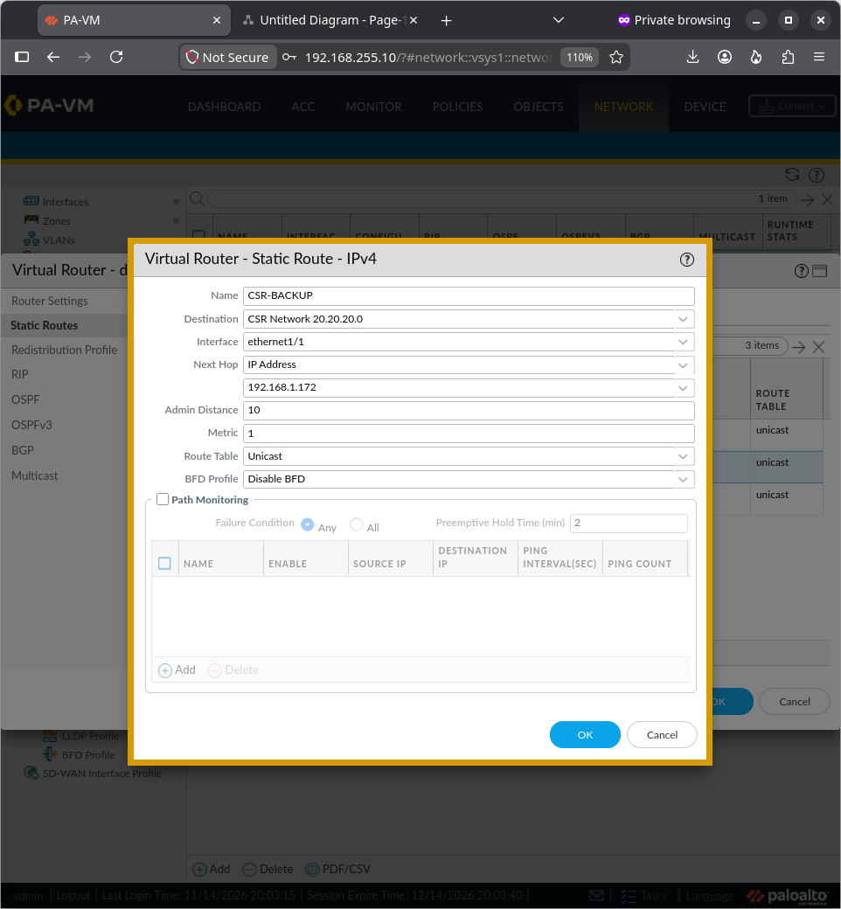

---

## Empirical Verification & Failover Evidence

### 1. Comparative Hop-by-Hop Traceroute Analysis (The Architectural Proof)

Traceroutes executed from the remote client (`Alpine Linux PC` on `20.20.20.0/24`) targeting `10.10.10.10` verified the dynamic path shift:

#### A. Healthy State: Encrypted IPsec Tunnel Path (3 Hops)
While the Cisco tunnel interface was UP and PBF was active:

```bash
localhost:~# traceroute 10.10.10.10
traceroute to 10.10.10.10 (10.10.10.10), 30 hops max, 46 byte packets
 1  20.20.20.1 (20.20.20.1)      8.794 ms  11.199 ms  9.092 ms
 2  10.255.255.1 (10.255.255.1)  22.960 ms  18.976 ms  205.434 ms
 3  10.10.10.10 (10.10.10.10)   18.754 ms  17.777 ms  25.609 ms
```
* **Path Analysis:** Hop 2 is **`10.255.255.1`** (Palo Alto `tunnel.1`), proving traffic traversed the encrypted VTI tunnel.

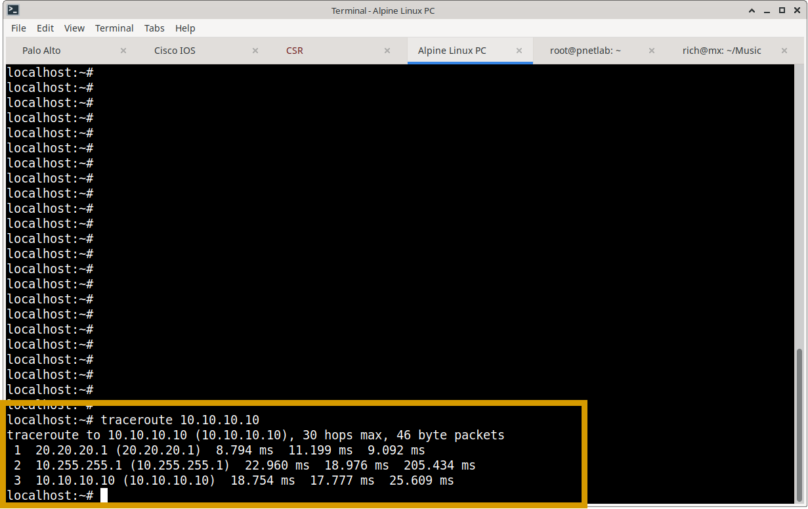

**10.255.255.1 - tunnel.1 verification**

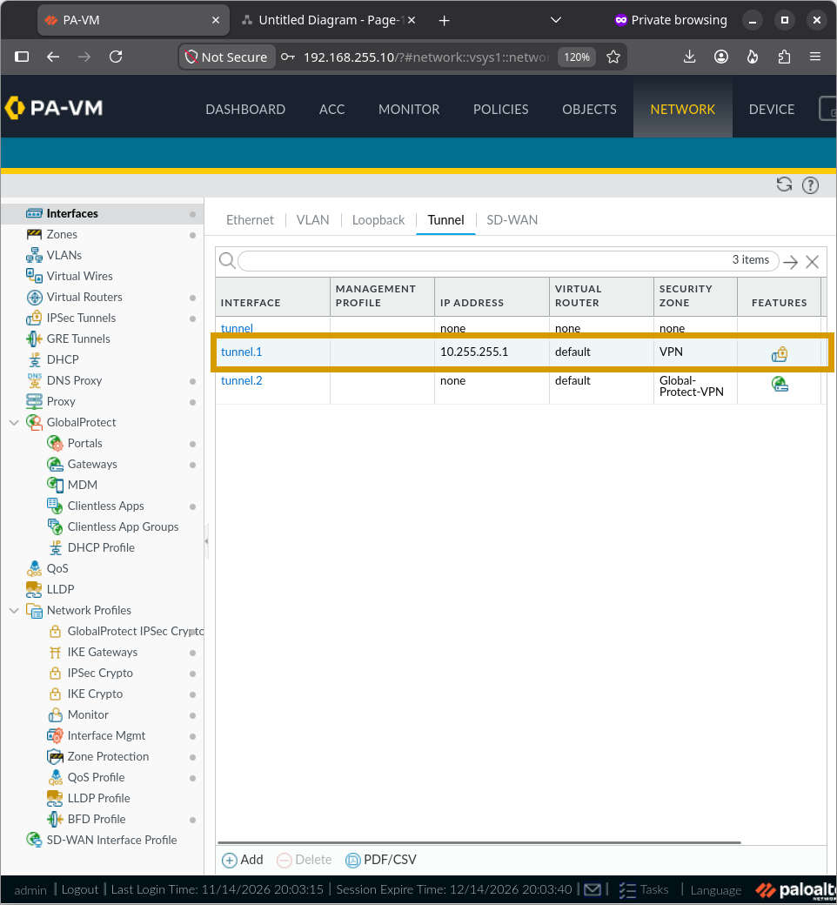

#### B. Failover State: Physical Underlay Backup Path (5 Hops)
Following the administrative shutdown of `Tunnel1` on the Cisco CSR:

```bash
localhost:~# traceroute 10.10.10.10
traceroute to 10.10.10.10 (10.10.10.10), 30 hops max, 46 byte packets
 1  20.20.20.1 (20.20.20.1)        7.289 ms  3.818 ms  5.046 ms
 2  192.168.254.1 (192.168.254.1)  4.839 ms  4.092 ms  5.503 ms
 3  172.16.109.1 (172.16.109.1)    3.319 ms  3.180 ms  6.150 ms
 4  192.168.1.200 (192.168.1.200)  6.633 ms  7.098 ms  10.326 ms
 5  10.10.10.10 (10.10.10.10)     6.040 ms  7.557 ms  8.090 ms
```
* **Path Analysis:** Traffic automatically rerouted around the collapsed tunnel, traversing the physical underlay transit network (**`192.168.254.1` ➔ `172.16.109.1` ➔ `192.168.1.200`**) before reaching `10.10.10.10`. Zero packet blackholing occurred.


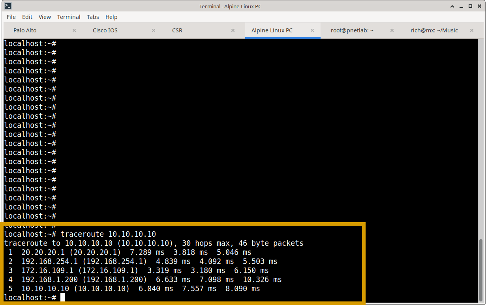

**192.168.1.200 - Ethernet1/1 Verification**

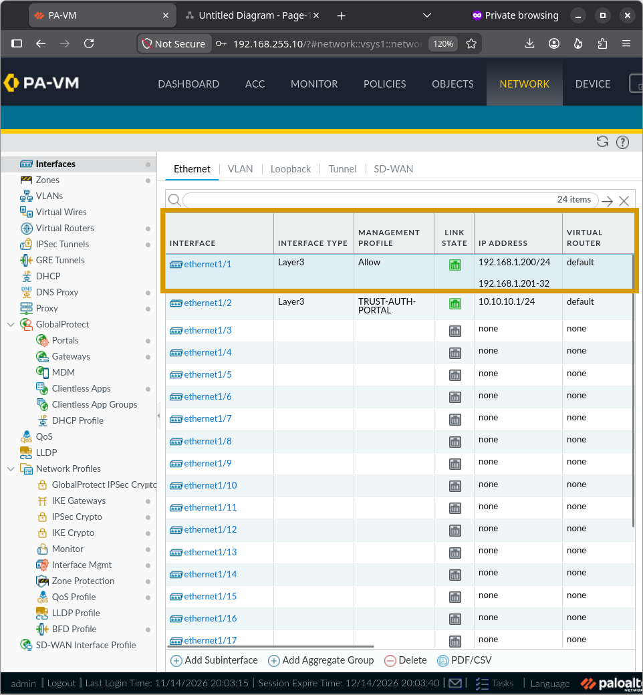

---

###  PAN-OS System Event Telemetry: Automated Route Revocation & Recovery Lifecycle

Inspecting the system event log (**`Monitor > Logs > System`**) verified the underlying daemon state transitions during the failure and recovery sequences:

#### Chronological Event Audit Log (`Monitor > Logs > System`)

| Receive Time | Subsystem | Severity | Event ID | Object | Description & Forensic Analysis |
| :--- | :--- | :--- | :--- | :--- | :--- |
| `22:40:55` | `vpn` | Informational | `ipsec-key-delete` | `IKE_GATEWAY_CSR` | Physical tunnel drop triggers deletion of active IPsec SAs (`SPI: 0x8B4A6758 / 0xB4C45E1F`). |
| `22:41:09` | `pbf` | Informational | **`nh-down`** | `PBF-TO-CSR-OVERLAY` | **SLA Threshold Tripped:** 3 unacknowledged ICMP probes flag `nexthop is DOWN`. |
| `22:41:09` | `pbf` | Informational | **`nh-down`** | `PBF-TO-CSR-OVERLAY` | **Policy Revoked:** Rule status dynamically updates to **`is Bypassed`**, releasing traffic to the FIB. |
| `22:41:38` | `vpn` | Informational | `ikev2-nego-ike-start` | `IKE_GATEWAY_CSR` | Path restoration initiates automated IKEv2 SA renegotiation over UDP 4500. |
| `22:41:45` | `pbf` | Informational | **`nh-up`** | `PBF-TO-CSR-OVERLAY` | **Path Restored:** Keepalives succeed; monitor logs `PBF-TO-CSR-OVERLAY is Normal`. |
| `22:41:45` | `pbf` | Informational | **`nh-up`** | `PBF-TO-CSR-OVERLAY` | Policy route re-installed into hardware dataplane (`nexthop is UP`). |
| `22:42:17` | `routing` | **High** | `routed-BGP-peer-left-established` | `default` | Control-plane notification logging BGP teardown with neighbor `10.255.255.2`. |
| `22:42:32` | `routing` | Informational | `routed-BGP-peer-enter-established` | `default` | BGP session reconverges; dynamic prefixes re-synchronized. |

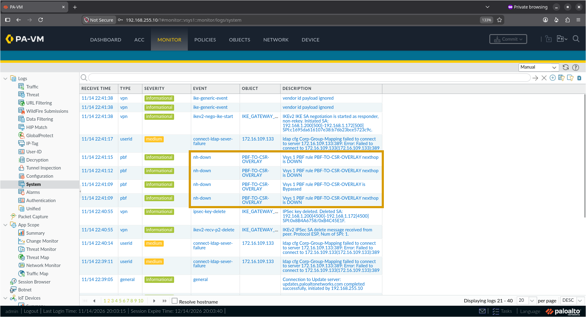

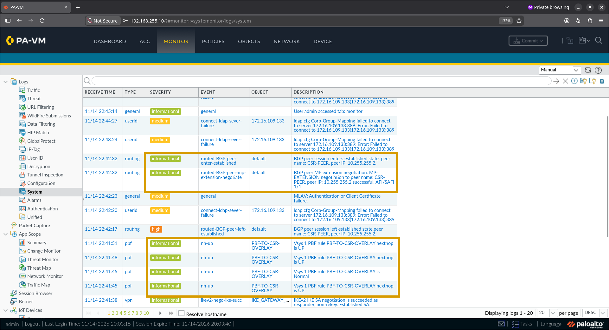

> **Key Architectural Takeaway:** The transition from `nh-down` (`PBF is Bypassed`) to `nh-up` (`PBF is Normal`) occurs at the hardware kernel level within milliseconds of probe evaluation. This guarantees that traffic is immediately diverted to the alternate route without waiting for higher-layer BGP hold-down timers (which took an additional 68 seconds to declare peer down at `22:42:17`).
```


### Live CLI State Table Transitions

#### Healthy State: PBF Active
```text
admin@PA-VM> show pbf rule all

Rule        ID  Rule State Action   Egress IF/VSYS  NextHop       NextHop Status
================================================================================
PBF-TO-CSR  1   Active     Forward  tunnel.1        10.255.255.2  UP
```
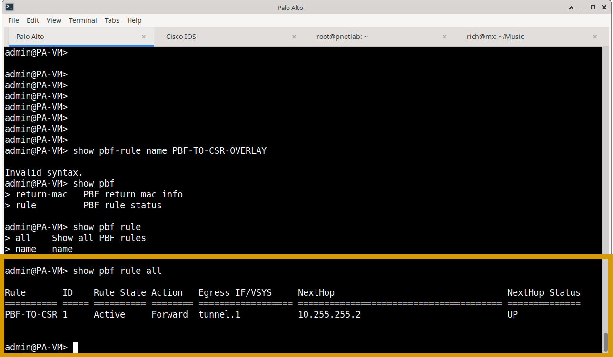

#### Outage Injected: Cisco Interface Flap
```cisco
Router(config)# interface Tunnel1
Router(config-if)# shutdown
*Nov 15 06:28:46.909: %BGP-5-NBR_RESET: Neighbor 10.255.255.1 reset (Interface flap)
*Nov 15 06:28:46.920: %BGP-5-ADJCHANGE: neighbor 10.255.255.1 Down Interface flap
*Nov 15 06:28:47.128: %CRYPTO-6-ISAKMP_ON_OFF: ISAKMP is OFF
*Nov 15 06:28:48.866: %LINEPROTO-5-UPDOWN: Line protocol on Interface Tunnel1, changed state to down
*Nov 15 06:28:48.869: %LINK-5-CHANGED: Interface Tunnel1, changed state to administratively down
```
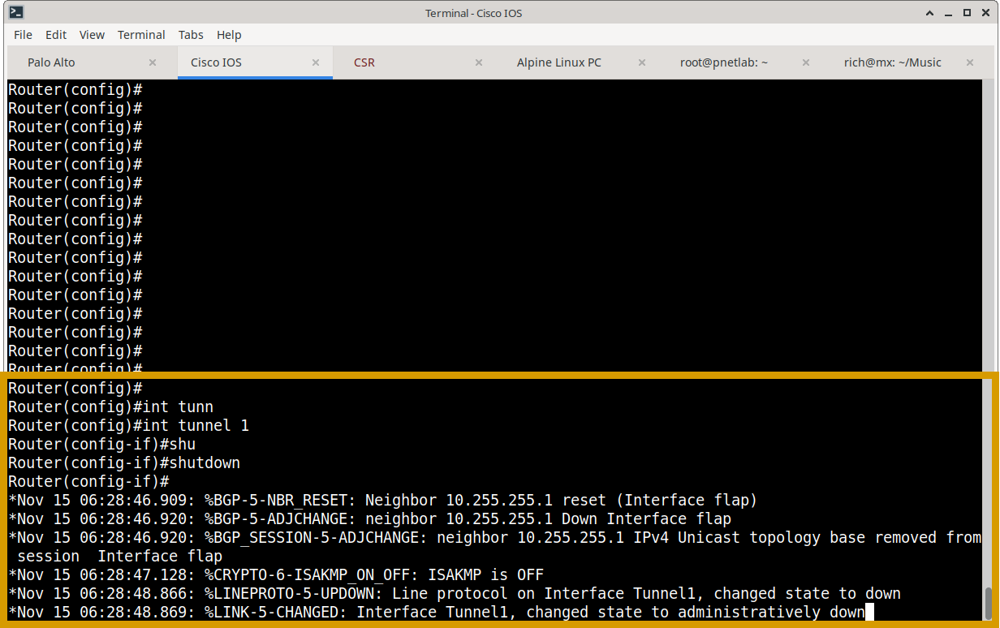

#### Failover State: PBF Disabled
Upon missing 3 consecutive probes (9 seconds), PAN-OS revoked the rule:

```text
admin@PA-VM> show pbf rule all

Rule        ID  Rule State Action   Egress IF/VSYS  NextHop       NextHop Status
================================================================================
PBF-TO-CSR  1   Disabled   Forward  tunnel.1        10.255.255.2  DOWN
```
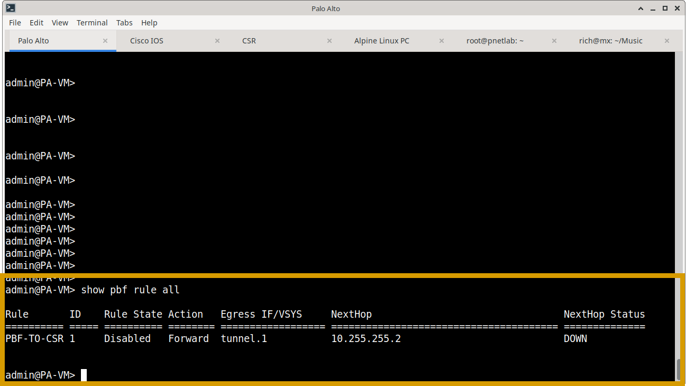

---

### Wire-Level Verification 

* **Encrypted ESP Payload Capture:** Wireshark captures on the WAN interface verified active IPsec encryption during healthy PBF steering (`SPI=0x8b4a6758` / `0xb4c45e1f`).
* **Continuous ICMP Stream:** A continuous ping between `20.20.20.10` and `10.10.10.10` maintained uninterrupted sequence numbers (`seq=255` through `seq=265`), proving sub-second data-plane recovery.

**PCAP: Before Failure**

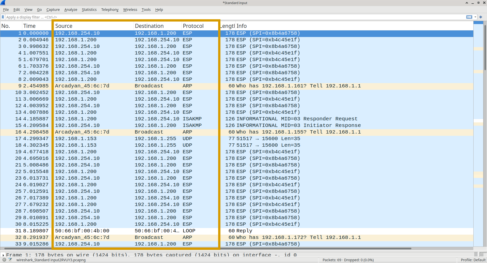

**PCAP: During Failure**

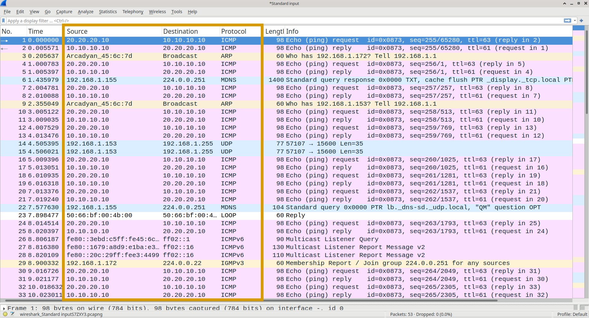


---

### Key Artifact Index

| Artifact File | Category | Technical Proof & Validation |
| :--- | :--- | :--- |
| **`traceroute-before-failure-20.20.20.10-to-10.10.10.10.png`** | Path Verification | Traceroute proving healthy PBF steering through tunnel gateway `10.255.255.1`. |
| **`traceroute-after-failure-20.20.20.10-to-10.10.10.10.png`** | Path Verification | Traceroute proving dynamic failover through physical underlay (`192.168.1.200`). |
| **`show-pbf-rule-name-all.png`** | Dataplane CLI | `show pbf rule name all` verifying `Rule State: Active` and `NextHop Status: UP`. |
| **`show-pbf-rule-name-all-during-failure.png`** | Dataplane CLI | `show pbf rule name all` verifying `Rule State: Disabled` and `NextHop Status: DOWN`. |
| **`shutting-down-interface-tunnel-cisco-ios.png`** | Failure Injection | Cisco IOS console logs documenting interface shutdown and BGP neighbor reset. |
| **`creating-pbf-general.png`** | PBF Config | Rule definition configuring `PBF-TO-CSR-OVERLAY` with source `Trust` (`10.10.10.0/24`). |
| **`creating-pbf-forwarding.png`** | PBF Config | Forwarding tab configuring `tunnel.1`, next-hop `10.255.255.2`, and active monitoring. |
| **`creating-monitor-profile.png`** | SLA Profile | Monitor profile `CSR-Monitor` enforcing 3-second intervals, threshold 3, and Fail Over. |
| **`creating-backup-route.png`** | Routing Config | Floating static route `CSR-BACKUP` ensuring FIB fallback path. |
| **`monitor-traffic-logs-vpn-ping-traffic.png`** | Telemetry Log | Traffic monitor auditing continuous ping streams matching `PA-LAN-TO-CSR-LAN`. |
| **`pcap-when-tunnel-is-up.png`** | Wire Trace | Packet capture confirming ESP-encapsulated tunnel payloads during healthy PBF state. |
| **`pcap-when-tunnel-is-down.png`** | Wire Trace | Packet capture proving continuous ICMP sequence delivery across the failover event. |

---
