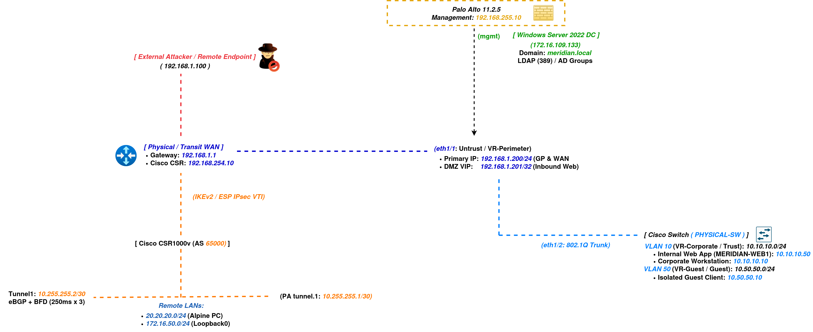

# Enterprise Palo Alto Networks NGFW, SASE & NetDevOps Security Architecture

An end-to-end, multi-domain enterprise security and routing fabric deployed on **Palo Alto Networks PA-VM (PAN-OS 11.2.5)** interconnected with **Cisco IOS / CSR1000v**, **Cisco Catalyst Switching**, **Windows Server 2022 Active Directory**, and **Linux/Windows Endpoints**. This repository documents a complete **15-project engineering progression** spanning Layer 7 App-ID Zero Trust, enterprise PKI & bidirectional SSL/TLS decryption, Content-ID threat inspection & 187k-domain EDL DNS sinkholing, AD-integrated User-ID & Captive Portal RBAC, perimeter Zone Protection & Classified DoS mitigation, multi-vendor IKEv2 IPsec + eBGP peering, GlobalProtect SASE remote access, SLA-probed PBF failover, hierarchical App-ID QoS shaping, Multi-VR segmentation (`next-vr`), Terraform/Python NetDevOps auditing, custom App-ID decoder engineering, and sub-second BFD convergence.

Every design principle, cryptographic handshake, failure threshold, and data-plane transition was empirically verified using PAN-OS CLI state tables, hardware micro-counters, live Traffic/Threat/System/Decryption monitors, Wireshark packet captures, and controlled fault injection.

---

## Lab Architecture & Hybrid Enterprise Fabric

### Infrastructure Node & Interface Matrix

| Infrastructure Node | Interface / Subinterface | IP Addressing | Zone / Virtual Router | Network & Security Role |
| :--- | :--- | :--- | :--- | :--- |
| **Palo Alto PA-VM** | `mgmt` | `192.168.255.10/24` | Out-of-Band Mgmt | Web UI, SSH CLI, XML/REST API, Terraform/Python control |
| **Palo Alto PA-VM** | `ethernet1/1` | `192.168.1.200/24` `192.168.1.201/32` (VIP) | `Untrust` / `VR-Perimeter` | Primary WAN uplink, GlobalProtect edge, Inbound DMZ VIP, QoS egress |
| **Palo Alto PA-VM** | `ethernet1/2.10` (VLAN 10) | `10.10.10.1/24` | `Trust` / `VR-Corporate` | Corporate LAN gateway, Captive Portal (`authportal`), `next-vr` egress |
| **Palo Alto PA-VM** | `ethernet1/2.50` (VLAN 50) | `10.50.50.1/24` | `Guest` / `VR-Guest` | Isolated untrusted tenant gateway with zero route to Corporate |
| **Palo Alto PA-VM** | `tunnel.1` | `10.255.255.1/30` | `VPN` / `VR-Perimeter` | Route-based IKEv2 IPsec VTI, eBGP (`AS 65001`), BFD (`250ms`), PBF |
| **Palo Alto PA-VM** | `tunnel.2` | Dynamic (`10.200.1.10-50`) | `Global-Protect-VPN` / `default` | Remote workforce IPsec/ESP termination & split-tunneling |
| **Cisco CSR Router** | `GigabitEthernet0/0` `Tunnel1` `Gig0/1` & `Lo0` | `192.168.254.10/24` `10.255.255.2/30` `20.20.20.1/24`, `172.16.50.1/24` | Global Routing (`AS 65000`) | Remote Datacenter WAN/VTI endpoint, eBGP peer, BFD neighbor |
| **Cisco Switch** | `Gig1/0/1`, `1/0/3`, `1/0/4` | L2 802.1Q Trunk (`1,10,50`) | Switching Core | Multiplexes VLAN 10 (Corporate) & VLAN 50 (Guest) to `eth1/2` |
| **Windows Server 2022** | Host DC Network | `172.16.109.133` | External Identity Core | Active Directory (`meridian.local`), LDAP auth, AD group mapping |
| **External / Attacker** | `enp2s0` / Win10 VM | `192.168.1.100/24` | Untrusted External | GlobalProtect client, Nmap/Hping3/Curl attack simulation |

---

## 15-Project Master Implementation

| # | Project Module | Engineering Capability | Key Verification Artifacts | Folder |
| :-: | :--- | :--- | :--- | :--- |
| **01** | **App-ID Zero Trust & L4 Evasion** | Decoupled port from application; blocked `youtube-base` mid-flow after SNI inspection (`4 pkts / 947 bytes`) while allowing `google-base` via `Standard-Internet-Apps`. | `youtube-base-denied-detail-log-view.png` `security-policy-match-google.png` | [`01-app-id-zero-trust/`](./01-app-id-zero-trust/) |
| **02** | **SSL/TLS Forward Proxy Decryption** | Deployed Forward Trust/Untrust PKI; decrypted outbound TLS (`*NS` flag), blocked expired/untrusted BadSSL certs, bypassed 51 banking domains (`Bank-NoDecrypt`). | `google-ca-details-after.png` `show-session-ssl-decrypt-yes.png` | [`02-forward-proxy-ssl-decryption/`](./02-forward-proxy-ssl-decryption/) |
| **03** | **Content-ID, File Blocking & EDL Sinkhole** | Blocked magic-byte PE executables (`putty.exe`), intercepted EICAR over HTTPS (`Threat 100000`), ingested **187,027** C2 domains via EDL to sinkhole lookups (`198.135.184.22`). | `cli-edl-validation.png` `nslookup-c2-sinkholed.png` | [`03-content-id-edl-dns-sinkhole/`](./03-content-id-edl-dns-sinkhole/) |
| **04** | **Identity Fabric: AD LDAP & Captive Portal** | Integrated AD (`meridian.local`); forced unauthenticated clients to HTTPS Captive Portal (`authportal`); enforced Admin allow vs. Contractor TCP RST on same IP (`10.10.10.10`). | `cli-show-user-ip-mapping.png` `cli-policy-match-contractor-drop.png` | [`04-user-id-ad-captive-portal/`](./04-user-id-ad-captive-portal/) |
| **05** | **Zone Protection & Volumetric DoS** | Absorbed **4,032,467-pkt** SYN flood via SYN Cookies (`39,005 drops/s`, CPU `<20%`), dropped **131,242** UDP sweep packets via RED, and sanitized LSRR/Timestamp/SYN+Data headers. | `cli-dos-counter-global-39k-drop.png` `cli-resource-monitor-cpu-stable.png` | [`05-zone-protection-dos-hardening/`](./05-zone-protection-dos-hardening/) |
| **06** | **Multi-Vendor IPsec VTI & eBGP** | Built IKEv2 AES-256/DH14 VTI (`tunnel.1` ↔ `Tunnel1`) over NAT-T UDP 4500 with eBGP (`AS 65001` ↔ `AS 65000`); verified synchronized SPIs (`BD359D70`/`B4E8D71F`) and 3-hop VTI trace. | `palo-cli-show-vpn-ipsec-sa.png` `traceroute-20.20.20.20-to-10.10.10.10.png` | [`06-ipsec-vti-ebgp-cisco/`](./06-ipsec-vti-ebgp-cisco/) |
| **07** | **GlobalProtect SASE & Split-Tunneling** | Deployed Portal/Gateway on `ethernet1/1`, leased `10.200.1.10` over IPsec (`ESP: exist`), enforced client split-tunneling (`2ms` VPN vs. local DIA), and GP-driven User-ID RBAC. | `win10-route-print-split-tunnel.png` `pa-cli-gp-gateway-current-user.png` | [`07-globalprotect-sase-remote-access/`](./07-globalprotect-sase-remote-access/) |
| **08** | **Inbound SSL Decryption & WAF Defense** | Bound secondary VIP `192.168.1.201:443` with DNAT+SNAT and private key (`*NB`); engineered 5 custom OWASP signatures (`41070–41074`) blocking Log4Shell, SQLi, XSS, Traversal, and RCE via Frame 325 `[RST, ACK]`. | `wireshark-tcp-rst-frame-325.png` `threat-pcap-log4shell-jndi.png` | [`08-inbound-ssl-decryption-waf/`](./08-inbound-ssl-decryption-waf/) |
| **09** | **PBF, Path Monitoring & SLA Failover** | Steered `20.20.20.0/24` across `tunnel.1` with 3s×3 ICMP probes; on `Tunnel1` shutdown, `nh-down` bypassed PBF and shifted live traceroutes from 3-hop VTI to 5-hop physical underlay (`CSR-BACKUP`). | `pbf-traceroute-failover-underlay.png` `monitor-system-logs-pbf-recovery.png` | [`09-pbf-path-monitoring-failover/`](./09-pbf-path-monitoring-failover/) |
| **10** | **App-Based QoS & Egress Shaping** | Attached `Corp-Egress-Shaping-Profile` (`10M` pipe) to `ethernet1/1`; clamped Class 8 bulk iPerf3 to a flat **`2.014 Mbps`** (`4,429,576` dropped pkts) while Class 1 (`ssl`/`web-browsing`) burst to `10,002 kbps`. | `wireshark-io-graph-2mbps-plateau.png` `pa-cli-qos-hardware-counters-4m-drops.png` | [`10-qos-traffic-shaping/`](./10-qos-traffic-shaping/) |
| **11** | **Multi-VR Segmentation & `next-vr` Leaking** | Partitioned `VR-Perimeter`, `VR-Corporate` (VLAN 10), and `VR-Guest` (VLAN 50); leaked internet defaults via `next-vr` while enforcing 100% lateral isolation at the FIB layer (`ping`/`nc` timeout). | `pa-cli-vr-guest-fib.png` `wireshark-vlan50-unanswered-icmp.png` | [`11-multi-vr-next-vr-segmentation/`](./11-multi-vr-next-vr-segmentation/) |
| **12** | **NetDevOps: Terraform & Python Auditing** | Extracted 16 live rules via `paloaltonetworks/panos` into JSON, audited CIS compliance with `audit.py` (**29** findings), remediated `PA-LAN-TO-CSR-LAN` (**27** findings), and compiled HTML reports via Pandoc. | `audit.py`, `outputs.tf` `security_audit.html` | [`12-netdevops-terraform-python-audit/`](./12-netdevops-terraform-python-audit/) |
| **13** | **Custom App-ID & Protocol Decoders** | Staged `Temp-Capture-888` to extract `portquiz8888-drop.pcap` (81B HTTP stream); compiled `portquiz-8888` (`http-req-host-header` regex `portquiz\.net:8888`) and blocked port `8889` evasion under `application-default`. | `portquiz8888-drop.pcap` `cli-show-session-custom-app.png` | [`13-custom-app-id-decoders/`](./13-custom-app-id-decoders/) |
| **14** | **Classified DoS (Per-Source Limiting)** | Deployed `Classified-Web-DoS` (`50/100/200 cps`, `300s` block) on VIP `192.168.1.201:443`; escalated attacker loss to 100% (`136,004ms` curl timeout, `306` rule drops) with ACC logging **869 threats / 0 sessions**. | `pa-cli-dos-rule-statistics.png` `acc-source-ip-threat-metrics.png` | [`14-classified-dos-per-source/`](./14-classified-dos-per-source/) |
| **15** | **Sub-Second BGP Convergence via BFD** | Deployed `BFD-250MS-PROFILE` (`250ms × 3 = 750ms`) over IPsec VTI (`VR-Perimeter` ↔ Cisco `Tunnel1`); reduced BGP failure teardown from **`67 seconds`** (no BFD) to **`2 seconds`** (**97.0% faster**). | `pa-cli-show-routing-bfd-details.png` `pa-system-logs-bfd-subsecond-teardown.png` | [`15-bfd-subsecond-bgp-convergence/`](./15-bfd-subsecond-bgp-convergence/) |

---

## Domain Progression & Architectural Highlights

### Domain 1: Zero Trust Layer 7 Visibility & Content Inspection (Projects 01–03, 08, 13)
* **Single-Pass App-ID Mechanics:** Proved that PAN-OS admits initial TCP handshakes provisionally (`incomplete` ➔ `ssl`), extracts TLS SNI headers, promotes sessions mid-stream (`youtube-base`), and drops unauthorized apps after 4 packets / 947 bytes—far beyond legacy L4 port rules.
* **Bidirectional Cryptographic Visibility:** Implemented both **Outbound SSL Forward Proxy** (with enterprise CA minting and 51-domain GLBA/HIPAA compliance bypasses) and **Inbound SSL Inspection** (VIP `192.168.1.201` with local private key termination).
* **Virtual Patching & Custom Decoders:** Ingested **187,027** live threat domains via EDL for inline DNS sinkholing, engineered custom OWASP vulnerability signatures (`41070–41074`) blocking Log4Shell/SQLi/XSS/RCE, and reverse-engineered raw PCAP streams to build custom Layer 7 App-IDs (`portquiz-8888`).

### Domain 2: Identity-Aware Access & SASE Remote Edge (Projects 04, 07)
* **Active Directory Integration:** Connected `PA-VM` to Windows Server 2022 (`meridian.local`) via LDAP, dynamically enumerating `network-admins`, `network-users`, and `contractors`.
* **Captive Portal & GlobalProtect:** Enforced both on-prem HTTPS Captive Portal authentication (`authportal:6082`) and remote IPsec/ESP GlobalProtect tunnels (`tunnel.2`) with split-tunneling—proving `netadmin.test` and `contractor.test` receive entirely different permissions across identical IP pools.

### Domain 3: Perimeter Hardening & Surgical DoS Defense (Projects 05, 14)
* **Aggregate Zone Protection:** Absorbed a **4.03M-packet** SYN flood via cryptographic SYN Cookies (`39,005 drops/sec`) while keeping dataplane CPU under 20% and dropping malformed L3/L4 headers pre-state.
* **Per-Source Classified DoS:** Tuned `Protect-Meridian-Web1` to track connection velocity per unique source IP (`50/100/200 cps`), quarantining abusive sources for 300s (`869` ACC threats, `0` admitted sessions) without collateral impact to valid users.

### Domain 4: Multi-Vendor Routing, Virtualization & SLA Resilience (Projects 06, 09, 10, 11, 15)
* **Multi-Vendor Interconnect:** Established IKEv2 VTI (`tunnel.1`) + eBGP (`AS 65001` ↔ `AS 65000`) with Cisco CSR, verified synchronized SPIs, and benchmarked **BFD (`250ms × 3`)** reducing BGP teardown latency by **97.0%** (`67s` ➔ `2s`).
* **Steering, Shaping & Virtualization:** Proved automated PBF SLA failover (`3-hop VTI` ➔ `5-hop underlay`), HFSC QoS egress clamping (`2.014 Mbps` Class 8 plateau with `4.42M` drops while Class 1 bursts to `10 Mbps`), and 3-way Multi-VR segmentation (`VR-Perimeter`, `VR-Corporate`, `VR-Guest`) with `next-vr` route leaking.

### Domain 5: NetDevOps & Programmatic Security Auditing (Project 12)
* **IaC State Extraction & Compliance Pipeline:** Automated rulebase extraction via Terraform (`paloaltonetworks/panos`) into `security_rules.json`, audited 16 rules via Python (`audit.py`), closed-loop remediated `PA-LAN-TO-CSR-LAN` (`29 ➔ 27` findings), and generated executive HTML dashboards via Pandoc.

---

## Consolidated Engineering Troubleshooting & Lessons Learned

| Challenge Encountered | Root Cause | Engineering Resolution |
| :--- | :--- | :--- |
| **HTTPS browsing failed despite `ssl`/`web-browsing` being allowed.** | PAN-OS parsed TLS Client Hello SNI and promoted sessions mid-flow to `google-base`, which wasn't in the rule. | Grouped interdependent cloud apps in `Standard-Internet-Apps` while excluding streaming apps (`youtube-base`). |
| **GlobalProtect & Inbound DMZ HTTPS conflicted on WAN TCP 443.** | Both `Global-Protect-Gateway` and DMZ `MERIDIAN-WEB1` required listening on port 443 on `ethernet1/1`. | Bound secondary VIP `192.168.1.201/32` to `ethernet1/1`, isolating GlobalProtect on `.200` and DMZ NAT on `.201`. |
| **Inbound DNAT & GlobalProtect sessions timed out on return.** | Internal hosts (`10.10.10.50`) lacked reverse routes for remote GP pools (`10.200.1.0/24`) or external IPs. | Paired DNAT / GP ingress rules with **Source NAT (PAT)** translating to the firewall LAN gateway (`10.10.10.1`). |
| **Palo Alto BGP failed to advertise `10.10.10.0/24` despite Export Rule.** | PAN-OS requires connected prefixes to be injected into the BGP Local-RIB before Export Rules can advertise them. | Created Redistribution Profile `LAN-REDIST` (`connect` + `10.10.10.0/24`) and attached it under `BGP > Redist Rules`. |
| **PBF failover blackholed traffic after `Tunnel1` shutdown.** | Once PBF disabled the rule on 3 missed probes, the VR lacked an alternate route to `20.20.20.0/24`. | Added floating static route `CSR-BACKUP` (`AD 20`) via `ethernet1/1`, shifting traffic cleanly to the 5-hop underlay. |
| **iPerf3 evaded Class 8 QoS throttling and hit Class 4 (`8M`).** | Unmatched App-IDs fall back to PAN-OS default Class 4; `ping` also lacked payload volume to saturate Class 1. | Assigned `ssl`/`web-browsing` to Class 1 (`10M`) and matched `Any` on Class 8 (`2M`) to lock synthetic traffic. |
| **VR-Guest traffic had no internet return path after `next-vr` leak.** | `VR-Perimeter` held the ISP default route (`0.0.0.0/0`), but lacked a return pointer back to `VR-Guest`. | Added static return route `10.50.50.0/24 ➔ next-vr: VR-Guest` in `VR-Perimeter`, keeping `VR-Guest` blind to Corporate. |
| **Custom App-ID regex failed to match HTTP traffic on port `8888`.** | Without a Parent App, PAN-OS skips HTTP header parsing; also, an unescaped regex dot matches any char. | Set `Parent App: web-browsing`, escaped the regex (`portquiz\.net:8888`), and matched `http-req-host-header`. |
| **BGP peer stayed down after Multi-VR migration & global BFD disable.** | `ethernet1/1` moved to `VR-Perimeter` (leaving `default` VR isolated), and peer-level BFD overrides VR-global `None`. | Migrated `tunnel.1` / `CSR-PEER-2` into `VR-Perimeter` and toggled peer-level `Disable BFD` for baseline benchmarking. |
